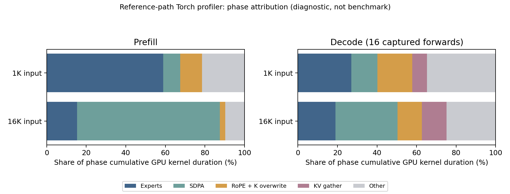

# Profiling 证据与阅读说明

本页是答辩备查材料，不增加正式四页报告的篇幅。所有数据来自既有采集，本次仅在 CPU 上核验、归档和绘图，没有重新运行 GPU。

## 1. 可直接查看的原始证据

主证据为参考路径采集 `mellum_profile_study/20261113T190525160560Z`，代码版本 `63851f02fa53ee5e5ecd4122f091dac24cea31de`。推理为单卡、批大小1、BF16/eager，参考专家、独立QKV、参考RoPE与SDPA；prefix/chunk关闭。

| 内容 | 仓库文件 |
|---|---|
| 1K 输入原始 Torch profiler trace | [ctx_1024.pt.trace.json.gz](../../artifacts/submission/reference_profiling/ctx_1024.pt.trace.json.gz) |
| 16K 输入原始 trace | [ctx_16384.pt.trace.json.gz](../../artifacts/submission/reference_profiling/ctx_16384.pt.trace.json.gz) |
| 原始路径、SHA256、配置与观察扰动 | [manifest.json](../../artifacts/submission/reference_profiling/manifest.json) |
| 分阶段统计 | [1K分析](../../artifacts/submission/reference_profiling/ctx_1024_analysis.json)、[16K分析](../../artifacts/submission/reference_profiling/ctx_16384_analysis.json) |
| 可导出统计图 | [PNG](../../artifacts/submission/reference_profiling/phase_attribution.png)、[SVG](../../artifacts/submission/reference_profiling/phase_attribution.svg) |
| 19组计时、全部10份trace索引 | [扩展采集记录](../../report/performance/02_expanded_bs1_profile_study.md)、[原始清单](../../artifacts/performance/02_expanded_profile/manifest.json) |

压缩 trace 是实际工具输出，解压后可载入支持 Chrome trace 格式的本地查看器。应同时查看 CPU/模块标记与 GPU kernel 轨迹。统计图由 `scripts/build_mellum_profiling_evidence.py` 从 phase/exclusive 统计生成，不是手绘时间线或模拟数据。

本项目已有 Torch profiler 的 ROCm GPU 事件；尚无已归档的 rocprof 硬件计数器采集，不声称测得 occupancy、实际HBM带宽或roofline。ATOM服务日志和批次审计是另一个证据层，不等同于GPU profiler。

## 2. 分阶段读数及选点联系

| 项目 | 1K 输入 | 16K 输入 | 含义 |
|---|---:|---:|---|
| prefill累计kernel时间 | 127.401 ms | 3902.955 ms | 随长输入显著增加 |
| prefill专家占比 | 58.94% | 15.33% | 短输入专家执行值得优化 |
| prefill SDPA占比 | 8.53% | 72.21% | 长输入注意力是主要开销 |
| decode累计kernel时间，16次forward | 360.642 ms | 515.448 ms | 不等于单token墙钟时间 |
| decode专家占比 | 27.09% | 19.07% | 支持研究专家执行粒度 |
| decode参考RoPE与K覆盖写入占比 | 17.64% | 12.37% | 与源码重复计算/写入相互印证 |
| decode分页KV gather占比 | 7.46% | 12.42% | 历史长度增加时搬运成本增长 |

这些占比是阶段内累计kernel时长的归因，不是整个请求的加速上限。KV去冗余保留了参考RoPE，不能假设表中对应时间全部消失；专家分组不减少模型FLOPs，不能把组大小4当作4倍加速预测。

采集前后以相同输入、相同输出预算检查生成一致。短trace观察到的wall扰动约1.09–1.53倍，详细trace约2.61倍；性能计时因此关闭profiler。没有把累计kernel时间、CPU跨度和请求wall相加。

## 3. 后期轨迹与服务证据的边界

`artifacts/submission/profiling/` 是11月16日快速路径实验的1K输入、批大小1/32轨迹，不是当前参考组合的重新采集。bs1累计prefill约69.389 ms、decode约100.616 ms；bs32约1443.473/129.874 ms。因此不再笼统将两者都称为“以prefill为主”，也不把其归因直接套给参考方案。

C服务层证据见[性能38](../../report/performance/38_c_chunked_prefill_screen.md)、[性能39](../../report/performance/39_c_admission_and_prefix_accounting.md)。它们揭示超时、连续预填充和首次准入等待，但秒级日志不能量化GPU decode stall毫秒数，也不能单独证明全部超时根因。最终候选的服务轨迹与必要的profile复采：—。

## 4. 面试时建议展示顺序

先展示16K trace及其prefill归因，说明为何最初尝试SWA；再展示1K decode中的专家与重复KV工作，解释为何转向兼容数学路径的分组和去冗余；最后展示C60/C200完成分母与准入等待，说明为何现在优先做调度和公共前缀复用。每一项都同时交代采集配置、未测事项和对应决定。
