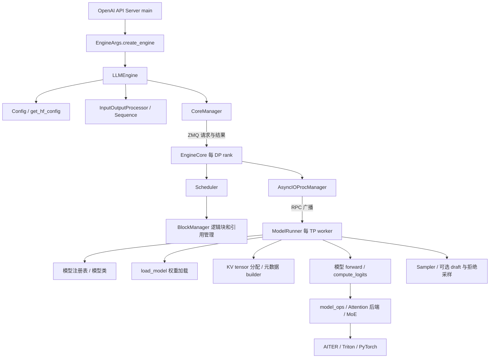
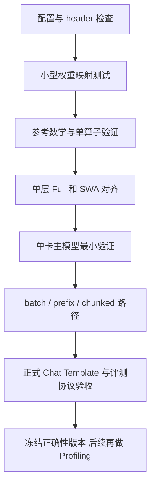

# D1：ATOM 工程概览与模型支持研究记录

> 状态：已完成 Phase 1–4 只读调查与 Phase 5 适配设计草案；尚未实施适配、加载完整权重或完成正确性验收。
> 阅读导航：第 0–13 节保留调查记录，第 14 节为原题到位前草案，第 15 节核对原题，第 16 节为据原题修订的推荐规划（待讨论，未实施）。规则以原题为准，实施路线以第 16 节更新第 14 节。  
> 日期：2026-11-10。源码基线：`26f23a0bdbf50b9010c07ee3a71171189723e767`，分支 `feature/mellum-support`。  
> 除特别注明外，下文源码路径相对 `/workspace/ATOM`，行号对应本次基线。

## 0. 任务理解、边界与阅读记录

已完整阅读 `/workspace/docs/MELLUM_ATOM_RESEARCH_GUIDE.md`。本项目目标是冻结环境下在 ATOM 上完成 Mellum 2.1 Thinking 的正确适配，之后才研究最多三个有独立开关、可消融的优化点。指南记录硬件为 MI308X × 2、Transformers 5.2.0、原始 editable install 指向 `/app/ATOM`；这些是任务背景，本轮没有重新执行硬件或 Python 环境验证。

本轮按指南第 12 节仅执行 Phase 1：工程结构、启动入口、核心模块和开发规范。读取源码、Git 状态并新增本报告；不修改 ATOM 功能代码，不运行模型导入、权重加载、服务、GPU 推理、测试或 Benchmark，不改变软件环境和 Git 版本。没有对 `/app` 或文件系统进行大范围递归搜索。

完整阅读的开发文档：

- `CLAUDE.md`（工程约束与开发索引）。
- `docs/model_support_guide.md`（385 行，模型接口、注册、权重映射、MTP 等）。
- `docs/architecture_guide.md`（284 行，模块与请求生命周期）。

补充核对了 README 的启动示例、`pyproject.toml`、`/workspace/scripts/atom`，并沿入口有选择地阅读下述源码区段。未将索引式浏览当成对整个文件的深入分析。

证据分级：**源码事实**指本轮直接读取到的定义和调用；**架构理解**指据调用关系形成的归纳；**待确认**指需要下一阶段深入阅读或实验验证。本报告不把指南提供的 Mellum 参数当成本轮已复核的模型配置。

## 1. ATOM 工程结构与整体架构

### 1.1 实际目录与职责

仓库根目录实际存在 `atom/`、`docs/`、`recipes/`、`scripts/`、`tests/`、`tools/`、`docker/`，**没有根目录 `models/`**；模型实现位于 `atom/models/`。

| 路径 | 本轮确认的职责与代表性证据 |
|---|---|
| `atom/entrypoints/openai/` | HTTP 服务；`api_server.py:1070` 的 `main()` 组织启动，`:789` 的 `chat_completions()`、`:924` 的 `completions()` 是请求入口 |
| `atom/model_engine/` | 引擎 API、进程管理、批调度、请求状态、GPU 执行；见下文具体调用链 |
| `atom/config.py` | 运行配置与 HF 配置桥接；`Config`、`ParallelConfig`、`CompilationConfig`、`QuantizationConfig`、`SpeculativeConfig` |
| `atom/model_config/` | 自定义配置实现目录；实际有 `qwen3_5.py`、`qwen3_5_moe.py`、`qwen3_next.py`、`kimi_k25.py`；`__init__.py` 当前为空，不能将此目录直接视为唯一 Config 注册入口 |
| `atom/models/` | 模型结构；例如 `qwen3_moe.py:444` 的 `Qwen3MoeForCausalLM` |
| `atom/model_loader/` | `loader.py:279` 的 `load_model()`、`:140` 的 `safetensors_weights_iterator()`；`weight_utils.py` 提供下载、属性和分片过滤工具 |
| `atom/model_ops/` | Attention、并行 Linear、Embedding/Head、Norm、MoE、采样等算子；不是只有薄封装，也包含 Triton 实现与后端适配 |
| `atom/model_ops/attentions/` | 后端及元数据构建接口；`backends.py:49` 的 `AttentionBackend`、`:72` 的 `AttentionMetadataBuilder` |
| `atom/spec_decode/` | 可选 draft 路径；`eagle.py:161` 的 `EagleProposer`，`:240` 的 `load_model()`、`:330` 的 `propose()`；本轮仅定位 |
| `atom/utils/` | 前向上下文、编译/Graph、分布式工具等；`forward_context.py:360` 的 `ForwardContext` |
| `atom/quantization/` | 量化相关实现目录，本轮未分析具体量化方法 |
| `atom/plugin/` | vLLM / SGLang 集成目录；`pyproject.toml` 中也有 vLLM platform/general plugin 入口，与独立 Server 路径需区分 |
| `atom/kv_transfer/` | KV 传输相关模块；`EngineCore` 中有可选 connector 分支，本轮不深入 |
| `atom/examples/`、`atom/benchmarks/` | 离线示例与评测工具所在目录，本轮不执行 |
| `docs/` | 架构、模型支持、配置、调度/KV、算子、分布式等开发文档 |
| `recipes/` | 实际有 `atom_sglang/` 与 `atom_vllm/` 集成配方目录 |
| `scripts/`、`tests/`、`tools/` | 脚本、测试和分析工具；本轮仅检查目录，未认定任何脚本为 Mellum Baseline |

### 1.2 初步架构图

以下是源码调用关系的归纳，不表示已经完成所有分支验证。



图中两个所有权边界很重要：Scheduler 管理 Sequence 与逻辑 KV 块；ModelRunner 管理执行、实际 KV tensor 与前向元数据。它们通过 `ScheduledBatch` / `ScheduledBatchOutput` 交接，而不是由 Scheduler 直接执行模型算子。

证据：`scheduler.py:197,359` 定义这两个批结构；`EngineCore._process_engine_step()`（`engine_core.py:193–255`）依次调用 `schedule()`、RPC `forward`、`postprocess()`；`ModelRunner.allocate_kv_cache()`（`model_runner.py:1354`）调用 builder 的 `allocate_kv_cache_tensors()`（`:1406`），并在 `:1493` 注册 KV 数据。

### 1.3 Server 启动与初始化

**源码事实：旧入口与新入口兼容。** `atom/entrypoints/openai_server.py:10–13` 仅导入 `atom.entrypoints.openai.api_server.main` 并执行它。因此 README / CLAUDE 的旧命令与指南脚本中的新模块路径并非两套服务。

后续如需启动开发副本，指南指定使用 `/workspace/scripts/atom`。本轮读取确认脚本设置 `PYTHONPATH=/workspace/ATOM...`，然后执行 `/opt/venv/bin/python -m atom.entrypoints.openai.api_server`，但没有执行脚本。

已确认的初始化链：

```text
api_server.main()                                  api_server.py:1070
  → EngineArgs.add_cli_args / parse_args            :1076,1100
  → _load_tokenizer(...)                           :1116
  → EngineArgs.from_cli_args(args)                 :1121
  → engine_args.create_engine(tokenizer=...)        :1122
      → LLMEngine(...)                             arg_utils.py:331–333
          → Config(model, **config_kwargs)         llm_engine.py:35–39
          → InputOutputProcessor(...)              :53–55
          → CoreManager(config)                    :56
  → uvicorn.run(app, ...)                          api_server.py:1146
```

`Config.__post_init__()`（`config.py:1001–1007`）先调用 `get_hf_config()`。CoreManager 创建并启动各本地 DP EngineCore（`engine_core_mgr.py:64–114`）；EngineCore 再创建 TP worker 管理器、询问 KV 块数量、分配 KV、按 `enforce_eager` 决定是否 capture Graph，之后创建 Scheduler 并发送 ready（`engine_core.py:81–135`）。这说明服务启动包含引擎初始化，并非先开 HTTP 再按请求懒加载模型；具体错误传播和 ready 等待细节留 Phase 2。

### 1.4 请求执行与主要输入输出

| 环节 | 输入 → 输出 | 调用依据 |
|---|---|---|
| 引擎接收请求 | prompt / token IDs + SamplingParams → Sequence | `LLMEngine.add_request()`，`llm_engine.py:79,129–136`；调用 `InputOutputProcessor.preprocess()` |
| 预处理 | 单请求 → Sequence | `preprocess():244–272` 实际委托 `preprocess_fanout()`；因此架构文档的描述是概括，不是当前完整实现 |
| IPC 分发 | Sequence 列表 → ADD 消息 | `CoreManager.add_request()`，`engine_core_mgr.py:373–410`，pickle + ROUTER；多本地 Core round-robin |
| 批调度 | waiting/running 请求状态 → ScheduledBatch 与 seq map | `Scheduler.schedule()`，`scheduler.py:633`；构造函数 `:412–421` 持有 BlockManager 和两个 deque |
| 执行派发 | ScheduledBatch → worker forward 结果 | `EngineCore._process_engine_step()`，`engine_core.py:234–236` |
| GPU 执行入口 | ScheduledBatch → ScheduledBatchOutput | `ModelRunner.forward()`，`model_runner.py:2017–2038`：prepare_model → run_model → postprocess → reset_forward_context |
| 模型执行 | input IDs、positions / 可选 PP intermediate → hidden states → logits | `run_model()` 中 `self.model(...)`、`compute_logits(...)`，`model_runner.py:1862–1872`；Qwen 包装器例见下文 |
| 状态回写 | seqs + forward 结果 → 已完成请求 / 流输出 | `Scheduler.postprocess()`，由 `engine_core.py:251–255` 调用 |
| 用户输出 | 已完成 Sequence → 解码后的输出结构 | `LLMEngine.generate()`，`llm_engine.py:145–164`，调用 `step()` 与 `InputOutputProcessor.postprocess()`；HTTP 流式分支本轮未逐条追踪 |

`Sequence` 是请求状态载体（`sequence.py:33–85`）：token IDs、prompt 长度、cached tokens、block_table、per-request cache slot 等；执行类型有 PREFILL/DECODE，状态还包含 `WAITING_FOR_REMOTE_KVS`，比架构文档的简图更丰富。

`Scheduler.schedule()` 的源码明确“先 prefill 后 decode”，但现有代码还包含 partial/chunked prefill 与 PrefillDelayer（`scheduler.py:633–681`）。不能把文档中“prefill 一次处理所有 prompt”的简述当作所有运行配置下的事实。

### 1.5 跨模块数据与进程通信

- `ForwardContext`（`utils/forward_context.py:360–374`）持有 attention metadata、KV tensor 引用、执行 Context、DP 与 spec metadata。`get_forward_context():426`、`set_forward_context():440`、`set_kv_cache_data():548` 是访问接口。`PagedAttentionImpl.forward_impl_server_mode()` 从全局上下文取信息（`attention_mha.py:89–99`）。这是模型显式参数之外的一条重要数据路径。
- `CoreManager` 与 EngineCore 的输入/输出分别使用 ROUTER/DEALER 与 PUSH/PULL；本轮在 manager 的 `:105–114` 核对 ROUTER/PULL，EngineCore 的 socket 方法位于 `engine_core.py:285,328`。
- **文档需要细化**：并非所有层级都单纯以 ZMQ 传 batch。`AsyncIOProcManager.__init__()`（`async_proc.py:210–258`）创建 `MessageQueue` 并把 handle 传给 worker；`call_func():353–362` 经 `rpc_broadcast_mq.enqueue()` 广播 RPC，主结果由 outputs_queue 返回。架构图因此将这一段标为 RPC 广播。
- `CoreManager` 在尚未设置启动方法时设为 spawn（`engine_core_mgr.py:55–58`）。CLAUDE 要求 multiprocessing 使用 spawn；本轮未展开 `get_mp_context()` 的完整实现和异常分支。

### 1.6 ATOM 与 AITER

源码支持“ATOM 负责引擎编排与模型组织，并通过算子层使用 AITER”的理解，而不能简化成所有算子都直接调用同一个 AITER kernel。

具体依据：

1. `model_ops/moe.py:11–16` 导入 AITER routing、fused_moe、量化和 shuffle 相关能力；`rocm_aiter_fused_moe_impl()`（`:675–709`）接收 hidden states、专家权重、top-k 权重/IDs，转换 activation/quant 枚举后调用 `aiter.fused_moe.fused_moe()` 返回 tensor。本轮不判断 Mellum 最终将选择哪条 MoE 方法。
2. `model_ops/sampler.py:7–16` 导入 AITER sampling/softmax/topk，并包含能力探测；实际采样实现仍有分支。
3. Attention 构造入口 `base_attention.Attention.__new__()`（`base_attention.py:22–26`）转发到 `atom.model_ops.Attention`；后者在 `model_ops/__init__.py:1–8` 默认绑定 `PagedAttention`，并允许集成模式替换。不能仅看入口类名确定后端。
4. `PagedAttentionImpl`（`attention_mha.py:29–99`）保存 heads、head_dim、KV dtype、sliding_window、RoPE、Q/K norm 与 KV 引用，前向读取 ForwardContext。`attentions/aiter_attention.py:89,250` 进一步调用 AITER paged-attention metadata 接口。具体 kernel 选择留下一阶段之后分析。

## 2. 模型注册与配置解析：Phase 1 定位

**本轮已确认 Config 识别与模型类选择是两层接口。**

- 配置入口是 `Config.__post_init__()` → `get_hf_config()`（`config.py:1005,592`）。后者先调用 `PretrainedConfig.get_config_dict()`（`:593–596`），之后按多模态、`_CONFIG_REGISTRY` 别名或普通 `AutoConfig.from_pretrained()` 分支处理（`:614–684`）。`_CONFIG_REGISTRY` 在 `:567–574`，不是模型执行类注册表。
- 普通分支依赖 Transformers `AutoConfig`（`:670–684`）；只有 vLLM plugin 分支在 ValueError 时尝试 vLLM config helper。不能说 ATOM 已完全独立于 Transformers 解析任意未知架构。
- 模型执行类注册表为 `model_runner.py:58–75` 的 `support_model_arch_dict`。`ModelRunner.__init__()` 直接取 **`hf_config.architectures[0]`** 查表，再 `resolve_obj_by_qualname()`，做量化名称映射，调用 `model_class(config)`，最后 `load_model(...)`（`:619–640`）。不是遍历 architectures 寻找任意可支持项。
- 本轮仅观察到上述两个显式表中没有 Mellum 项；这不足以认定整个仓库/容器没有 Mellum 或 Baseline 实现。未知 model_type 的精确阻塞点、是否有额外注册副作用，以及如何扩展配置，需 Phase 2/4 专项确认。

**文档差异：** Model Support Guide 的注册表示例列出 Qwen3.5 的 `...TextOnly` 类；当前真实表指向 `Qwen3_5MultimodalModel` / `Qwen3_5MoeMultimodalModel`。源码表还含 DeepSeek V4、Kimi、MiniMax、MiMo 等项。因此不能据文档列出的模型数量推断当前支持全集。

## 3. 权重加载机制：本轮仅定位接口

`model_loader/loader.py:140–189` 的 `safetensors_weights_iterator()` 根据本地目录或 Hub 路径获取分片，以索引过滤重复文件；默认使用 `safetensors.safe_open(..., device="cpu")`，yield `(name, tensor)`。本轮没有调用它，也没有读取模型权重。

`load_model()` 的真实签名在 `loader.py:279–289`，比文档示例还多 prefix、plugin、weights_mapper 和 fused-expert 回调等参数；`:320–350` 读取模型提供的名称映射、packed mapping、MTP remap 和 expert mapping。默认/参数专用 weight_loader 的细节、完整性校验和加载后处理留 Phase 2。

Model Support Guide 的核心含义是：适配不仅需要写 forward，还需要让 checkpoint 名称、内部 packed 参数和专家布局吻合。此理解有接口证据，但尚不是 Mellum 的权重映射结论。

## 4. Qwen3-MoE 参考实现：仅确认工程接口

文件存在：`atom/models/qwen3_moe.py`。已定位 `Qwen3MoeSparseMoeBlock:85`、`Qwen3MoeAttention:142`、`Qwen3MoeDecoderLayer:265`、`Qwen3MoeModel:356`、`Qwen3MoeForCausalLM:444`。

为核对开发规范，本轮读取了包装器与映射接口：

- `Qwen3MoeForCausalLM.packed_modules_mapping`（`:445–451`）将 q/k/v_proj 对应到 qkv_proj 的 q/k/v shard，将 gate/up_proj 对应到 gate_up_proj 的 0/1 shard。
- `__init__()`（`:466–481`）构造 backbone、最后 PP rank 的 ParallelLMHead，并按 `tie_word_embeddings` 决定是否共享权重。
- `forward()`（`:490–505`）返回 backbone hidden states；`compute_logits()`（`:507–512`）单独调用 lm_head。这与 ModelRunner 中 forward 后再计算 logits 的调用契约相符。
- `get_expert_mapping()`（`:528–529`）委托 backbone；backbone 方法（`:433–441`）调用 `FusedMoE.make_expert_params_mapping()`。
- `Qwen3MoeModel` 带 `@support_torch_compile`（`:355`）。

本轮未分析 Qwen 的 Attention/MoE 数学与 Mellum 差异，不给出“可以直接复用”的结论。

## 5. SWA / Full Attention：后续参考入口

已确认 `atom/models/gpt_oss.py`、`atom/models/mimo_v2_flash.py` 存在。开发文档将前者描述为交替 SWA，并列出 sinks 等特性；本轮没有逐层核对，不将这些描述直接视为 Mellum 可复用能力。

已经核实通用 `PagedAttentionImpl.__init__()` 接收 sliding_window、rotary_emb、q_norm、k_norm（`attention_mha.py:34–79`）。这只证明有参数接口，不能证明 Mellum 的 3:1 层安排、1024 窗口、两类 RoPE 和缓存语义已满足。需在 Phase 3 沿模型构造 → Attention → metadata → kernel 验证。

## 6. MTP：后续参考入口

已定位 `atom/models/deepseek_mtp.py`、`mimo_v2_flash_mtp.py`、`qwen3_5_mtp.py` 和 `spec_decode/eagle.py`。本轮只确认 EagleProposer 有 load_model/propose 等接口，未分析 Target/Draft 共享、拒绝采样或权重重写。

未读取 Mellum safetensors index，未确认 MTP 权重存在。Step 0 不要求 MTP，本轮没有兼容性结论。

## 7. Mellum 与官方 Baseline 支持：尚未开展专项调查

当前只能记录“本轮查看的模型执行类表和 Config 别名表未列出 Mellum”。未进行指南 Phase 4 要求的 Mellum、朴素 MoE、显式 mask SDPA、脚本/补丁及有限外部目录搜索。因此：

- 不确认完整或部分 Mellum 实现是否存在。
- 不确认官方 Baseline 源码是否存在；不能因 baseline.json 存在就推断有实现。
- 不把 Qwen、MiMo 等候选参考文件的存在等同于模型适配已完成。

## 8. 对 Model Support Guide 的理解与适配边界

模型支持是一组需要相互一致的契约：

1. Config 能产生模型构造需要的字段。
2. HF architecture 字符串能在执行类注册表中定位类。
3. 模型分为 Attention/MLP/Decoder、backbone 和 CausalLM wrapper；forward 和 compute_logits 分工明确。
4. packed_modules_mapping、weights_mapping / WeightsMapper、get_expert_mapping 配合通用 loader 和参数 weight_loader。
5. PP intermediate、compile、KV/metadata 与可选 draft 也是工程接口，不能仅以 eager 单次 forward 推断全部路径正确。

这组理解分别得到本报告第 1–4 节引用的源码支持。Model Support Guide 可作为接口清单，但具体类名、注册表和签名必须重新核对。

CLAUDE 的关键约束也已记录：不得修改带 `@support_torch_compile` 的模型文件；multiprocessing 使用 spawn；GPU/Server 出错先走调试流程。当前只读任务没有触发修改或运行流程；没有执行文档中的安装、清缓存或格式化命令。将来如需实现，应结合用户届时授权和真实接口重新审视约束，本轮不作文件级修改方案。

本节暂不填写 Mellum 模块复用表、修改清单、实施顺序和正确性实验参数；这些属于 Phase 5，应建立在 Phase 2–4 的证据上。

## 9. Phase 1 当时的待确认问题与计划

### 9.1 优先级与问题

| 优先级 | 尚未确认的问题 | 建议阶段 |
|---|---|---|
| P0 | 冻结 Transformers 环境下 Mellum 配置具体如何进入/阻塞 get_hf_config；自定义 config 类在哪里被导入注册 | Phase 2 |
| P0 | 模型构造前运行上下文/默认 dtype/device、配置派生字段和 backend 的初始化顺序 | Phase 2 |
| P0 | Loader 完整映射顺序、专家参数组织、分片加载与未加载/错配权重的检测机制 | Phase 2 |
| P0 | 是否存在预置 Mellum 或官方 Baseline 实现，有限调查范围如何选择 | Phase 4 |
| P1 | Qwen3-MoE 与 Mellum 的 Attention、MoE、RoPE 和 checkpoint 差异 | Phase 3 |
| P1 | SWA/Full 按层共存、窗口和两类 RoPE 的元数据及缓存限制 | Phase 3 |
| P2 | Mellum MTP 权重是否存在，Draft 的接入接口是否匹配 | Phase 3/4 |

### 9.2 下一轮建议阅读文件及原因

下一轮仍建议只读，先执行 Phase 2，沿启动链逐个闭合接口：

1. `atom/model_engine/arg_utils.py` 的 EngineArgs → `atom/config.py` 的 Config/get_hf_config：明确 CLI 到配置的转换、未知 model_type 的处理和派生字段。
2. `atom/model_config/qwen3_next.py`、`qwen3_5.py`、`qwen3_5_moe.py` 及它们的导入位置：确认自定义 Config 注册机制，不能从空的 __init__.py 推断不会使用。
3. `atom/model_engine/model_runner.py` 的完整 __init__、prepare_inputs、run_model、allocate_kv_cache：明确模型构造环境、执行输入、后端选择和缓存张量归属。
4. `atom/model_loader/loader.py`、`weight_utils.py`：追踪 Safetensors → 名称转换 → packed/expert mapping → weight_loader → 完整性检查/后处理。
5. `atom/model_ops/linear.py`、`embed_head.py` 中实际被 loader 调用的 weight_loader，以及 `atom/models/utils.py` 的 make_layers/IntermediateTensors：补齐 TP/PP 和词表参数的加载契约，只读相关函数，避免无差别展开。
6. 以 `atom/models/qwen3_moe.py` 作为一条具体链路的校验对象；详细 Attention/MoE 对比保留到 Phase 3。可配合 `docs/configuration_guide.md`、`docs/model_run_guide.md`，但以源码为准。

下一轮预期产出是有逐跳证据的“模型路径 → 配置 → 注册类 → 构造 → 权重加载 → forward 输入输出”调用链；尚不实施 Mellum 适配。

## 10. Phase 1 验证与限制

- 读前确认工作副本 Git status 为空，HEAD 与指南一致，分支为 feature/mellum-support；读后再次核对。
- 验证方式是静态读取定义、调用点和目录，不涉及 GPU 或加载模型；本轮无需运行测试套件。
- 写入范围仅本报告。后续阶段尚未完成，不能以此报告认定指南第 11 节的全部研究验收条件已满足。

## 11. Phase 2：配置、注册、构造、加载与执行链路

### 11.1 本轮范围与结论摘要

第二轮继续只读源码分析。未导入 ATOM / PyTorch / Transformers 运行模型，未实例化 Config/Runner，未读取 Safetensors tensor，未启动服务、GPU 任务或 Benchmark。新增操作只有本报告更新；轻量检查只使用 Python 标准库 ast/json/pathlib 读取源文件和模型 config.json。

本轮补读 EngineArgs、Config/get_hf_config、ModelRunner 初始化/执行相关区段、通用 loader、weight_utils、Linear/Embedding/专家参数 loader、模型工具；以 Qwen3-MoE 的 backbone/wrapper 验证接口。另读取本机安装的 Transformers AutoConfig 源码，避免把当前配置阻塞只归因于文档。完整阅读 Model Run Guide，索引式查阅 Configuration Guide；其中的容器、安装和 Benchmark 命令均未执行。

主要结论：

1. **当前原样独立 Server 路径不能解析并构建 Mellum。** Mellum 首先阻塞于 CPU 侧 AutoConfig；即使越过配置解析，执行类表也没有 MellumForCausalLM。证据与条件见 11.3。这不是对容器其他位置是否存在实现的结论。
2. 模型实例化之前已经设置进程内 Config、GPU device、AITER 分布式组、默认 dtype/device、Attention backend；直接从普通 Python 环境构造模型不等同于 Runner 的构造环境。
3. 模型权重不是由每个模型统一提供 load_weights() 加载，而是由通用 load_model() 配合模型映射属性和参数上的 weight_loader 处理。Qwen3-MoE 是这一契约的具体例子。
4. 加载覆盖检查有明确局限：仅参数名级别、部分跳过只告警、默认线程池未读取 Future 异常。本轮仅记录静态发现，未修复或注入故障复现。
5. “模型已构造/权重加载函数返回/Engine READY/真实推理正确”是不同的验证层次。Runner 初始化本身还有 dummy forward warmup；不能作为无 GPU 的配置检查入口。

### 11.2 从 CLI 到运行配置

入口仍是 `entrypoints/openai/api_server.py:1070` 的 main()，然后调用 `EngineArgs.from_cli_args()` / create_engine()，详见 Phase 1。

| 步骤 | 真实接口与源码位置 | 主要输入、转换与输出 |
|---|---|---|
| CLI 字段收集 | `EngineArgs.from_cli_args()`，`model_engine/arg_utils.py:269–275` | 按 dataclass 字段从 argparse Namespace 构造 EngineArgs |
| 运行参数转换 | `EngineArgs._get_engine_kwargs()`，`:277–329` | block_size → kv_cache_block_size；level/capture sizes → CompilationConfig；可选 method → SpeculativeConfig；TBO/all2all 参数转为运行标志 |
| 创建引擎 | `EngineArgs.create_engine()`，`:331–333` | `LLMEngine(self.model, tokenizer=..., **kwargs)` |
| 创建主配置 | `LLMEngine.__init__()`，`llm_engine.py:35–56` | 只把 Config dataclass 字段送入 Config；data_parallel_size 单独写入 parallel_config；设置 tokenizer/BOS/EOS，随后创建 CoreManager |
| 配置解析 | `Config.__post_init__()`，`config.py:1001–1140` | 读取 HF config，归一化部分 RoPE 字段，读取 generation config、量化规格、上下文上限、dtype 与编译设置 |

关键默认值：`EngineArgs` 的 level=3、enforce_eager=False、BF16 KV、prefix cache 与 chunked prefill 默认开启（`arg_utils.py:30–59`）；但直接使用 `CompilationConfig()` 的 level 默认是 0（`config.py:97–98`）。不能混淆 CLI 默认和配置类默认。

`Config.__post_init__()` 的具体派生行为：

- `:1005–1007` 调 get_hf_config；返回前异常会阻止后续 CoreManager/worker 创建。
- `:1012–1026` 仅在 rope_parameters 缺失或为 None 时从 rope_scaling / root rope_theta 等合成；不会在这里把现存按层类型嵌套的 RoPE 配置转换成平面配置。
- `:1028–1033` 从 GenerationConfig.eos_token_id 填 stop_token_ids；`get_generation_config():688–694` 在 OSError 时返回 None。
- `:1034–1037` 构造 QuantizationConfig；无 quantization_config 时默认 QuantType.No（`:286–296`），但仍存在用户显式 online_quant_config 路径（`:300–318`），故 BF16 checkpoint 不自动保证用户未打开在线量化。
- `:1049–1057` max_model_len 默认取 HF max_position_embeddings，显式设置时取两者较小值。
- `:1072–1076` level=3 设置 piecewise splitting/graph 配置；`:1078–1082` 运行 dtype 取 hf_config.dtype，否则 BF16。量化配置则读取 hf_config.torch_dtype（`:286–293`），两者依赖 HF Config 的 dtype 兼容接口。
- `:1096–1101` 对已启用 speculative_config 限制 draft token 数为 1–4。默认 method=None 时 `_get_engine_kwargs():313–317` 设置 speculative_config=None，即不因 num_speculative_tokens 的默认数值自动启用 MTP。

**编译与 Graph 是两层开关。** EngineCore 在 `not config.enforce_eager` 时请求 capture（`engine_core.py:104–112`），Config 的 level 管编译；Runner 的 run_model() 也单独检查 enforce_eager。仅设 level=0 不能据此推断“完全没有 Graph”。本轮没有提出或执行 Baseline 启动参数，后续需同时核对两类开关。

### 11.3 配置支持：Mellum 阻塞点与自定义 Config 的真实作用

#### A. ATOM 实际配置分支

`config.py:get_hf_config():592–685` 的控制流：

```text
PretrainedConfig.get_config_dict(model) → model_type
  ├─ model_type 在多模态表 → 提取 text_config → AutoConfig.for_model(mapped_type)
  │                            → 恢复原 architectures，尝试取得完整多模态 config
  ├─ model_type 在 _CONFIG_REGISTRY → AutoConfig.for_model(alias)
  │                                → config 实例.from_pretrained(model)
  │                                → 回填目标 Config 未包含的原字段
  └─ 普通分支 → AutoConfig.from_pretrained(model, trust_remote_code=...)
                 └─ ValueError：仅 is_vllm() 才尝试 vLLM helper，否则原样抛出
```

注意：`AutoConfig.for_model()` 返回配置**实例**，虽然 ATOM 局部变量叫 config_class（本机 `configuration_auto.py:1307–1313`）；之后通过实例访问 from_pretrained/from_dict 类方法。不能从变量名误认是独立的 ATOM Config 工厂。

`_CONFIG_REGISTRY`（`config.py:567–574`）是 model_type 别名，不是任意 JSON 到 PretrainedConfig 的通用 fallback。普通分支并没有在 AutoConfig 失败时直接执行 `PretrainedConfig(**config_dict)`。

#### B. 本机 Mellum 配置与 Transformers 源码证据

本轮只读 `/data/models/Mellum2.1-12B-A2.5B-Thinking/config.json`，核实 model_type=mellum（`:77`）、architectures=[MellumForCausalLM]（`:2–4`）、dtype=bfloat16（`:8`），且整个文件没有 auto_map 和 quantization_config。标准库静态统计确认 28 层中 SWA 21 / Full 7；`:87–101` 的 rope_parameters 按 full_attention/sliding_attention 嵌套。这里只记录配置事实，不推断数学实现。

读取的本机依赖文件为：

`/opt/venv/lib/python3.12/site-packages/transformers/models/auto/configuration_auto.py`

- 静态解析 CONFIG_MAPPING_NAMES 得到 463 个键，没有 mellum。
- `AutoConfig.from_pretrained():1403–1405` 读 config_dict，并检查 auto_map 与 CONFIG_MAPPING。
- `:1416–1421` 的 remote-code 分支需要 config 中提供 AutoConfig 映射且 trust_remote_code 为真；当前 Mellum config 没有该映射，因此仅增加 trust_remote_code 不能凭空获得 Mellum Config。
- `:1430–1443` 按 model_type 查表；KeyError 转为“Transformers does not recognize this architecture”的 ValueError。
- ATOM 的两张配置分支表均无 mellum；独立服务框架默认是 atom（`plugin/prepare.py:12–28`），因此走普通 AutoConfig 分支，ValueError 被 `config.py:683–684` 重新抛出。

**推导结论与边界：** 在当前未额外注入注册的独立 Server 启动路径、当前安装依赖和当前 checkpoint config 下，不能独立解析 Mellum 并构建模型。失败发生在 LLMEngine 的 Config 构造阶段，早于 GPU worker 和模型权重加载。此为跨源码静态推导，与指南中先前 AutoConfig 失败结果一致；本轮没有再次执行 AutoConfig。不能据此断言所有 plugin/外部补丁环境都失败，也不能把别名指到 Qwen 就当作正确适配。

#### C. `atom/model_config/` 不会自动注册

对当前工作副本 Python 源码做定向检索：

```bash
rg -n 'atom.model_config|AutoConfig.register|CONFIG_MAPPING.register' . --glob '*.py'
```

没有发现 AutoConfig.register 或 CONFIG_MAPPING.register 调用；本地 Config 的导入点集中于 Qwen 模型/MTP 文件及 Kimi plugin 模型。具体例子：

- `models/qwen3_next.py:14` 导入 Qwen3NextConfig；使用处包括类型注解 `:939`。
- `models/qwen3_5.py:15–19` 导入本地 Config 类；`get_qwen3_5_text_config():54–56` 实际从 atom_config.hf_config/text_config 返回已有配置，并不在这里调用本地 Config.from_pretrained。
- 本地 `model_config/qwen3_5.py:22–118` 定义字段、layer_types 默认值及验证；`qwen3_5_moe.py`、`qwen3_next.py` 类似，但定义类本身不会修改 Transformers 的映射表。
- `atom/__init__.py:4–8` 导出 LLMEngine、SamplingParams、prepare_model，没有扫描本地 Config 目录的逻辑；`get_hf_config()` 也没有按文件名动态导入本地 Config。

结论限于所检查源码：不能靠往该目录放一个类就让独立 Server 的 AutoConfig 自动识别它。未来需明确设计配置接入接口，届时再选择显式配置类、受控注册或别名等方案；本轮不选择实现路线。

### 11.4 模型类查找、构造环境和 ready 边界

`ModelRunner.__init__()`（`model_runner.py:507–727`）按以下顺序初始化：

1. `:513` 设置进程全局 current Config；`:520` 经 `utils.get_hf_text_config():107–118` 取文本配置；`:526–530` 判 MLA/GDN/V4/MRoPE。
2. `:537–551` 根据 local DP rank × TP size + worker rank 定位 GPU，并检查设备数量；`:567–581` 设置 CUDA device 和 AITER init_dist_env(backend="nccl", ...)；ROCm 环境仍使用 torch.cuda API 名称。
3. `:583–591` 设置默认 dtype 和默认 GPU device，再选择 Attention backend。
4. `:619` 直接查 `support_model_arch_dict[hf_config.architectures[0]]`，交给 `resolve_obj_by_qualname()`（`utils/__init__.py:561–567`）做 importlib 导入与 getattr；`:622–628` 先做量化配置的 packed/exclude 名称映射，再 `:629` 构造 model_class(config)。
5. `:633` 把默认 device 重置为 None，然后 `:634–640` 调通用 load_model；模型参数已在构造时创建，loader 读取 CPU tensor 再复制到目标参数。
6. 仅启用 speculative_config 时构造/加载 drafter（`:655–664`）。随后重新设 GPU default device、分配 forward buffers、创建 backend metadata builder（`:677–683`）。有 per-request cache 的 builder 还要求 model_type 出现在 IOProcessor 对应集合（`:691–704`）。
7. 可选 TBO 包装后 `:716` 调 warmup_model；最后恢复默认 CPU device（`:719`）；level=1 时还有显式 `torch.compile(..., backend="eager")`（`:722–727`）。

Attention backend 选择依据 `utils/selector.py:get_attn_backend_cls():49–68`：V4 → MLA（AITER 或 Triton）→ GDN（区分 plugin）→ 普通 MHA（ATOM_USE_UNIFIED_ATTN 时 TritonMHABackend，否则 AiterBackend）。这只是 Runner 层选路，本轮未验证 Mellum 的实际 Attention kernel 能力。

`is_deepseek_mla()` / is_qwen_next()（`model_runner.py:729–760`）基于 model_type 等字段；不是“只要 MoE 就是 MLA”。Phase 1 所读 Architecture Guide 第 7 节把 Qwen3 MoE 放在 MLA 描述中，不应直接沿用为实际架构事实。

模型支持表静态核对有 16 项，未含 MellumForCausalLM。即使让配置解析成功，当前 `:619` 仍无目标类可查；这是第二道独立缺口。架构列表为空/首项未支持时此处也没有遍历候选的 fallback。

**初始化不会止于权重加载：** `warmup_model():1051–1097` 构造 zero-token dummy ScheduledBatch，调用 `self.forward(dummy_batch)`；is_dummy_run 会改变 Attention 行为，但这仍是 GPU 前向，不是纯 CPU 配置检查。本轮没有调用 Runner 构造。

EngineCore 在 worker 初始化后调用 get_num_blocks、allocate_kv_cache、按开关 capture，创建 Scheduler 后才发 READY（`engine_core.py:84–135`）。CoreManager 在创建输出线程前同步等待所有 READY（`engine_core_mgr.py:120–131,157–193`）；等待函数无超时。异常清理路径在 `:142–147`，但不能由此推断所有 worker 故障都能立即返回到 HTTP 调用者，本轮没有验证所有 IPC 失败分支。

补齐的进程证据：`utils.get_mp_context():121–123` 显式返回 spawn；AsyncIOProc 在 `async_proc.py:110–113` 动态解析 ModelRunner 并实例化，busy_loop `:165–189` 根据 RPC 名字调用方法。

### 11.5 通用权重加载完整顺序

#### A. 分片发现与 CPU tensor 迭代

`model_loader/loader.py:safetensors_weights_iterator():140–189`：

```text
本地模型目录？
  是 → glob *.safetensors
  否 → download_weights_from_hf(... allow_patterns=["*.safetensors"])
→ filter_duplicate_safetensors_files(..., SAFE_WEIGHTS_INDEX_NAME)
→ 遍历分片
→ 默认 safe_open(framework="pt", device="cpu") → (name, tensor)
  或 disable_mmap 时读整个分片 bytes → safetensors.torch.load()
```

`weight_utils.py:156–174` 的索引过滤只按 weight_map 中**文件名集合**筛选候选分片；没有在这里按每个权重 key 检查是否加载，也不会在这个函数中检查索引所列的全部文件都存在。无 index 时原样返回文件列表。不要把这个函数理解成 checkpoint 完整性校验。

远程下载由 `weight_utils.py:65–123` 处理，使用 HF offline 状态、文件锁和 snapshot_download；本轮使用本地文件阅读，没有网络下载。

#### B. 名称变换与参数分发顺序

`load_model()`（`loader.py:279–727`）真实处理顺序如下：

| 顺序 | 源码位置 | 行为 |
|---|---|---|
| 初始化 mapper | `:319–336` | 优先显式参数；否则 hf_to_atom_mapper（dict 当作前缀映射 / WeightsMapper）；若仍无 mapper，再取 model.weights_mapper |
| 初始化参数/专家索引 | `:327–359` | 读取 packed_modules_mapping、weights_mapping、skip_weight_prefixes、remap_mtp_weight_name；named_parameters() 建表；get_expert_mapping() 按 key 建索引，长匹配串优先 |
| 读取 tensor 后第一次改名 | `:383–391` | weights_mapper._map_name()；返回 None 即跳过 |
| dummy 与默认跳过 | `:392–409` | load_dummy 则 continue；target 模式跳过名称含 mtp 的项，跳过 kv_scale / inv_freq 与模型声明 skip prefixes |
| draft 与旧映射 | `:410–419` | spec_decode 下可做模型 MTP remap；weights_mapping 子串替换；weight_scale_inv → weight_scale |
| 层过滤与共享专家 | `:421–437` | 正则提取 model.layers.N，target 模式跳过超出 num_hidden_layers 的层；开关启用时 shared expert 改名 |
| packed 参数 | `:438–474` | tuple 表示多个磁盘权重写入一个内部参数，并传 shard_id；list 表示由目标 loader 按 shard_idx 处理磁盘 fused tensor。expert 不在 params_dict 时留给专家分支 |
| fused expert 回调 | `:475–518` | 可选 detect_fused_expert_format/get_fused_expert_mapping/load_fused_expert_weights；属于模型特定格式协议 |
| 常规 expert mapping | `:520–552` | 改为内部参数名，调用 param.weight_loader(param,tensor,name,shard_id,expert_id) |
| fallback | `:553–596` | 部分 expert merged 形式特殊处理；其他按名字 get_parameter，使用自带 loader 或 default_weight_loader |
| 等待、覆盖记录与后处理 | `:597–727` | 等待线程池，参数/丢弃 key 告警，模块与 quant_method 后处理，返回 loaded_weights_record |

`WeightsMapper._map_name()`（`:72–94`）按 substr → prefix → suffix 顺序处理，每条匹配可改名或映射为 None；这是具体的顺序规则，不等同于 weights_mapping 的无锚点 replace。

**文档校正：** Model Support Guide 曾描述通用 loader 调 rewrite_spec_layer_name()，当前 `load_model()` 实际通过模型可选 `remap_mtp_weight_name` 回调工作；不能把文档函数名照抄为当前通用调用。完整 draft 格式留 Phase 3。

`load_dummy=True` 的 continue 在 tensor 已 yield 之后（`:383–393`），因此不能把它当作“完全不读取 checkpoint”的纯结构模式。

### 11.6 参数 weight_loader：TP、Embedding/LM Head 与专家布局

通用 loader 负责选目标；具体切片方式由参数自带的 weight_loader 决定。`LinearBase` 在 `linear.py:304–313` 把实例方法挂到 weight/bias/scale 参数上；Embedding 在 `embed_head.py:120–123` 同样挂载。参数本身通过 `model_ops/utils.py:21–32` 的 atom_parameter() 创建。

| 参数类型 | loader 证据 | 加载与布局 |
|---|---|---|
| ReplicatedLinear | `linear.py:639–641` | 不做 TP 维度切分，交给 weight_loader_process 复制 |
| ColumnParallelLinear | `:644–671` | tp_dim=0，按 TP rank narrow 输出行 |
| RowParallelLinear | `:1358–1400` | tp_dim=1，按输入列切；bias 特殊处理，非零 rank 置零；scale 另有维度分支 |
| MergedColumnParallelLinear | `:696–777` | 多逻辑输出存储在一个参数；整数 shard_id 定位片段，再对该磁盘权重切 TP；支持 tuple、多输出以及盘上 fused 输入分支 |
| QKVParallelLinear | `:1275–1355` | Q/K/V 内部拼接；q 按 TP rank 分片；当 KV heads < TP size 时复制 KV heads，k/v shard_rank 按 replicas 调整 |
| VocabParallelEmbedding | `embed_head.py:105–142` | vocab 必须整除 TP；weight 为 [vocab/TP, hidden]，按词表行切片并断言 shape；前向 TP>1 时 masked embedding + all_reduce |
| ParallelLMHead | `embed_head.py:154–192` | 继承词表 weight_loader；前向 AITER tgemm.mm，并按需 gather 词表 logits；target prefill 时只选各序列最后 query token |
| 普通 fallback | `loader.py:120–137` | numel 相等时 copy；或按 TP 做扁平区间切片；不满足时 RuntimeError。并不提供复杂 packed/expert 格式推断 |

`LinearBase.weight_loader_process()`（`linear.py:318–345`）还处理 dtype 转换/同宽格式、等 numel reshape 与 raw FP4 拷贝；因此不能只核对磁盘与参数名称，而不核对 shape、dtype 和 loader 分支。

#### 专家参数具体组织

- `FusedMoE.make_expert_params_mapping()`（`moe.py:3106–3133`）对每个 expert 生成三项：gate_proj → experts.w13_ / w1；down_proj → experts.w2_ / w2；up_proj → experts.w13_ / w3，保留 expert_id。
- 无量化方法 `UnquantizedFusedMoEMethod.create_weights()`（`:507–541`）创建 w13_weight=[local_experts, 2×I_partition, H]、w2_weight=[local_experts, H, I_partition]。`FusedMoE.__init__():2077–2079` 要求 intermediate_size 可整除其 TP size，`:2133–2140` 传入 local_experts、维度、dtype 和 weight_loader。
- `FusedMoE.weight_loader()`（`:2726–2773`）先把 global expert ID 映射到本地；未归属本 rank 的 expert 返回；正常权重按 w1/w3 的输出维、w2 的输入维切片（`:2759`）。2D 单专家与 3D full_load 分支不同。
- `_load_model_weight_or_group_weight_scale():2368–2404` 分发到 `_load_w13()` / `_load_w2()`；`:2502–2524` 将 gate/up 放到 w13 两半并切 TP，`:2550–2572` 处理 down 的输入维切片。量化 scale 有额外逻辑，本轮不展开全部量化类型。
- 所谓 BF16 原始权重也不等于运行时完全保留磁盘布局：`UnquantizedFusedMoEMethod.process_weights_after_loading():546–552` 调 shuffle_weights；通用 loader `:691–701` 会调用模块及 quant_method 后处理，并初始化 MoE prepare/finalize。

这是 ATOM 参数布局事实；本轮没有读取 Mellum 权重索引或 tensor，不能据此声称 Mellum 磁盘权重已匹配这些路径。

### 11.7 权重完整性检查的静态局限

以下是需要后续验证的代码风险，不是已复现的 Mellum 故障，也未在本轮修复：

1. **线程池异常未被消费。** `_submit()` 把 executor.submit 的 Future 存入列表（`loader.py:375–379`），结束时只 wait/shutdown（`:597–600`），函数内没有 Future.result()/exception()。`envs.py:88–90` 的 ATOM_LOADER_USE_THREADPOOL 默认值为 1。在该路径中，loader 任务抛出的异常没有由这段代码显式重新抛给主线程；同步路径的异常则会直接传播。标准库 AST 检查也确认 load_model 内没有 result/exception 调用，但本轮未做故障注入。
2. **记录写入早于任务成功确认。** 例如 packed 分支先 submit，然后立刻往 loaded_weights_record 加参数名（`:471–473`）。因此“被记录加载”并非“复制成功”的充分证明。
3. **覆盖粒度是参数名。** `:609–621` 做 expected_param_names - loaded_param_names；qkv_proj 或 w13_weight 的某个 shard/expert 到达就会记录整个参数名，不能证明其余 Q/K/V、gate/up 或所有专家已到齐。
4. **缺失通常仅 warning。** 未加载参数（`:622–641`）和部分 checkpoint 改名后无匹配参数（`:648–675`）只告警，且过滤了一些后缀/名称；不是 strict fail。专家映射分支的 get_parameter AttributeError（`:534–540`）还直接跳过，不进入同样的 dropped key 记录。
5. **记录名不总是内部目标名。** 常规专家映射记录改名后的 name（`:550`），但 fused-expert 回调成功分支记录 prefix+name（`:514`），未必等于 name_mapped；不能无条件拿所有记录项当成统一规范的模型参数覆盖表。
6. **文件筛选不等于完整 checkpoint 校验。** 11.5 已说明，index 仅用于筛选实际 glob 得到的文件，缺分片/缺 shard 的保证需另查。

因此未来正确性阶段应分别核对磁盘权重覆盖、packed shard/expert 覆盖、加载异常和数值输出；本轮只确立验证维度，不提前修改 loader 或设计 Mellum 专用映射。

### 11.8 ModelRunner 的 forward 输入输出与 KV 接口

完整主链（非多模态、无 MTP 的基本路径）为：

```text
EngineCore._process_engine_step()                   engine_core.py:193
 → Scheduler.schedule() → ScheduledBatch
 → runner_mgr.call_func("forward", batch)           :234–236
 → AsyncIOProc.busy_loop() → getattr(runner, name)   async_proc.py:165–189
 → ModelRunner.forward()                            model_runner.py:2017–2038
    → prepare_model()                              :1784–1800
       → prepare_sample()                          :1736
       → tokenIDProcessor.prepare_input_ids()
       → prepare_inputs()                          :1653–1734
          → attn_metadata_builder.build(batch,bs)   :1691
          → Context + set_forward_context()        :1695–1733
    → run_model(input_ids,batch)                    :1802–1902
       → self.model(input_ids,positions)            :1862
       → self.model.compute_logits(hidden_states) :1872
    → postprocess() → Sampler + tokenIDProcessor    :1904–2014
    → reset_forward_context()
 → Scheduler.postprocess(seqs,fwd_out,batch=...)     engine_core.py:251–255
```

主要接口细节：

- prepare_inputs 接收 ScheduledBatch，按 num_scheduled_tokens 计算 query 累积长度，处理 DP padding/Graph batch size，再由 backend builder 返回 positions 和 attention metadata；模型不直接接收完整 ScheduledBatch，而是显式输入 token IDs/positions，加上全局 ForwardContext 中的隐式数据。
- tokenIDProcessor 缓存 GPU 上的前次 sampled tokens。`prepare_input_ids()` 的 prefill/decode 分支见 `model_runner.py:298–358,413–443`；普通 decode 会按请求位置 gather 前次 token，不是每步都仅从 CPU Sequence 重建输入。
- `tokenIDProcessor.__init__():91–94` 虽有“PD 关闭 deferred”的注释，实际代码直接令 is_deferred_out=True；不能把注释当成当前条件判断。`prepare_sampled_ids():242–254` 先接收前次异步输出，再发送当前 tokens，返回 prev_batch.req_ids；因此 ScheduledBatchOutput 不一定对应当前 forward 的同一批请求。Scheduler 接口需处理该标志，不应由模型适配绕过。
- run_model 的 eager 条件是 prefill / enforce_eager / DP 非统一 decode / batch 超出最大 graph（`:1813–1818`）；否则 replay graph（`:1885–1900`）。logits 可以被 capture，也可在 replay 后单算。当前基本模型 forward 返回 hidden states，而不是 HF ModelOutput 或已采样 token。
- postprocess 无 spec metadata 时采样（`:1918–1928`），有 spec 时调用 rejection_sampler（`:1930–1959`）；最终返回 ScheduledBatchOutput 中的 req_ids、token_ids、deferred 标志及 spec 统计（`:2007–2014`）。本轮没有深入接受率算法。

#### Qwen3-MoE 作为接口实例

`Qwen3MoeForCausalLM` 构造 backbone + lm_head，tie_word_embeddings 时共享参数；forward 返回 hidden states，再由 compute_logits 调 head（`qwen3_moe.py:453–512`）。

backbone `Qwen3MoeModel.__init__():355–396` 使用 Embedding → make_layers → Final RMSNorm；`forward():401–431` 在首 PP rank 做 embedding，其他 rank 读 IntermediateTensors；依次执行本 stage 的 decoder，非末 rank 返回 hidden_states/residual 字典包装，末 rank 做 Final Norm 后返回 hidden states。

`models/utils.py:118–140` 的 make_layers() 按 PP 分配层范围，用 PPMissingLayer 保持层编号；`:178–200` 的 IntermediateTensors 承载 hidden_states/residual。这里只确认模型层具备 PP 接口；本轮看到的独立 Runner 基本 eager 调用未传 intermediate_tensors，不据此宣称独立 CLI 的 PP 端到端能力已经验证。Mellum Step 0 单卡不需要先解决 PP。

#### KV 的初始化与执行衔接

`get_num_blocks():1204–1279` 使用 warmup 的内存 peak/current、GPU budget、Graph 估计和安全余量计算可用 pool，并由 backend builder 提供每块及 per-request cache 的费用；它不是单纯“总显存减模型大小”。

`allocate_kv_cache():1354–1493` 根据 KV heads 与 TP 确定本 rank heads，委托 builder.allocate_kv_cache_tensors()，遍历模型模块用 builder.build_kv_cache_tensor() 绑定，最后 set_kv_cache_data() 注册。实际 SWA/Full 的分配形状、窗口是否节省缓存和后端限制仍需 Phase 3，不从“传入 sliding_window”推断。

### 11.9 已闭合的问题、仍待确认事项及下一轮

Phase 1 的三个 P0 加载链问题现在有了源码结论：

| 原问题 | 本轮结论 | 证据 |
|---|---|---|
| Mellum 在哪里阻塞 | 独立 Server 的 Config → AutoConfig 阶段；解析后还缺执行类项 | config.py:592–685；本机 configuration_auto.py:1430–1443；model_runner.py:619 |
| 本地 Config 是否自动注册 | 所检查仓库无 AutoConfig/CONFIG_MAPPING 注册调用；不能靠新增文件自动接入 | 定向 rg、本地 Config 定义和模型导入点，见 11.3 |
| 构造上下文及加载顺序 | current Config → GPU/分布式/dtype/backend → 量化名字映射 → model_class → load_model → builder/warmup → KV/capture/READY | model_runner.py:507–727；engine_core.py:84–135 |
| 加载如何映射和切分 | 通用 loader + 参数级 weight_loader，另有模型 fused-expert 协议 | loader.py:279–727；linear.py、embed_head.py、moe.py 的具体方法 |
| 现有加载检查是否充分 | 有参数名覆盖与 dropped-key 告警，但不覆盖所有 shard/expert，线程池存在异常传播缺口 | loader.py:375–379,597–675 |

仍待确认：

- **P0（后续 Phase 4）**：Mellum/Baseline 完整或部分源码是否存在，尚未做名称、朴素 MoE、SDPA、脚本和有限外部目录调查。
- **P1（Phase 3）**：Qwen3-MoE 结构与配置字段、head_dim、QK-Norm、MoE routing/归一化及专家 checkpoint 格式如何对应 Mellum。
- **P1（Phase 3）**：GPT-OSS / MiMo 的 SWA 和 Full 共存、按层 RoPE、prefix/chunked cache、window 的实际 kernel 语义与限制。
- **P2（Phase 3/4）**：MTP Target/Draft 契约、Mellum index 是否含 draft 权重；本轮尚未读 index。
- **P1（后续正确性阶段）**：真实权重覆盖及线程池问题是否影响实际加载，均未运行验证。记录发现不等于本轮获准修复。

下一轮建议按指南执行 **Phase 3：参考模型分析**，仍保持只读：

1. 先完整读 `atom/models/qwen3_moe.py` 的 Attention/MoE/Decoder，再沿其调用读 `model_ops/moe.py` 的 routing 与方法选择、`topK.py`、`linear.py` 的对应执行接口，明确模型数学与 ATOM packing 的边界。
2. 单独读 `atom/models/gpt_oss.py`、`mimo_v2_flash.py`，再跟进 `paged_attention.py`、`attention_mha.py`、`attentions/aiter_attention.py`、`triton_mha.py` 及 RoPE 构造点；只追实际相关分支。
3. 最后单独读 `deepseek_mtp.py`、`mimo_v2_flash_mtp.py`、`qwen3_5_mtp.py` 和 `spec_decode/eagle.py`，配合只读 Mellum index 进行 MTP 存在性调查；不启动推理。
4. 建立“源码确认的候选组件、关键差异、尚需验证”的对照表；完整 Mellum 文件级修改方案仍留到 Phase 4 调查完成后的 Phase 5。

### 11.10 本轮静态核对记录

使用 `python -B` 和标准库读取/解析文件，未 import 模型或依赖执行模块。结果：

```text
ATOM 执行类表项数：16
MellumForCausalLM 在执行类表：False
mellum 在 Config 别名/多模态分支表：False / False
本机 Transformers CONFIG_MAPPING_NAMES 项数：463
mellum 在该静态表：False
Mellum checkpoint config 含 auto_map / quantization_config：False / False
config.layer_types：28 层，full_attention=7，sliding_attention=21
load_model 内 Future.result / Future.exception 调用：0
```

这是静态核对，不是运行期全局注册状态快照；外部进程若做动态注册，结论需结合该入口另行调查。工作副本 HEAD/分支保持原基线，收尾核对 Git status/diff；本轮不运行模型测试套件，因为没有功能改动且仍处只读研究阶段。

## 12. Phase 3：Qwen3-MoE、SWA / RoPE 与 MTP 参考实现

### 12.1 范围、证据与主要结论

本轮继续遵守只读边界：阅读工作副本、选定的原始 AITER 源文件、Mellum config 与 safetensors index；仅用 Python 标准库分析 JSON/AST/文件存在性和数值公式。不导入 ATOM/AITER/PyTorch 运行模块，不读取权重张量，不启动 GPU、服务或 Benchmark，不改功能代码。

按“Qwen3-MoE → GPT-OSS/MiMo → MTP”分别分析，未混同不同模型的数学结构。AITER 源码引用均位于只读 `/app/aiter-test/aiter/`，不是工作副本；后文缩写 **AITER/** 表示该绝对目录。ATOM 路径仍相对 `/workspace/ATOM`。结论以现有冻结源码为依据，不查询或引入外部最新版实现。

本轮得到的结论：

- Qwen3-MoE 提供 Mellum 候选骨干组件和高度相似的 checkpoint 命名协议，但现有模型类没有读取 Mellum 的逐层 SWA/双 RoPE 格式，不能原样当作适配完成。
- GPT-OSS 提供按层传窗口的例子，MiMo 提供按层选择不同 Attention 参数的例子；两者都有 Mellum 不应直接继承的模型特征。
- SWA 窗口控制真实算子 mask，但所检查的标准 MHA KV 分配并不会按窗口裁剪历史缓存。窗口为 1024 不等于只保留 1024 tokens 的 KV。
- 发现 Flash prefill 与 unified/Gluon 路径的窗口传参存在潜在边界差一，需后续验证；不能直接据此宣布 Mellum 正确支持 SWA。
- AITER 有 Default/YaRN 实现，但两类 RoPE 必须选取正确子配置，且注意 attention_factor/attn_factor 的语义差别。
- Mellum 当前索引的 5,631 个 key 完全可归类为 28 层主模型及 Embedding/Norm/LM Head，未见 MTP 专用项。这是“索引不提供已识别的 MTP 权重”的证据，不是对所有磁盘文件或未来 checkpoint 的断言。
- MTP 的结构、加载和验证接口不是只注册一个 Head；当前普通 MHA 多步 draft 还有接口缺口。Step 0 应继续维持 MTP Off 的研究边界，本轮不实施适配。

### 12.2 Qwen3-MoE 的模型数据流

完整阅读 `atom/models/qwen3_moe.py`，并沿实际调用核对相关算子。

#### 12.2.1 Backbone、Decoder 与 residual

`Qwen3MoeModel`（`:355–431`）为 Embedding → 本 PP stage 的 decoder layers → Final RMSNorm，CausalLM 包装器另持有 LM Head，forward/compute_logits 分离，接口见 Phase 2。

`Qwen3MoeDecoderLayer.__init__()` / forward()（`:265–352`）：

```text
hidden_states + residual
 → input_layernorm
 → Qwen3MoeAttention(positions, hidden_states)
 → post_attention_layernorm(hidden_states, residual)
 → SparseMoeBlock 或 Dense MLP
 → (hidden_states, residual)
```

这里把 residual 作为跨层数据传递，不能理解成漏了残差连接。`model_ops/layernorm.py:RMSNorm.forward():250–279,334–345` 分别处理纯 Norm、add+Norm 和 TP fused allreduce；最后 backbone norm 合并末层 residual（`qwen3_moe.py:429`）。

MoE 层选择条件是 layer 不在 mlp_only_layers、num_experts>0 且 `(layer_idx+1) % decoder_sparse_step == 0`（`:300–315` 附近）；代码不读取 Mellum 的 mlp_layer_types。Mellum config 有全部 sparse 的 mlp_layer_types，但没有 decoder_sparse_step。此差异需要配置/模型入口明确处理，不能默认不存在的字段会自动正确补齐。

另一个工程限制：包装器和 backbone 虽然都有 layer_type 参数（`:453–458`、`:357–362`），包装器构造 backbone 没传该参数，backbone 的 make_layers lambda 直接写死 Qwen3MoeDecoderLayer（`:375–381`）。不能假设只传入一个替代 decoder 类就能让现有链路使用它。

#### 12.2.2 Attention：输入、GQA、Norm、RoPE 与 Kernel

`Qwen3MoeAttention.__init__()` / forward()（`:142–262`）：

- 输入为 `[T,H]` hidden states 和 `[T]` positions；QKVParallelLinear 合并投影，再按 q_size/kv_size 拆分。
- head_dim 显式存在时优先使用，否则回退 hidden_size/num_heads；head/TP 划分与 KV replication 在 `:162–180`。QK scale 为 head_dim^(-0.5)。
- Q/K 分别按 `[T, heads, head_dim]` 做 RMSNorm（`:250–255`），V 不做 QK-Norm。
- `get_rope()` 构造一个该层使用的 RoPE（`:202–208`）；Attention 收到 rotary_emb，模型普通 forward 不重复显式旋转 Q/K。
- 输出 Attention tensor 为 `[T,local_q_heads×D]`，由 RowParallelLinear o_proj 返回 `[T,H]`（`:190–200,258–262`）。

普通执行链：

```text
Qwen3MoeAttention.forward
 → qkv_proj → split → q_norm/k_norm
 → base_attention.Attention → PagedAttention.forward
 → torch.ops.aiter.unified_attention_with_output_base
 → PagedAttentionImpl.forward_impl_server_mode
 → rope_cache（旋转与写 KV）→ dispatch_backend → Attention kernel
 → o_proj
```

`paged_attention.py:174–189` 将模型的 per_layer_sliding_window、RoPE、Q/K norm 传给 impl；`:222–224` 是 standalone custom-op 入口。`attention_mha.py:89–122` 读取 ForwardContext，reshape QKV，先缓存后执行 Attention。

可选 `ATOM_ENABLE_QK_NORM_ROPE_CACHE_QUANT_FUSION` 默认 0（`utils/envs.py:50–52`）。开启后 Qwen 把 q_norm/k_norm 和 joint cos_sin_cache 交给 Attention（`qwen3_moe.py:209–229,243–248`），`attention_mha.py:142–226` 的标准 RMSNorm 路径调用 AITER fused_qk_norm_rope_cache_quant_shuffle。默认关闭时 Norm 在模型层、RoPE 在 cache 路径。两种执行方式需要各自验证，不能因接口相同推断数值等价已测。

`Qwen3MoeDecoderLayer` 当前直接取 `config.rope_parameters["rope_theta"]`（`:272–276`），没有 layer_types 分支；构造 Qwen3MoeAttention 时也未传 per_layer_sliding_window。Mellum 的嵌套 rope_parameters 没有顶层 rope_theta，因此只保留原 JSON 而更换 architecture，并不能原样走通这里。

**Mellum 尺寸依据（配置算术，非权重 tensor 实测）：** H=2304，Q heads=32，KV heads=4，D=128。Q 投影宽度应为 4096，K/V 各为 512，O 输入宽度为 4096；不能回退到 `2304//32=72` 的 head_dim。现有 QKVParallelLinear 能表达 H 与 Q heads×D 不相等的投影（`linear.py:1275–1320`），但 Mellum tensor 的实际 shape 本轮未读。

### 12.3 Qwen3-MoE 的 Router、专家执行与权重

`Qwen3MoeSparseMoeBlock`（`qwen3_moe.py:85–139`）的输入/输出都是 `[T,H]`：

1. ReplicatedLinear gate：H → num_experts，无 bias、不传 quant_config，得到 `[T,E]` router logits。
2. FusedMoE 配置：num_experts、num_experts_per_tok、moe_intermediate_size、norm_topk_prob；use_grouped_topk=False、has_bias=False、reduce_results=False。
3. FusedMoE 返回加权专家输出；TP>1 且未启用 fused allreduce+Norm 时在该 block 显式 all_reduce；否则延迟到后续 Norm。

实际 BF16 无量化路径的调用链：

```text
FusedMoE.forward()                               model_ops/moe.py:2961
 → custom op → forward_impl()                    :3053
 → UnquantizedFusedMoEMethod.apply()              :559–616
 → FusedMoE.select_experts()                      :2862–2959
 → rocm_aiter_topk_softmax_impl()                 model_ops/topK.py:98 起
 → aiter.topk_softmax(..., renormalize, ...)
 → AITER fused_moe（或已初始化的 modular kernel）
```

`select_experts()` 的非 grouped、softmax 分支（`moe.py:2909–2917`）把 renormalize 传至 AITER；topK.py 分配 `[T,K]` FP32 weights 和 int32 IDs 并调用 topk_softmax。没有在这个 Qwen block 中逐专家 Python 循环执行 GEMM。

为闭合 token dispatch → GEMM → aggregation，仅定向阅读 AITER/fused_moe.py：`fused_moe_():258` 接收 hidden states、w13/w2、topk weights/IDs；`:369–393` 调 moe_sorting，生成 sorted token IDs、sorted weights、sorted expert IDs 与 output buffer；之后依据 metadata 分成一阶段或两阶段执行（`:396–450`）。`fused_moe_2stages():1512` 执行 stage1，再于 `:1769–1787` 把 sorted_weights 等交给 stage2 并返回 moe_out。具体 ASM/CK/Triton/FlyDSL 选择依赖 metadata 和运行形状，本轮不声称 Mellum 已选择或验证某个特定 GPU kernel，也未解决指南中 OPUS 警告的问题。

专家参数组织和 loader 已在 Phase 2 给出：gate/up 融为 w13，down 为 w2，按 expert_id 与 shard_id 加载。Mellum index 的命名与 `Qwen3MoeModel.get_expert_mapping():433–441` 的 gate/down/up 名称吻合，见 12.7；这只证明名称协议，不证明所有权重 shape、routing 数学和数值结果已验证。

Mellum config 的 E=64、K=8、I_expert=896、norm_topk_prob=true 对应 Qwen block 的四个参数接口；普通 intermediate_size=7168 不能替代 I_expert。没有索引证据支持添加 shared expert，见 12.7 的完整 key 分类。

### 12.4 GPT-OSS 与 MiMo：分别可参考什么

| 特性 | GPT-OSS 源码 | MiMo-V2-Flash 源码 | 对 Mellum 的证据边界 |
|---|---|---|---|
| 按层选窗口 | `gpt_oss.py:124–138`，偶数层 window、奇数层 None | `mimo_v2_flash.py:294–332,390–391`，hybrid_layer_pattern==1 为 SWA | 可参考选择逻辑；都没有直接读取 Mellum 的 S/S/S/F layer_types |
| 不同 Attention 参数 | OAIAttention 使用一套 heads/rope_parameters | SWA 与 Full 可有不同 heads、head_dim、rope_theta、v_head_dim | MiMo 体现按层构造接口；Mellum 实际 heads 相同，不能搬入 MiMo 尺寸字段 |
| RoPE | `OAIAttention.__init__():80–91`，平面 get_rope(... rope_scaling=...) | `MiMoV2Attention.__init__():211–217`，只传 theta/partial factor，无 YaRN scaling；forward `:250` 显式应用 | GPT-OSS 可参考 YaRN 传递；MiMo 并不自动处理 Mellum Full YaRN |
| QK-Norm | OAIAttention 未建 q_norm/k_norm | MiMoV2Attention 也未建 QK-Norm | Mellum 的 QK-Norm 候选来自 Qwen，而非直接继承二者 |
| 特殊参数 | QKV/O bias + per-head sinks（`gpt_oss.py:95,102–118,135`） | 可选 SWA sink、V scale、V padding/truncation（`mimo_v2_flash.py:219–269`） | Mellum index 无这些 bias/sinks 项，不应无依据新增 |
| MoE | biased router、has_bias=True、ActivationType.Swiglu（`gpt_oss.py:205–225`） | FP32 gate + correction bias、grouped sigmoid（`mimo_v2_flash.py:98–140`） | 均不同于 Qwen 的非 grouped softmax 候选，不能整体替代 Mellum MLP |

MiMo 在 forward 中先旋转 Q/K，再把 rotary_emb=None 传入 Attention（`:236–250`），是避免重复 RoPE 的具体例子；注释解释其 head_dim=192 与 fused kernel 的限制。Mellum D=128 不自动继承这项限制，也不因此自动证明所有融合分支可用。

### 12.5 SWA / Full 的真实后端、窗口与缓存

#### 12.5.1 窗口从模型到 kernel

```text
模型构造 Attention(per_layer_sliding_window=W 或 None)
 → PagedAttention(...):paged_attention.py:34,184
 → PagedAttentionImpl.sliding_window=W 或 -1:attention_mha.py:76
 → rope_cache 判断 use_triton_attn
 → dispatch_backend 区分 prefill/decode 与 KV layout
```

`attention_mha.py:134–140` 的判断：只要 window!=-1，或 D!=128，或 Q heads==KV heads，就选择 decode 的 Triton/Gluon 分支；普通 D=128 GQA Full 可走 ASM。它不等同于用户开启了 `ATOM_USE_UNIFIED_ATTN`：**AiterBackend 内部本来就可能用 Gluon 做 SWA decode**。

实际分支（`dispatch_backend():644–660`）：

| 阶段 / layout | 函数 | window 的传递 |
|---|---|---|
| 非 flash-layout prefill | `prefill_attention():554–579` | `aiter.flash_attn_varlen_func(window_size=(W,0,0))` |
| flash-layout prefill | `prefill_attention_triton():581–642` | `unified_attention(window_size=(W-1,0))` |
| 非 flash-layout SWA decode | `paged_attention_triton():434–497` | `torch.ops.aiter.pa_decode_gluon(sliding_window=W)` |
| flash-layout decode | `paged_attention_triton():404–433` | `unified_attention(window_size=(W-1,0))` |
| 非 flash-layout Full decode（满足其他选择条件） | `paged_attention_asm()` / persistent 版本 | Full window=-1；block_size=1024 时选 persistent，不能与 SWA window=1024 混为一谈 |

#### 12.5.2 静态发现：窗口计数可能差一

从本机 AITER 继续追踪，而不是仅比较参数外观：

- AITER/ops/mha.py 的 FlashAttnVarlenFunc.forward()（`:2453–2455`）把 window_size[0] 直接传 window_size_left；同文件 flash_attn_varlen_func() 的接口说明（`:2654–2656`）定义区间为 `[q_abs-left, q_abs+right]`，两端 inclusive。
- AITER/ops/triton/attention/unified_attention.py:144 定义 `SLIDING_WINDOW=1+window_size[0]`；对应 `_triton_kernels/attention/unified_attention.py:307–311` 的 mask 要求 `q_abs-key_pos < SLIDING_WINDOW`。
- AITER/ops/triton/gluon/pa_decode_gluon.py:5571 原样传 sliding_window 给 kernel；例如 SWA kernel `:2537–2543` 以 `context_length-W` 作为起点，终点为 context_length（exclusive）。

因此，在接口文档所述语义下，传 W=1024 给 Flash 的 left 可能保留“1024 个历史 token + 当前 token”，而 unified 的 W-1 和 Gluon 的 W 表示总计 1024 个 token。标准库区间算术示例：q_abs=2048 时前者 [1024,2048] 共 1025 个，后者 [1025,2048] 共 1024 个。

**性质：源码/API 语义不一致的静态风险，尚未 GPU 复现。** 本轮未深入 CK/ASM 的全部底层 mask 实现，也没有权威 Mellum forward 实现作为最终口径；不能将这一推导写成已测出的错误或提前决定修复。后续正确性阶段需验证 W 附近边界、prefill/decode 一致性，含有 cached prefix 与 chunked prefill 的情况。

AITER 的旧导入路径 `aiter.ops.triton.unified_attention` 实际通过 AITER/ops/triton/__init__.py:107 的兼容映射指向 attention/unified_attention；上述物理文件路径已经核对，不能因旧路径没有同名文件误认能力缺失。

#### 12.5.3 KV cache：SWA 不等于环形缓存

`AiterAttentionMetadataBuilder.allocate_kv_cache_tensors()`（`attentions/aiter_attention.py:363–408`）标准路径仍分配 `[2,L,physical_blocks,physical_block_size,KV_heads,D]`，没有按该层窗口 W 缩小容量。`build_kv_cache_tensor():488–516` 绑定各层 K/V slice。

MiMo 专用路径（`:379–386,446–487`）逐模块分配，原因是 heads/结构可能异构；依然按 runner 的全部 physical_blocks 分配，不是自动的窗口 eviction。不能把 MiMo 的“逐层不同分配”解释为 Mellum 的环形 SWA cache。

`CommonAttentionBuilder.prepare_prefill()`（`attentions/backends.py:334–435`）按 num_cached_tokens 到 context_len 构造绝对 positions 与 slot_mapping；有 prefix/partial cache 时准备 block tables 和完整 KV 长度。`PagedAttentionImpl.rope_cache():288–294` 在 has_cached 时调用 `_gather_prefix_and_concat_kv():298–392`，写新 KV 后 gather cached+new 成连续 K/V，再供 prefill Attention 使用。

这个链路提供 prefix/chunked prefill 的工程入口，但缓存量与 gather 临时内存仍随历史增长；本轮不把它等同于验证了 Mellum 长上下文性能或语义。

#### 12.5.4 Backend / 融合组合限制

`TritonMHAMetadataBuilder.build_kv_cache_tensor()`（`attentions/triton_mha.py:66–92`）显式拒绝 MiMo 的 per-layer allocation 路径；也拒绝 impl 同时带 rotary_emb、q_norm、k_norm 的融合 shuffle cache 路径。开启 unified backend 和开启 QK-Norm/RoPE/cache fusion 不是可任意组合的两个独立优化。

普通 cache 路径的 QK-Norm 顺序也应保持模型语义：Qwen 非融合时在模型层先 Norm，Attention 后做 RoPE；不能简单把 norm 从模型层搬到 `rope_cache()` 的其他分支而不检查先后关系。

### 12.6 Default / YaRN RoPE 的实际复用边界

本轮定向阅读 AITER/rotary_embedding.py 的 get_rope、RotaryEmbedding 相关入口和 YaRNScalingRotaryEmbedding：

- `get_rope():1705–1749` 接收一个平面 scaling dict，以维度、max_position、base、scaling 参数与 dtype 为缓存 key；不负责从 Mellum 的 nested config 选择层类型。
- `:1776–1784` 从 rope_type/type 与 factor 选实现；default 分支 `:1801–1839` 构造普通 RotaryEmbedding；yarn 分支 `:1860–1877` 使用 original_max_position_embeddings、factor、beta_fast/beta_slow 等构造 YaRN。
- `YaRNScalingRotaryEmbedding._compute_inv_freq():647–670` 根据原始 context 做频率混合；`_compute_cos_sin_cache():672–681` 覆盖 original_max×factor 并在 cos/sin 上施加 mscale。Mellum 的 8192×16=131072 与此长度接口对应，但未做长位置 tensor 数值对比。

**幅度参数必须按语义判断：** AITER 读取的可选键叫 attn_factor（`:1866`），其 mscale=`(1+0.1×ln(factor))×attn_factor`（`:609–612,642`）；Mellum config 的键为 attention_factor，AITER 该分支不直接读取这个名字。

然而 Mellum 当前配置的 attention_factor=1.2772588722239782，恰好等于 `1+0.1×ln(16)`，AITER 默认 attn_factor=1 的总幅度也为该值（已用标准库 math 核对）。所以：

- 不能据键名不同直接宣布当前输出有幅度错误。
- 也不能直接把 attention_factor 原数值改名为 attn_factor，否则在该公式下会再次乘默认 mscale，造成双重放大。
- 这里只证明当前常数与 AITER 默认幅度相等；YaRN 的完整频率、rotation style、融合/非融合路径和精度仍需权威参考与运行验证。

已有模块可以表达每层持有不同 RoPE 对象，但 Mellum 按 layer_types 选择子配置尚不是 Qwen/GPT-OSS/MiMo 任一现有模型类的现成行为。

### 12.7 Mellum checkpoint index：完整名称分类与 MTP 证据

只读文件：

- `/data/models/Mellum2.1-12B-A2.5B-Thinking/config.json`
- `/data/models/Mellum2.1-12B-A2.5B-Thinking/model.safetensors.index.json`

使用 json 解析 weight_map，没有打开 Safetensors。索引 metadata（`:3–4`）为 total_parameters=12,149,923,072、total_size=24,299,846,144 bytes；这是索引声明，不是本轮重算 tensor 大小。5 个索引指向的分片文件均通过 is_file() 确认存在，未检查其头部或张量完整性。

分类结果：

| 项目 | 数量 / 命名 |
|---|---|
| weight_map key 总数 | 5,631 |
| 主模型 layer IDs | 0–27，未出现 >=28 |
| 每层普通权重 | 9：input/post-attention Norm、mlp.gate、Q/K/V/O projection、Q/K norm |
| 每层专家权重 | 64×3=192：experts.0–63 的 gate_proj/up_proj/down_proj |
| 非 layer 权重 | 3：model.embed_tokens.weight、model.norm.weight、lm_head.weight |
| 总计校验 | 28×(9+192)+3=5,631；生成上述预期名称集合，与全部 weight_map key 精确相等，缺失=0、未分类=0 |

具体 key 例子：索引 `:5220` 的 model.layers.0.self_attn.q_norm.weight，`:5550` 的 model.layers.0.mlp.experts.0.gate_proj.weight，`:5378` 的 lm_head.weight。

这里的集合完全覆盖意味着，**当前 index 没有额外的显式 MTP 专用参数项**，不只是简单“搜不到 mtp 字符串”。辅助检索 mtp/nextn/predict/enorm/hnorm/eh_proj/shared_head/pre_fc/draft 均无命中，config 中也没有对应 MTP 配置字段。

结论范围：未发现 DeepSeek/MiMo/Qwen MTP 所需的独立融合投影、额外 decoder、norm 或 draft head 权重。不能凭考核说明写“当前模型目录已包含单层 MTP”；也不能断言分片未被索引的 tensor、其他目录的额外 checkpoint 或其他命名方案绝对不存在。本轮未扫描分片头部，也未做 Phase 4 的容器实现搜索。

名称兼容性方面，Embedding/LM Head、q/k/v_proj、q_norm/k_norm、mlp.experts.N.gate/up/down_proj 与 Qwen 的标准 loader 映射接口吻合。未读取 shape/dtype tensor 元数据，故不宣称实际加载成功或无转换差异。

### 12.8 三类 MTP 参考结构与 draft 权重

#### 12.8.1 DeepSeek MTP

`models/deepseek_mtp.py`：

- `DeepSeekMultiTokenPredictorLayer:43–103`：对 next-token embedding 和 previous_hidden_states 分别 enorm/hnorm，拼接 `[T,2H]`，ReplicatedLinear eh_proj → `[T,H]`，再进入 DeepseekV2DecoderLayer；合并 residual。
- `DeepSeekMultiTokenPredictor:106–163` 从 num_hidden_layers 开始创建 num_nextn_predict_layers 个模块，按 step modulo 选择；compute_logits 使用该层 SharedHead 的 norm + head。
- `DeepSeekMTP.remap_mtp_weight_name():227–231` 委托 get_spec_layer_idx_from_weight_name/rewrite_spec_layer_name（`:270–314`），从额外 model.layers.N 识别 draft 层，把 decoder 权重加 mtp_block 段并处理共享 embedding。

这是 DeepSeek 的 MLA/模型配置和权重协议，不是一个可脱离结构直接套在 Mellum 上的通用 Head。

#### 12.8.2 MiMo MTP

`models/mimo_v2_flash_mtp.py`：

- `MiMoV2FlashMTPLayer:20–103` 明确构造 SWA Attention + **dense** MiMoV2MLP；不是主模型 MoE 的简单复制。
- `MiMoV2FlashMTPPredictorLayer:106–162` 为 enorm/hnorm → eh_proj → block → residual 合并 → final_layernorm。
- `MiMoV2FlashMultiTokenPredictor:165–205` 维护从主层数开始编号的 ModuleDict；`MiMoV2FlashMTP.__init__():219–227` 当前断言 num_speculative_tokens==1。
- `remap_mtp_weight_name():293–331` 识别 `model.mtp.layers.N.*`，把 predictor keys、pre_mlp_layernorm、embed_tokens 和其余 decoder 权重映射到相应位置。

其 1 个 draft token 限制与模型含几个 predictor layers 是两个概念；不能从某个默认 num_nextn_predict_layers=3 推断当前能做 MTP3。

#### 12.8.3 Qwen3.5 MTP

`models/qwen3_5_mtp.py:25–105` 的 Qwen3_5MultiTokenPredictor：分别 pre_fc_norm_embedding/hidden，concat 后 ColumnParallelLinear fc，再 TP all_gather，进入强制 full_attention 的 Qwen3_5DecoderLayer 并做末 Norm；LM Head 在外层 Qwen3_5MTP。

权重过滤由 remap_mtp_weight_name（`:121–134`）和 `weights_mapping={"mtp.":"model."}`（`:119`）配合；与 DeepSeek/MiMo 的 checkpoint 格式不同。这里只研究接口，不推断 Mellum 必须采用其中一种结构。

### 12.9 MTP 的注册、共享、提出、验证与限制

#### 12.9.1 Config 与加载协议

`SpeculativeConfig`（`config.py:807–826,860–930`）先将 model_type 映为 MTP type，再改 architectures / predictor 层属性；当前映射无 mellum。`spec_decode/eagle.py:24–31` 的 draft registry 也无 Mellum draft 类。

`EagleProposer.__init__():187–212` 从 draft config 查类；普通 MTP 将原 atom_config 交给模型构造，而 Eagle3 有独立 config/cache 分支，不能混用。`load_model():257–318` 对 MTP 调通用 loader(spec_decode=True)，随后按条件共享 Embedding/LM Head；Embedding 在 PP=1、shape 相同时直接替换为 target 模块，LM Head 在未记录加载时共享，另可提供 share_with_target hook。所依赖的 loaded record 局限见 Phase 2。

MTP 至少要求：额外 hidden_states 输入、与 target 配合的 positions/KV、compute_logits 接口、checkpoint remap 与共享策略、配置/draft 注册，以及拒绝后缓存/位置更新。不能只写一个名为 MellumMTP 的类就认定接入完成。

#### 12.9.2 提出与 target 验证

`EagleProposer.propose()`（`eagle.py:330–489`）：

1. 使用 target token IDs/positions/hidden_states，置 is_draft=True，把 next_token_ids 写入对应位置，positions 加一。
2. 循环 mtp_k 次调用 draft forward；第一次选每请求最后 hidden state，之后使用返回状态；compute_logits 后用 argmax 提出 draft token（`:391–408`）。
3. 多步时调整 query length、context lengths、positions、KV slot / indices，并调用 builder.prepare_mtp_decode（`:410–482`）。
4. 返回 `[batch,mtp_k]` IDs。配置 predictor layer 数与 mtp_k 不等同；当前 proposer 调用没有显式传 spec_step_idx，不应假定循环自动轮换多个不同 predictor layer。

下一次 target 批次评分时，`calc_spec_decode_metadata():516–562` 计算 draft/bonus logits 索引和 draft IDs；ModelRunner.postprocess（`model_runner.py:1930–1959`）调用 RejectionSampler，并用 mtp_k-num_bonus_tokens 得拒绝数，后续调度根据结果更新 Sequence。

`model_ops/rejection_sampler.py:10–16,89–130,150–178` 显示默认是严格 greedy：逐项要求 draft ID 等于 target argmax，首次不符时输出该 target token 并停止后续接受，全部匹配则追加 bonus token。开关 ATOM_ENABLE_RELAXED_MTP 默认 0（`utils/envs.py:119–121`）；开启时有 top-10/delta=0.6 的放宽接受路径。

这段实现没有使用完整 draft probability 做通常的随机接受比率校正，不能笼统声称任意温度采样下保持 target 分布；本轮也没有运行温度或接受率实验。

接受率统计来自 `Scheduler.SpecStats.update()` / acceptance_rate（`scheduler.py:58–84`），按输出 token 数减一统计额外接受 token，除以累计 draft 数；`:1038–1048` 排除没有实际验证 draft 的 prefill 步。本轮没有任何实测接受率。

#### 12.9.3 普通 MHA draft 的额外接口缺口

- `EagleProposer.propose():466` 的多步循环要求 metadata builder.prepare_mtp_decode。当前该方法只在 `aiter_mla.py:524`、`gdn_attn.py:524`、`deepseek_v4_attn.py:956` 中有实现；普通 AiterAttentionMetadataBuilder、CommonAttentionBuilder、TritonMHAMetadataBuilder 都没有定义。已核对 `plugin/attention.py:692–745` 的装饰器：独立模式继承 CommonAttentionBuilder，不会自动注入该方法。因此不能认定普通 Mellum MHA 的多步 draft 已具备完整框架；mtp_k=1 不进入这段步间更新，但也不因此自动具备模型/权重。
- 标准 `AiterAttentionMetadataBuilder.allocate_kv_cache_tensors()` 虽接收 num_draft_layers，实际标准 tensor 的 layer 维度用 hf_config.num_hidden_layers（`aiter_attention.py:363–405`）；MiMo 的逐模块分配和 GDN 等专用路径不同。新普通 MHA MTP 还需核对 draft KV 容量与 layer 编号，不能默认已经预留。
- 这些为静态接口缺口，不是已运行的 Mellum 错误；本轮不新增方法、不扩 cache、不尝试 draft 推理。

### 12.10 Mellum 候选组件映射：基于本轮证据，尚非实施方案

| Mellum 需求 | 候选实现 / 接口 | 本轮可确认的参考程度 | 尚需处理或验证 |
|---|---|---|---|
| model_type/architecture | config.py:get_hf_config；model_runner 注册表 | 已明确接入位置，当前缺项 | Phase 4 查已有实现；Phase 5 决定配置接入方式 |
| Embedding / 独立 LM Head | VocabParallelEmbedding / ParallelLMHead | key 名称及尺寸配置接口对应 | tensor shape/dtype、词表输出和共享规则验证 |
| GQA + D=128 | Qwen3MoeAttention / QKVParallelLinear | 支持显式 head_dim、32:4 heads 接口 | 保留 head_dim；不能用 H/heads 默认值 |
| QK-Norm | Qwen3MoeAttention 的 per-head RMSNorm | 索引存在 Q/K norm weight；接口与名称可参考 | rotation 顺序、epsilon、权重形状/数值 |
| 双 RoPE | AITER get_rope default / yarn | 实现与长度接口存在；当前默认 mscale 常数匹配 | 按层选子配置，attention_factor 语义及数值验证 |
| S/S/S/F + window=1024 | GPT-OSS per_layer_sliding_window；MiMo 按层选择 | 可参考按层构造与参数传递 | 不沿用交替偶数规则；窗口边界与后端一致性 |
| 64 Experts / Top-8 / I=896 | Qwen3MoeSparseMoeBlock + FusedMoE | 参数接口对应；索引命名完全分类 | routing 与归一化的权威模型语义、kernel 实际支持/正确性 |
| 主模型权重映射 | Qwen packed_modules_mapping / get_expert_mapping | 5,631 个 key 均可按对应命名分类 | 没有读取 tensor 元数据，不能宣称已加载验证 |
| Prefix / chunked cache | CommonAttentionBuilder + PagedAttentionImpl | 有绝对位置、slot、cached KV gather 链路 | 两种 Attention 的实际正确性；内存峰值；不能假定环形 eviction |
| MTP | DeepSeek / MiMo / Qwen3.5 + EagleProposer | 明确结构/协议有差异；当前 index 无专用项 | 先查权重来源；普通 MHA draft 框架缺口，继续排除在 Step 0 外 |

这里没有给出 Mellum 文件级修改清单或代码方案：Phase 4 尚未确认是否存在预置/官方 Baseline，权威 Mellum 数学实现也尚未定位。名称匹配不能替代语义证据。

### 12.11 当前问题与下一轮 Phase 4 建议

| 优先级 | 问题 | 当前状态 / 下一步 |
|---|---|---|
| P0 | 是否有 Mellum 完整/部分实现、官方 Baseline 代码 | 未开展专项调查；下一轮按指南 Phase 4 做有限范围搜索 |
| P0 | Mellum SWA 的权威边界口径 | 找参考实现/考核说明，与 Flash、Gluon、unified 的 mask 比较；运行验证留后续授权阶段 |
| P1 | Mellum routing、QK-Norm、YaRN 精确数学 | 现有配置与名称提供候选对应，仍需可信模型源码或 Baseline 证据 |
| P1 | Qwen 配置字段和逐层结构如何最小扩展 | 已定位差异；不在本轮选择实现方案 |
| P1 | 加载完整性和各 kernel 在 MI308X 的实际执行 | 仍为未运行验证，包括 OPUS 警告；不据静态阅读声称通过 |
| P2 | MTP 权重来源 | 当前索引全分类未见 MTP；下一轮有限目录检查是否另有材料，不擅自加载 |

下一轮按 Phase 4，继续只读：

1. 对 `/workspace/ATOM` 的 Python/Markdown/JSON/脚本搜索 Mellum、相关 architecture、配置入口、weight mapper、朴素循环 MoE、显式 mask SDPA 与 Baseline 记录；从实际命中追踪，不只靠名称缺失得结论。
2. 核对当前 Git tracked/untracked 文件与适当历史记录，确认是否有补丁、未合入实现或专用启动脚本；不切换 commit，不 reset/pull。
3. 针对已经知道的 `/app/ATOM`、`/workspace/scripts`、`/workspace/report`、`/data/datasets` 等目录做有边界的材料核对；只在顶层列目录后选择相关文件，不对 `/app` 或整盘递归扫描。
4. 对找到的朴素 MoE/SDPA 实现核对是否真的能到达 Mellum 启动链，是否匹配官方 BF16/Eager/level0/MTP Off/SWA On 描述；明确“性能 JSON”与“原始实现代码”两种证据。
5. 若仍找不到官方实现，记录搜索范围、候选排除依据与缺少材料，不能把现有 Qwen fused MoE 冒认为官方循环 MoE Baseline。

Phase 4 后才综合形成 Phase 5 文件级适配设计；本轮停止于参考分析。

### 12.12 本轮验证记录与局限

- 标准库脚本验证了 index key 集合的完整分类、分片存在性、MTP 命名/配置字段缺失和 YaRN 常数；未读取 tensor payload/header，未验证实际 shape/dtype 或分片内部未索引项。
- AST 核对了相关类的方法定义，帮助确认普通 MHA builder 的方法缺口；未实例化装饰器或执行模型。
- 窗口边界示例是按源码/API 定义计算的整数区间，不是 GPU Attention 对比实验。
- 未生成实测准确率、吞吐或 MTP 接受率；未运行测试套件，未变更任何软件版本。
- 本轮写入仅本报告；结束时核对 ATOM 工作区 status/diff、HEAD 与分支。

## 13. Phase 4：Mellum / Baseline 现有实现与材料调查

### 13.1 调查结论与范围限定

**在本轮检查的 ATOM 工作副本、原始副本、已知项目目录、模型与数据目录中，没有找到完整或部分 Mellum 功能适配，也没有定位到官方 Baseline 的原始实现和专用启动脚本。** 已确认存在 Baseline 性能数据、评测题目及被拒绝的旧 HumanEval 结果；已确认有可参考的通用模型、SWA 和算子组件。

按指南的 A/B/C/D 分类，当前仓库的证据支持 **C：没有找到 Mellum 代码，但有可复用候选基础模块**。不是 D（完全没有相关组件）；也不能仅因基础组件存在就归为 B（部分 Mellum 适配）。这个分类针对已检查源码，不宣称容器整盘、未访问的缓存/目录、远端仓库或不可达 Git 对象中绝对不存在实现。

此结论不限于字符串搜索：还核对了配置/类注册与启动链、源码与原始副本一致性、无名称的 SDPA/循环 MoE 候选、脚本/patch、Git 引用与历史命名，以及 checkpoint 目录是否提供自定义模型源码。没有执行 Git fetch/pull/checkout/reset，没有改功能代码、加载模型或启动 GPU。

### 13.2 搜索清单、命令与结果

| 检查对象 | 实际范围 / 方法 | 结果与边界 |
|---|---|---|
| `/workspace/ATOM` 当前树 | 含隐藏与 ignored 文本，排除 `.git`、字节码，检索 Mellum/architecture、SDPA/mask、Baseline/关键性能值 | Mellum 名称 0 命中；SDPA/attn_mask 共 3 行，见 13.4；Baseline 泛词命中属于其他功能/CI/配方 |
| `/app/ATOM` 原始树 | 同样定向检索；工作副本 384 个 tracked 文件逐个做 SHA256 内容比较 | Mellum 0 命中；384 文件均存在且内容完全相同；两处 Git status 均干净 |
| 工作副本 Git 文件 | ls-files、非 ignored untracked、ignored 清单、patch/archive 后缀 | tracked=384；非 ignored untracked=0；ignored=42，源码/脚本/patch 类只见自动生成 `atom/_version.py`，其余主要为 egg-info/bytecode；tracked 无 .patch/.diff/.zip/.tar/.gz/.tgz |
| Git 引用与历史 | 本地 heads、354 个 refs 的名称；所有本地可达 refs 的提交 subject 含 Mellum、路径名含 Mellum；本地 main 的定向 grep | 只有 feature/mellum-support 分支名命中；提交 subject 与文件路径名历史无命中；不等于逐个扫描所有历史 blob 内容 |
| `/workspace/scripts` | 顶层仅 atom，完整读脚本 | 只是设置 PYTHONPATH 后启动通用 api_server，无 Mellum patch/特殊参数 |
| `/workspace/docs`、`report` | 顶层与定向文本核对 | 研究指南和 D0/D1；它们是研究记录，不是预置实现；未找到独立原始考核说明书/实现包 |
| `/app` 顶层 | 只列目录后选择已知 ATOM / AITER 文件 | 顶层有 ATOM、aiter-test、mori；没有大范围递归扫描 `/app` 或 MORI |
| `/data/datasets` | 仅 6 个现有文件，读取 JSON/JSONL schema 和统计 | 性能 JSON、HumanEval 题目/结果、A/C prompts；无 .py/.sh harness 或实现文件 |
| Mellum 模型目录 | 列出全部 15 个条目；读 README/config/generation/template 与索引 | 5 个 Safetensors 分片、配置/分词器/模板/索引/README 等；无 modeling/configuration Python、自定义 inference 子目录、独立 MTP 文件 |
| `/data/models` 顶层 | 列目录，不递归其他大模型 | 4 个模型目录，仅一个 Mellum 目录；不以其他模型文件推断 Mellum 参考实现 |
| 当前 venv 可能的模型参考目录 | 只查具体标准路径存在性与 mellum 名条目 | transformers/models 存在但无 Mellum 条目；vllm/model_executor/models、vllm/transformers_utils/configs、sglang/srt/models 这些路径不存在；不是对所有安装/源码位置的全盘排查 |

关键检索形式（在相应仓库根目录运行，仅为可复查记录）：

```bash
rg -n -i --hidden --no-ignore -g '!.git/**' -g '!*.pyc' \
  'mellum|MellumForCausalLM' .
rg -n -i --hidden --no-ignore -g '!.git/**' -g '!*.pyc' \
  'scaled_dot_product_attention|attn_mask' .
rg -n -i --hidden --no-ignore -g '!.git/**' -g '!*.pyc' \
  'explicit.*mask|naive.*moe|torch_moe|pytorch.*loop' .
git log --all --regexp-ignore-case --grep=mellum --format='%h %s'
git log --all --format= --name-only -- '*[Mm]ellum*'
```

对两处 Git status 的收尾检查设置 `GIT_OPTIONAL_LOCKS=0`，避免可选 index refresh。源码对比只读字节，不复制或覆盖任何原始文件。没有搜索凭证目录、Shell 历史或整盘内容；没有扫描 Safetensors payload/header、解包二进制缓存或所有 Git 历史代码。

### 13.3 当前/历史 Git 能证明什么

- 工作副本 HEAD=`26f23a0bdbf50b9010c07ee3a71171189723e767`，feature/mellum-support 也指向此提交；当前没有适配修改。分支名表达工作意图，不是实现已经存在的证据。
- 本地另有 main=`890dc0f12e3040a5550bf5b476faee3eb21635b3`，不是当前研究基线。未切换或合并；对 main 的 atom/scripts/recipes/tests 做 Mellum grep 无命中。
- HEAD 上 tag 包含 v0.1.4 与 v0.1.4-rc0；本轮没有根据 tag 切版本。
- 本地存储的 refs 共 354 个（heads/remotes/tags），Mellum 名称只出现在本地工作分支；`git log --all --grep=mellum` 无提交 subject 命中，Mellum 路径名历史也无命中。

以上只能排除本轮这些证据入口；不能推出“所有历史代码内容都没有无名称实现”。没有下载远端新 refs，也没有为了找一个可能分支而改变冻结 commit。

### 13.4 不依赖 Mellum 名称的候选排除

#### 13.4.1 SDPA / 显式 mask 候选

当前两份 ATOM 树对 `scaled_dot_product_attention|attn_mask` 均只命中：

1. `tests/test_profiler_regression.py:67`，类 `_TransformerBlock`，forward()：测试用 LayerNorm + QKV + GELU dense FFN，4 层/16 heads 的小模型（`:37–43,49–79`），没有 Mellum checkpoint/config 接入，也没有此调用的显式 attn_mask 参数。
2. `atom/models/qwen3_5_vl.py:8` 的文件说明及 `:101` 的调用，类 `Qwen3VisionAttention`，forward()（`:66–104`）：视觉 block 使用 QKV/RoPE/SDPA，不是 Mellum 文本 decoder，调用也没传显式 mask。

故这些命中不能作为官方“显式 Mask SDPA + Mellum”的实现证据。原始 `attention_mask` 泛词还出现在类型/TP计划等配置说明；不能仅靠名称把配置声明当成执行 mask 的代码。

#### 13.4.2 循环 MoE 确实存在，但不是已定位的 Baseline

只读的 `/app/aiter-test/aiter/fused_moe.py:1864–1925` 有 **`torch_moe()`**：接收 hidden_states、w1/w2、top-k weights/IDs，转 FP32，逐 expert 做 mask → gate/up GEMM/activation → down GEMM，最后加权求和再转回原 dtype。逐专家循环明确在 `:1912–1925`。

但针对 `torch_moe` 的 ATOM 当前源码检索没有调用/导入命中；AITER 同文件的同名命中为这些参考函数定义和辅助 activation。前面已闭合的 ATOM Qwen 无量化运行链是 `UnquantizedFusedMoEMethod.apply()`（`model_ops/moe.py:559–616`）调用 fused_moe 或 modular kernel，而非 torch_moe。也没有找到把这个函数与 Mellum 配置、权重和 SDPA 拼接的启动入口。

因此它可以是后续算子参考的候选，**不能认定为产生官方性能数据的实现**。BF16 输出格式与内部 FP32 计算的参考行为也不能被简化为“与官方 BF16 Baseline 必定相同”。

ATOM 自身还有一些容易混淆的循环/开关：

- `moe.py:1366,1724,1754` 等 expert 循环用于量化参数处理；`:2227` 位于 `_online_quant()` 的权重量化处理，并非每步推理的朴素 MoE forward。
- `moe.py:891–892` 的 `ATOM_V4_TORCH_MOE` 命中在 Mxfp4MoEMethod.process_weights_after_loading() 中，只提前 return，不能据名字认定提供了 Mellum 的 PyTorch 循环执行开关。
- `fused_moe_triton.py:232` 的 triton_kernel_moe_forward 是 Triton MoE 包装，torch 排序/route 操作不等于逐专家 PyTorch GEMM Baseline。
- `v4_kernels/csa_translate_pack.py:155` 的 explicit mask 注释是 V4 index packing 的边界 mask，不是 Mellum SDPA。

#### 13.4.3 Generic Registry / plugin / patch 入口

除了名称检索，再核对机制：

- Phase 2 已证明独立 Server 的 get_hf_config 与首 architecture 查表链；当前 Mellum config 不能原样到达 model_class 构造。Qwen 可参考，但不存在“自动按近似架构执行未知 Mellum”的 fallback。
- `atom/plugin/register.py:13–33` 的 `_ATOM_SUPPORTED_MODELS` 及 SGLang 条件扩展中没有 Mellum；`plugin/vllm/model_wrapper.py:87–121` 选择已有 architecture，`ATOMModelBase.__init__():130–155` 使用 vLLM 配置，不是自动生成缺少的模型结构。相关注册文件全树 Mellum 检索也无命中。
- `atom/utils/debug_helper/ref_patch.py:3–29` 描述如何包装已有只读参考模型的 forward；`patch_method():88–118` 和 patch_block_forward():122 起是 dump 工具，不包含 Mellum 实现。文档中的 `/data/<model>/inference/model.py` 是模式示例，当前 Mellum 目录没有该目录，不能当作已找到参考模型。
- graph_capture_patch / spec_decode_patch 等文件属于框架集成补丁；没有 Mellum 专用 patch 文件、注册行为或脚本串联证据。

#### 13.4.4 Baseline 泛词命中

`baseline|638\.28|76\.216` 在单份当前树共 318 行、33 个文件；文件分布为 CI JSON/workflow、dashboard、benchmark scripts、其他模型 recipes、开发记录和 V4/prefill 注释。没有 Mellum 名称或目标适配链。

代表例子 `.github/scripts/plugin_benchmark_validate_baseline.py:20–36` 的 validate_result_dir() 检查 dashboard artifact 的 output_throughput / dashboard_publish_allowed；它不是 Mellum 模型或官方考核 evaluator。`.github/benchmark/models_accuracy.json` 的 accuracy_baseline 是各已支持模型的 CI 基线，不可替代 `/data/datasets/baseline.json`。

### 13.5 官方性能数据与可复现性缺口

`/data/datasets/baseline.json` 已逐字段核对：

| 内容 | 文件依据 | 可确认的事实 |
|---|---|---|
| 开始时间 | `:2` | 记录为 2026-10-26T20:07:50+0800 |
| 运行描述 | `:3–6` | 1 GPU、eager、level 0、BF16 KV、MTP off、SWA on；precision=bf16，rate_per_gpu=0.3 |
| Scenario A | `:7–15` | count=512，elapsed≈205.351s，output_tokens_per_s≈638.282724，TTFT p99≈5.009713s，TPOT p50≈38.951ms / p99≈50.144ms |
| Scenario C | `:16–23` | count=200，elapsed≈671.771582s，output_tokens_per_s≈76.216383，TTFT p99≈0.993549s，TPOT p50≈36.290ms / p99≈41.265ms |
| Scenario B | 整个文件 | 无 scenario_b 项 |
| 有效 HumanEval 指标 | `:26–31` | pass1_bf16/fp8 为 null；3/164 的旧结果被明确标记 Rejected |

**必须区分来源：** “PyTorch 循环 MoE + 显式 Mask SDPA”描述来自研究指南 `:482–488` 对考核说明的转述，baseline.json 本身没有这两个实现字段。没有找到对应原始代码或独立原始考核说明书，因此本轮无法直接核验这两项描述的具体实现。

JSON 也没有保存源代码 commit/patch、完整 server/benchmark 命令、软件环境快照、sampling/stop 参数、output length、prefill/cache 开关全量配置等。指南提供的额外描述可以指导后续设计，但这些数据文件**不足以单独恢复产生性能数据的运行过程**。

A/C prompts 文件轻量 JSONL 检查：

- scenario_a_prompts.jsonl：512 条，字段 id/intended_words/prompt。
- scenario_c_prompts.jsonl：200 条，另有 shared_prefix_group。
- 二者没有 max_tokens/output_len/input_tokens 等实测长度字段；intended_words 也不能当成 tokenizer token 数。

因此 count 与性能数据对上，只能确认材料相容，不能推断已复现 tokenizer 长度、并发、输出 token 数或吞吐。没有执行 benchmark。

### 13.6 正确性材料：有题目与测试，无有效模型输出 oracle

`/data/datasets/HumanEval.jsonl` 有 164 条，每条包含 task_id、prompt、canonical_solution、test、entry_point；164 条均有参考解与测试字段。压缩副本 HumanEval.jsonl.gz 解压后的内容与 JSONL 相同（仅标准库读取比较，没有执行测试代码）。

这说明**存在题目级参考解和测试代码**，不能写成“没有任何正确性参考”；但它们不是可执行的完整 Mellum 评测 harness，也不是 BF16 模型逐 token/logit 的参考输出。

`humaneval_bf16.json:2–4` 为 count=164、passed=3、pass_at_1≈0.01829。轻量统计显示 161 个失败记录中：

- 147 条记录包含 `No module named 'pytest'`；总计 153 条为 ModuleNotFoundError；
- 其余按记录异常名分类为 NameError 3、AssertionError 4、未分类 1。

这些是**历史结果文件中的错误**，不是本轮检查出的当前环境状态；本轮没有 import pytest、安装依赖或重跑 evaluator。官方 rejection 原因仍以 baseline.json:31 的“raw completions、无正确 chat template/thinking”为准，不以这些额外错误覆盖该结论。

此文件只有 task/pass/error 记录，没有生成文本、rendered prompt、logits 或 token ID 序列，不能用于模型逐层/逐 token 对齐，也不能把 3/164 当成 Step 0 正确性门槛。模型卡 HumanEval+ 91.5 也不是本次 HumanEval 的直接验收阈值。

### 13.7 模型目录与本地官方 README 的证据

当前 Mellum 目录的完整顶层清单已核对，没有 .py、inference/、单独 MTP checkpoint 或额外实现包。config 无 auto_map 的结论沿用 Phase 2；仅开启 trust_remote_code 不会从这个目录凭空取得自定义 Config/Model 类。

本地 `/data/models/Mellum2.1-12B-A2.5B-Thinking/README.md`：

- `:211` 表示相比 Mellum2 架构不变，主要变化在后训练。
- `:223–234` 列出 H/heads/experts/context/SWA 等模型概览，与本轮 config/index 的结构描述相容。
- `:239–250` 提供 vLLM serving 示例，但未随目录提供相应模型源码，不证明当前 venv 可运行这些命令。
- `:253` 将 vLLM MTP head 列为 coming soon；与 Phase 3 “当前 index 没有可识别 MTP 参数项”的证据相容，但不能据此断言所有发布渠道都无 MTP。
- chat_template.jinja:98–103 控制 generation prompt 与 enable_thinking=false 时的闭合 think 前缀；模板是 prompt 构造依据，不是 Attention/MoE 的权威数值实现。

这些只代表本地提供的 README 快照，不判断今天线上最新版框架的支持状态。本轮不查询远端、下载新代码或升级依赖；本地仍缺 Mellum Attention mask、RoPE、routing 的完整参考 forward。

### 13.8 Baseline 调查判定表

| 调查项 | 判定 |
|---|---|
| 当前 ATOM 完整 Mellum 实现 | 本轮范围内未找到；独立运行入口还有已证实的 Config/Registry 缺口 |
| 当前 ATOM 部分 Mellum 功能适配 | 未找到；研究分支名、已有 Qwen/SWA 组件和启动包装脚本不算模型适配 |
| 官方 Baseline 原始实现 | 未定位，不能认定可以原样复用或复现 |
| 官方 Baseline 性能数据 | 存在，A/C 已核对，B 缺失 |
| Mellum 专用启动/patch/权重映射 | 已检查位置未找到 |
| PyTorch expert-loop 参考 | AITER torch_moe 存在，但未连接 Mellum/ATOM Baseline |
| 显式 Mask SDPA 的 Mellum 实现 | 未找到；现有 SDPA 命中是测试和视觉模型 |
| 正确性参考 | 有 HumanEval 题目、参考解、test；无有效 Mellum 模型输出 oracle / 完整考核 harness |
| MTP 资源 | 当前模型目录未发现额外 MTP 文件，index 结论见 Phase 3；独立来源仍未知 |

### 13.9 后续设计与复现原则

官方实现尚未定位，不妨碍下一轮按指南 **Phase 5 形成适配设计**，但应保留未决假设与验证门槛：

1. 以当前冻结 commit 和实际模型 config/index 为基础，形成 Config/Registry/Model/Weight loader/Attention-RoPE 的文件级方案；不直接改变 model_type/architecture 冒充 Qwen，也不在设计前升级 Transformers。
2. 对已找到的 Qwen/MiMo/GPT-OSS 组件分别说明可参考接口和数学差异，给出单卡 BF16、MTP Off 的 Step 0 范围；保留 SWA 边界、YaRN、routing 和权重覆盖验证项。
3. 区分“官方性能 JSON”“将来自己的正确性版本”“若另建朴素参考实现”。没有官方代码时，不给自建版本贴“官方 Baseline 原实现”标签，也不把首个版本性能当作复现成功。
4. 正确性方案需覆盖 config/schema、全量权重名称/shape/packed shard/expert、局部算子/逐层/整模型输出，以及 Chat Template/Thinking 与评测 harness。当前缺少完整原始协议和数值门槛时，明确列为待确认，不编造通过标准。
5. 如果将来取得官方 Mellum 实现/patch、运行命令或 evaluator，应先在冻结基线上核对再更新设计；不必在本轮为了等待这些材料停止可完成的静态分析。
6. Phase 5 完成后提交设计供审阅；仍不自动开始功能修改或完整权重加载，遵守指南的阶段边界。

当前关键缺失材料：官方 Baseline 源码或 patch 与 commit 对应关系、完整启动/评测配置、有效参考输出或权威 Mellum forward、具体考核正确性阈值、Scenario B 基线及 MTP 额外权重来源。

### 13.10 证据固定与收尾

本轮输入文件 SHA256（仅文本读取）：

| 文件 | SHA256 |
|---|---|
| `/data/datasets/baseline.json` | `14674cbbc641709358e197bd5ad71c3cac8f41ed3932b3091266f5636b0dd6c8` |
| `/data/datasets/humaneval_bf16.json` | `399354335c6da2f1e57ca0f14133a509b60b8e99d7588b4bd97011dad2b9287b` |
| Mellum `config.json` | `f43d018246094dee6dca455b3072766b6acbefd1ac8e7fe664df34710606a541` |
| Mellum `model.safetensors.index.json` | `a6ad930e5bb35ea92d5b734c4df4649bfcfdcd899f64b0a83efe40fe0ab9b60e` |

工作副本与原始 ATOM 的 384 个 tracked 文件 SHA256 均一致；无功能修改。检查工具为 rg、只读 Git 命令、标准库 Python；未执行原始目录中的任何项目脚本，未修改数据集/模型/依赖、未获取远端代码、未跑测试或 GPU。写入范围仅本报告。

## 14. Phase 5：Mellum Step 0 适配设计草案与讨论

### 14.1 建议方案与设计状态

**建议：新增独立 MellumConfig 与 Mellum 模型实现，以现有 ATOM 算子和 KV 框架为主线，以独立的小规模 PyTorch 参考计算验证数学和 kernel；先完成单卡 BF16、Eager、MTP Off 的正确性闭环。** 不冒充 Qwen 的 model_type/architecture，不升级 Transformers，不把未找到的官方 Baseline 说成已复现。

本节是待审阅设计。所有“新增类、函数、文件、参数”均为拟议接口，当前仓库尚未创建；源码位置指已有接口的依据，不表示方案已实现或已测。仅更新本报告，未执行 GPU、未读取 tensor payload。

总体边界：

- 主线支持独立 ATOM Server 与当前 checkpoint；单 GPU、TP=1、DP=1、BF16 权重/KV、无在线量化、level=0 且 enforce_eager=True。
- 保留真实 S/S/S/F、QK-Norm、双 RoPE、64 experts / Top-8 / I=896 等结构；不以关掉 SWA 或改 RoPE 绕过正确性问题。
- 最先验证 prefix cache/chunked prefill 均关闭的基础路径，再分别启用并验证。关闭它们是隔离变量的阶段配置，不代表最终考核配置或优化收益。
- Step 0 不做 MTP、TP/DP/EP 扩展、FP8、Compile/Graph、SWA 环形缓存或大规模 Benchmark。它们需后续独立证据与阶段授权。
- 现有 `@support_torch_compile` 模型文件保持不动。依据 `CLAUDE.md` Critical Rules 的原文：`NEVER modify @support_torch_compile decorated model files`。推荐通过新增模块满足当前需求，不需要为设计绕过此约束。

### 14.2 本轮补充证据：五个分片头部的全量布局核对

为减少设计假设，使用 Python 标准库对已知五个 Safetensors 文件逐个只读 **8 字节长度前缀 + JSON header**；每个 header 设置 16 MiB 上限。没有调用 torch/safetensors/AITER，也没有读取张量 payload。来源目录为 `/data/models/Mellum2.1-12B-A2.5B-Thinking/`。

| 分片 | JSON header bytes | header 中 tensor 数 |
|---|---:|---:|
| model-00001-of-00005.safetensors | 133720 | 1092 |
| model-00002-of-00005.safetensors | 147296 | 1202 |
| model-00003-of-00005.safetensors | 148208 | 1202 |
| model-00004-of-00005.safetensors | 148208 | 1202 |
| model-00005-of-00005.safetensors | 115192 | 933 |

总共读取头部 692,664 bytes。检查结果：

- unique keys=5631，重复 key=0；所有 dtype=BF16。
- header key 集合与 index.weight_map 完全相等，索引的分片归属无错配；不存在额外未索引 tensor。
- header shape 与按 config 推导的主模型全部 5631 个名称/shape 逐一一致，missing/unexpected/shape mismatch 均为 0。
- offsets 均在文件范围内且连续、不重叠，末尾与文件长度一致；每个 tensor 的 storage bytes 等于 2×shape 元素数。
- shape 总元素数=12,149,923,072，payload 声明总 bytes=24,299,846,144，与 index metadata 一致。

**更新 Phase 3/4 的边界：** 对当前这五个实际分片，已经可排除“额外 tensor 藏在 header、未列入 index”的情况；全部参数均被主模型名称集合解释，未见 MTP 专用参数。仍不能排除其他未提供 checkpoint 的 MTP，也没有检查 payload 值、NaN、损坏或加载后的数值。

实际磁盘 shape：

| 权重 | 每层 / 全局 shape |
|---|---|
| Embedding、LM Head | [98304,2304]，两者各有独立 tensor |
| input/post-attention/final Norm | [2304] |
| q_proj / k_proj / v_proj | [4096,2304] / [512,2304] / [512,2304] |
| o_proj | [2304,4096] |
| q_norm / k_norm | [128] |
| mlp.gate | [64,2304] |
| 每 expert gate_proj / up_proj | [896,2304] |
| 每 expert down_proj | [2304,896] |

### 14.3 事实、设计假设与尚缺外部判据

| 问题 | 当前级别 | 设计如何处理 |
|---|---|---|
| 参数名称、shape、BF16、28 层 / 64 experts | config/index/header 直接证据 | 固定为当前 checkpoint 布局契约，启动前严格检查 |
| S/S/S/F 和两类 RoPE 参数 | config 直接证据 | 逐层读 layer_types，不依赖偶数规则，不压平成一套 RoPE |
| Norm→RoPE、标准非 grouped softmax routing、残差结构 | Qwen 参考源码 + Mellum 配置/权重支持的候选理解；尚缺 Mellum 权威 forward | 用独立参考显式表达，列为语义假设；若取得官方源码/有效 oracle，优先核对，不宣称已证明等价 |
| SWA 的 W 是否包含当前 token | 现有 unified/Gluon 支持的候选口径，Flash 传参有差异 | 设计候选为总 W 个 token；权威模型口径或正式协议未确认前，不把边界测试当作“官方语义已确认” |
| YaRN 幅度与 rotation style | AITER 源码可追踪，当前幅度常数吻合 | 独立公式对比，额外验证旋转布局和频率；禁止简单字段改名导致双倍幅度 |
| 正式考核门槛、直接复用 FusedMoE 的优化点计数 | 当前材料未明确 | 已向负责人提出文本澄清；设计继续完成，未获信息的项目保持待确认 |

自己写的 PyTorch 参考能证明“实现符合显式参考公式”，不能单独证明“该公式就是 Mellum 官方 forward”。没有有效官方 oracle/正式评测时，应分别报告这两种验证状态，避免循环自证。

### 14.4 三条路线的取舍

| 路线 | 变化 | 主要收益 | 主要问题 | 建议 |
|---|---|---|---|---|
| 改 config 冒充 Qwen | 直接改 model_type/architecture 或映射为 qwen3_moe | 表面改动少 | 丢失模型身份；双 RoPE/SWA/稀疏字段未解决；Qwen layer_type 也非有效注入点 | 不采用 |
| 独立 Mellum + 现有算子 + 小参考计算 | 新配置/模型入口，复用 Linear/Norm/FusedMoE/Attention/KV | 改动边界清晰、可逐项验证、符合优先复用原则 | 必须处理窗口边界与加载审计，不能跳过语义验证 | 推荐主线 |
| 先建完整 Python-loop MoE + SDPA 服务 | 另建生产可执行的朴素模型路径 | 接近指南描述的 Baseline 特征，便于逐层观察 | 仍不是官方代码；增加 KV/多请求/权重布局维护，完整长上下文显式 mask 昂贵 | 若考核强制要求或主线验证受阻，再单独立项 |

推荐路线仍需保留小规模的逐 expert / 显式 mask 参考工具，但初期放在研究/验证侧，不把两套完整服务都列为必做。若考核要求以朴素服务为 Step 0，再调整顺序；不能先默认 fused kernel 的采用不占优化点。

### 14.5 配置与模型接入设计

#### 14.5.1 独立 Config

拟新增 `atom/model_config/mellum.py:MellumConfig(PretrainedConfig)`；在 `atom/config.py:get_hf_config()` 取得原 config_dict 和 model_type 后，对精确 `model_type=="mellum"` 显式导入并构造本地配置，早于普通 AutoConfig fallback。依据原入口 `config.py:592–596,669–684`。

建议流程草图（不是已实现代码）：

```text
PretrainedConfig.get_config_dict(local_model_path)
 → model_type == mellum
 → MellumConfig.from_dict(原始字典的深复制，保留 name_or_path)
 → schema 校验
 → Config 的公共 generation/quant/max_len/dtype 初始化
```

不需要在 site-packages 加类或做 AutoConfig 全局猴子补丁；也不要求现有 Transformers 自带 Mellum 模型实现。未来其它入口如必须直接 AutoConfig 加载，另行设计注册，不在 Step 0 扩大范围。

Config 保留原 model_type、architectures、layer_types、mlp_layer_types、nested rope_parameters、head_dim、dtype、token IDs 与所有需要的 HF 元数据。检查：列表长度等于 num_hidden_layers，层类型只允许当前支持项，所有 MLP 为 sparse，1≤top_k≤experts，attention_bias=false、hidden_act=silu、tie_word_embeddings=false；拒绝未支持量化/混合 MLP/共享专家等变体，避免静默按相似模型执行。

不要为了复用 Qwen Decoder 人工添加 decoder_sparse_step 再依赖该旧类；新 MellumDecoderLayer 按自己的已校验结构构建 sparse block。普通 intermediate_size=7168 保留，但专家构造只使用 moe_intermediate_size=896。

**本轮核对的 HF 细节：** 本机 `transformers/configuration_utils.py:204–226` 会转换 dtype 字符串，并在已有 rope_parameters 时调用 RoPE mixin；`:264–270` 处理其余属性。`modeling_rope_utils.py:690–703,713–726` 支持按 layer_types 嵌套的 RoPE。新 Config 应正确设置字段与父类初始化顺序，深复制后校验两套参数未被丢失/误归一化；不能因为类名改好就宣称配置已兼容。需首批 CPU 测试覆盖。

#### 14.5.2 新模型类与复用边界

拟新增 `atom/models/mellum.py`：

| 拟议类/接口 | 职责与复用 |
|---|---|
| MellumAttention | QKVParallelLinear → per-head RMSNorm(Q/K) → 每层 RoPE/Attention → RowParallelLinear；显式 D=128 |
| MellumDecoderLayer | input Norm、Attention、post-attention add+Norm、sparse MLP，返回 hidden_states/residual；可复用 Qwen3MoeSparseMoeBlock 或等价小组合 |
| MellumModel | Embedding、逐层 make_layers、Final Norm；保留标准 parameter paths，Step 0 不加 compile decorator |
| MellumForCausalLM | 构造 backbone/独立 LM Head，forward 返回 hidden states，compute_logits 单独计算；提供 packed_modules_mapping/get_expert_mapping |
| 诊断约束检查 | 验证 TP/DP=1、MTP Off、BF16、受支持 backend 等初版边界，明确失败，不静默 fallback |

`Qwen3MoeAttention` 的构造器没有 SWA 参数，Qwen Decoder 又假设平面 RoPE；直接继承后临时替换内部字段不如新建小型 Attention 组合清晰。已有 `Qwen3MoeModel` 是 compile 装饰类且硬编码 decoder，不作为待修改基类。

在 `model_engine/model_runner.py:support_model_arch_dict` 加入 `MellumForCausalLM → atom.models.mellum.MellumForCausalLM`。模型构造、通用 loader、Runner/Scheduler 的大结构沿用现有契约；不改 tokenizer 源文件、模型磁盘 config 或原始 ATOM。

### 14.6 Attention、RoPE 与缓存的具体方案

#### 14.6.1 按层选择

每层用 `layer_type=config.layer_types[layer_idx]` 决定：

```text
sliding_attention → window=1024，取 rope_parameters.sliding_attention
full_attention    → window=None，取 rope_parameters.full_attention
```

以 config 列表为准，验证当前确为 21/7 分布；不把 `%4` 写成唯一配置来源。Q/K Norm 先由模型显式执行，随后只做一次 RoPE；不同时在模型 forward 和 Attention cache 两处重复旋转。

RoPE helper 计划放在新 mellum.py 内或本地小函数，返回 AITER get_rope 所需平面参数。Default 用 500000，Full 用原 context=8192/factor=16/beta 参数；保留原 attention_factor，并按 AITER 的 mscale 语义明确转换/校验。若需 attn_factor，可计算“目标幅度 ÷ AITER 默认 mscale”，当前应为 1，而不是 1.277...；此为拟议兼容转换，须与参考公式测试。

第一版不打开 QK-Norm/RoPE/cache quant fusion，不添加 sinks/bias/V scaling。它们都不是当前权重/配置要求。

#### 14.6.2 首选 backend 与窗口处理

首选保留默认 **AiterBackend**，用已有 split-cache 与 Full/SWA dispatch；不要仅为规避 Flash 窗口问题就无验证地把全模型强制改 unified backend。

补充原因：`attention_mha.py:134–140` 的 cache 路径 use_triton_attn 判断不含 use_flash_layout；D=128 的 GQA Full 层可能进入 `:251–284` 的 asm_layout=True cache 分支，而 TritonMHAMetadataBuilder 为其分配 4D flash-layout KV（`triton_mha.py:103–123`）。这是还需核查的组合风险，未运行复现；本轮不宣称 unified backend 对 Mellum Full 层已正确，也不扩展修复整个 backend。

对于 SWA，候选 mask 语义为 `k≤p 且 k≥p-W+1`，其中 W 含当前 token。若参考与 kernel 测试证实现有 Flash 的 left 表示历史 token 数，则建议新增一个**显式、默认关闭的窗口口径参数**，例如 `sliding_window_includes_current=False`：

- 仅 Mellum 构造 Attention 时传 True，现有模型维持默认行为。
- `PagedAttentionImpl.__init__()` 保存该字段；prefill_attention() 对正窗口且该字段 True 时传 left=W-1。
- decode 的 Gluon sliding_window 仍为 W；Full 仍 -1；unified 路径若后续启用仍用 W-1，不重复减一。
- `PagedAttention` 已把 kwargs 转发给 impl（`paged_attention.py:174–189`），可能无需另改包装器；实现时用参数传递测试核实。
- 不修改 AITER；不全局把所有模型的 Flash window 统一减一。该兼容参数需要 gated 回归测试，默认路径保持原参数语义。

这是**待验证后才落地的分支修正设计**。若实际 kernel 行为否定静态推导，就保留测试记录并调整方案，不能先写死修正再通过自选参考“证明”它。

#### 14.6.3 KV 策略

Step 0 使用全部 28 层标准 paged KV，不实现 SWA eviction/ring buffer；head 数与 D 一致，无须套 MiMo 专用异构分配。prefix/chunked 后续分别验证，复用现有绝对位置与 gather 链路。

容量预算应按现有 allocator，而不是“window1024所以只需少量 KV”：BF16 原始 K/V 每 token 为 `2×28×4×128×2=57344 bytes`，56 KiB；一个 131072-token 请求原始 KV 为 7 GiB（不含 scale、元数据、激活和临时 gather）。权重 payload 约 22.63 GiB。实际预分配由 `ModelRunner.get_num_blocks():1204–1233` 的显存预算与 peak 决定，max_num_seqs=1 并不保证只分配一条请求所需 KV。

### 14.7 权重映射与加载审计设计

目标是保留磁盘参数层级，复用已有 packed/expert loader，不新增 Mellum 专用磁盘转换格式。

| 磁盘 tensor | 内部目标（TP=1） | 明确布局 |
|---|---|---|
| self_attn.q/k/v_proj.weight | self_attn.qkv_proj.weight [5120,2304] | q:[0:4096]；k:[4096:4608]；v:[4608:5120] |
| self_attn.o_proj、q_norm、k_norm | 同名参数 | 按 header shape 直接加载 |
| experts.N.gate_proj.weight | experts.w13_weight [64,1792,2304] | expert=N，前 896 行，shard=w1 |
| experts.N.up_proj.weight | 同上 | expert=N，后 896 行，shard=w3 |
| experts.N.down_proj.weight | experts.w2_weight [64,2304,896] | expert=N，shard=w2 |
| mlp.gate、各 Norm、Embedding、LM Head | 同名参数 | no bias；Embedding/Head 不共享 |

`packed_modules_mapping` 建议只放实际存在的 q/k/v packed 项；专家 gate/up/down 由 get_expert_mapping → FusedMoE.make_expert_params_mapping 处理，不因没有 dense MLP 而照搬无关 gate_up_proj 规则。

审计分三层：

1. **Header preflight：** 固定 config/index/header 名称、shape、dtype 和 shard 对应；本轮已经做过只读检查，实施阶段应变为可重复的轻量检查工具。
2. **Loader routing：** 对每个 checkpoint key 计算唯一内部目标和 shard/expert；与真实 model.named_parameters/目标切片核对。必须覆盖 q/k/v 三片、每层每 expert 的 gate/up/down；不能只比内部参数名集合。
3. **拷贝后验证：** 先用互不相同的合成 Q/K/V、gate/up 和各 expert 标记验证 loader 放置；未来真实加载时，在 shuffle 前后选择明确布局检查点，核对拷贝结果或记录成功的 shard/expert 事件。不能把 post-shuffle 权重直接按磁盘行序比较。

首轮真实加载拟显式 `ATOM_LOADER_USE_THREADPOOL=0`，使 loader 任务异常直接传播，避免现有 Future 只 wait 不读结果的问题。通用 loader 不在最小适配清单中顺便重构；若需要恢复线程池，单独提交 `future.result()` 传播及对应失败用例修复。

`load_model()` 的 missing/dropped warning 不能默认放过。研究工具应把未解释的 key、缺失 shard、重复目标、shape mismatch 视为失败；不依赖“服务能返回文字”来掩盖加载缺口。对于真实参数上的 loader 事件审计，可在独立加载诊断入口包装参数 weight_loader 并在调用成功后记录 canonical tuple；不把测试 hook 混进正式 forward。

### 14.8 拟议文件级清单

以下均未实施，路径是计划位置；不把它们列为当前已存在文件。

| 文件 | 类型 / 计划内容 | 依据与边界 |
|---|---|---|
| atom/model_config/mellum.py | 新增 MellumConfig、schema/双 RoPE 检查 | get_hf_config 前置分支需要明确的配置类 |
| atom/config.py | 小改：精确 mellum 分支，保留其它分支 | :592–685；不升级 Transformers/不改原 JSON |
| atom/models/mellum.py | 新增模型/Attention/Decoder/CausalLM 与映射 | 复用小算子，不改现有 compile 模型文件 |
| atom/model_engine/model_runner.py | 小改：注册表一项 | :58–75；暂不改执行/调度逻辑 |
| atom/model_ops/attention_mha.py | **条件改动**：Mellum 显式选择的窗口口径参数 | 只有参考/kernel 边界验证后采用；不全局改变旧模型 |
| tests/test_mellum_config.py | 新增配置保真/拒绝不支持配置的 CPU 测试 | 包含双 RoPE、dtype、round-trip、layer list 校验 |
| tests/test_mellum_weight_mapping.py | 新增合成 shard/expert 布局与缺失检测测试 | 使用小数据/必要 mocks，验证实际切片结果 |
| tests/test_mellum_attention_contract.py | 新增窗口参数转发/默认路径保持测试 | CPU mock kernel，检查 prefill/decode 参数而非 GPU 数值 |
| /workspace/experiments/mellum/（计划目录） | 参考算子、布局审计、分阶段配置与评测驱动 | 研究资产，全部留在 workspace；明确 CPU/GPU 执行边界 |
| /workspace/results、logs（计划目录） | 配置快照、输入 token、logits/误差摘要、有效输出和日志 | 后续实验才创建；避免把敏感/大型 tensor 全量无限 dump |
| 本报告 | 记录实际实现差异、验证与未决项 | 当前唯一已更新产物 |

可选后续独立事项：通用 loader 异常传播修复、compile wrapper 与 graph capture、plugin/分布式支持；不捆绑到最小 Step 0 中。标准库检查工具的拆分路径可在实施时按现有目录规范收敛，不预估虚假的行数或工期。

### 14.9 正确性验证：依赖顺序与放行条件



| 阶段 | 要做什么 | 放行依据 / 状态 |
|---|---|---|
| G0：只读与 CPU | Config round-trip；header 全覆盖；注册类可定位；拒绝不支持配置；不构造 GPU Runner | 名称/shape/dtype/list 全量匹配；无模型权重加载。当前只有元数据核对已完成，拟议类还未实现 |
| G1：小数据 loader | distinct Q/K/V、不同 expert/gate/up sentinel，检查 packed 切片；故意缺 key/重复 key/坏 shape | 缺片能失败、拷贝位置正确；不靠参数名 set 通过 |
| G2：算子参考 | FP32 小张量 RMSNorm/RoPE/GQA/explicit-mask Attention、循环 MoE；再与 AITER BF16 对比 | 单独记录误差、top-k 与边界行为；实际 GPU 算子测试需后续执行授权 |
| G3：单层 | 同一输入和已核对权重的 Full 与 SWA 层，比较 QKV/Norm/RoPE/Attention/router/expert/output | 定位首次偏差，不只看最终输出；此阶段若读取真实 layer payload，也应显式安排在获准实验中 |
| G4：单卡主模型 | 先短 prompt、greedy 少量 tokens；teacher forcing 对比 logits，再比 incremental KV 与完整重算 | 无未解释加载警告、有限 logits、逐步输入对齐；无有效外部 oracle 时只能证明相应内部一致性 |
| G5：路径矩阵 | 独立/混合长短请求、prefix 命中、chunk 边界、重复请求和请求结束重用 | 每次只改变一项，比较相同输入/相同 reference 的 logits 与 token 轨迹，不从吞吐下结论 |
| G6：正式验收 | 正确模板/Thinking、指定 HumanEval harness/参数/阈值，保留 raw+解析后输出 | 依正式协议；协议/数值门槛尚待确认，不能以3/164或91.5代替 |

#### 14.9.1 建议的关键样例

- SWA 长度：1、1023、1024、1025、2048；query 位置覆盖 W-1/W/W+1，prefill 与单步 decode 比较；人为改变被 mask 的旧 KV，确认输出不受其影响，同时改变边界内 KV 应能观察影响。
- 非方形 Attention：不同 query/key 长度、cached prefix / chunked prefill，检查 causal bottom-right 对齐；prefix offset 改变时仍用真实绝对 RoPE positions。
- KV block 边界：block_size-1、block_size、block_size+1；同时跨 SWA 窗口与块边界。
- 双 RoPE：分别检验位置0/1、8191/8192/8193，以及接近131071的单位置 rotary 计算。后者不需要先跑131k全模型；完整长上下文验证另行逐级安排。
- MoE：不同 token 选同/不同 expert、Top-8 权重和归一化、每 expert 的 gate/up 顺序；路由分数近 tie 时保存 margin，避免单靠top-k ID差异误判或掩盖精度问题。
- Tokenizer/模板：相同 messages 渲染的字符串/token IDs 一致，enable_thinking 真/假、generation prefix、EOS/stop；工具调用作为独立扩展样例，不与第一轮模型算子验证混在一起。

#### 14.9.2 误差与参考的判据

先记录 max/mean absolute error、相对误差（明确分母epsilon）、cosine、top-1与margin等，再决定可接受容差。FP32 小公式可从 atol=1e-5/rtol=1e-4 作为**待校准的工程起点**，BF16 按算子和尺度单独校准；不把统一阈值当成正式考核门槛，也不只以 cosine 高或生成文本可读判定正确。

数值容差必须在看优化结果之前固定于对应参考/测试版本；数学 mask、索引、分片完整性和层类型不使用“允许误差”掩盖。FP32 参考与 BF16 算子因路由 near-tie 可能产生不连续差异，需先定位 router/GEMM误差再判断，不人为修改 checkpoint 或评测参数。

两条参考链分开保存：一条是独立明确公式的局部参考，一条是将来获得的官方 forward/有效模型输出或正式评测；没有后者时不能宣布完整官方等价。

### 14.10 首次运行配置草案：供审阅，未执行

先执行 G0/G1，再讨论允许启动的 GPU 层级；普通 ModelRunner 初始化自带 warmup，不能当作“只检查配置”的工具。首次完整加载也不由本轮规划自动授权。

拟议 smoke 配置如下，**不是官方 Baseline 复现命令**：

```text
GPU 可见数=1；TP=1；DP=1
weight/KV=BF16；online quant=None；MTP method=None
level=0；enforce_eager=True
prefix cache=False；chunked prefill=False
max_model_len=4096；max_num_batched_tokens=4096；max_num_seqs=1
block_size=16；gpu_memory_utilization 初始候选0.3（先按实际空闲显存核对）
AITER_LOG_LEVEL=WARNING
ATOM_LOADER_USE_THREADPOOL=0
ATOM_ENABLE_QK_NORM_ROPE_CACHE_QUANT_FUSION=0
ATOM_ENABLE_ALLREDUCE_RMSNORM_FUSION=0
ATOM_USE_UNIFIED_ATTN=0
ATOM_ENABLE_RELAXED_MTP=0
```

环境开关在 import 前设置；记录实际 backend、chip、依赖路径与完整配置，清除/核对其它覆盖这些值的调试开关。max_model_len=4096 是首轮诊断范围，不修改原始131072配置，更不能拿它替代长上下文验收。

已核对的 CLI 参数拼写在 `arg_utils.py:87–109,127–129,203–209`：`--enforce-eager`、`--kv_cache_dtype bf16`、`--level 0`、`--no-enable_prefix_caching`、`--no-enable_chunked_prefill`。后续服务继续经 `/workspace/scripts/atom` 指向工作副本，不直接使用系统 atom 命令。

正式模板链已有 `api_server.chat_completions():789–830` → `chat_encoders.apply_chat_template():88–118`，会合并 chat_template_kwargs、渲染 Jinja 并加 generation prompt。Mellum 目录无 custom encoding，计划复用这条 Jinja 路径；先保存渲染结果/原始 token，再检查 reasoning_content/content 分离，不通过 raw completions 直接喂未模板化的 HumanEval prompt重演旧错误。

### 14.11 风险、可回退边界与优化阶段衔接

| 风险 | 处理原则 |
|---|---|
| 缺权威模型语义 | 保留假设清单与两条参考链；外部协议未齐时先完成可验证的接口工作，不谎报正式通过 |
| 窗口差一 | 参考/kernel对比后再启用 scoped 修正；对旧参数默认行为做回归；不能全局改 W |
| YaRN 映射 | 原始/转换参数与 mscale 明确记录；测试频率与旋转，不仅测长度 |
| 数据加载静默缺片 | header + slice/expert 审计 + 同步loader + 未解释warning阻断；不先改大loader |
| Backend/cache layout 不兼容 | 默认 AITER 路径先验证；每个 Full/SWA 层记录 cache layout；不把 unified 当成无需验证的替代 |
| 首次显存/临时gather | 以 allocator实际预算/peak为准，先小样例；192GB并非可任意扩大batch/context的保证 |
| compile模型约束 | 新增未装饰Mellum类，不编辑现有装饰模型；Compile/Graph是后续独立工程项 |
| MTP资源与MHA接口 | 当前5分片无额外MTP tensor；不做空Head或猜测权重，继续排除在Step0外 |
| 性能收益计数口径 | fused kernel、SWA修正、cache开关如何计入考核须明确；不预先承诺最多3点能覆盖所有变化 |

每个实现批次保持可单独审阅的 diff/commit，不覆盖原数据，不切冻结 commit；回退是停止使用工作副本的新实现/回到该批次之前的工作记录，不能通过修改原始 `/app/ATOM` 或 reset 整个历史处理。

正确性版本冻结后再运行 Profiling，选择最多三个有证据的瓶颈和独立开关做消融。目前不预选“必做FP8/MTP”等优化，也不为尚未测到的瓶颈预写实现。

### 14.12 实施分批与待讨论问题

建议实施顺序（当前只规划）：

1. **批次A：Config、header检查、名称与shape审计。** 新增独立配置类与入口，CPU验证schema/dtype/双RoPE保真；重用本轮标准库header算法形成可重复工具。无需加载完整权重。
2. **批次B：独立模型骨架与参数映射。** 注册Mellum、组合小算子，做合成packed/expert测试；保持eager，不编辑旧Qwen/GPT-OSS/MiMo文件。
3. **批次C：局部参考与Attention边界。** 显式公式和窗口矩阵先行；GPU算子检查安排在对应授权实验中；根据证据决定scoped窗口修正。
4. **批次D：真实单卡正确性。** 分层/短prompt/greedy/teacher forcing/KV路径，完整权重加载须在该阶段明确执行范围；不顺带Benchmark。
5. **批次E：正式评测与封版。** 模板、Thinking、评测harness、长上下文/缓存矩阵，达到已确认门槛再进入性能阶段。

需要讨论的核心取舍：

- 是否接受“独立Mellum主线 + 小规模参考算子”作为首版，还是考核要求先提交完整朴素MoE+SDPA服务？推荐前者，后者作为条件路线。
- 官方正确性阈值、评测harness和FusedMoE优化点计数口径是什么？当前草案不替负责人填答案。
- scoped Attention 修正的范围是否以Mellum显式参数限定？推荐限定，先保留旧模型行为；如证明确为框架通用bug，再另行讨论推广。

这些讨论不会影响本轮方案交付，但会影响实际实施路线与最终验收措辞。当前可先审阅批次A/B的接口与测试范围，不需要提前决定性能优化点。

### 14.13 本轮交付与完成边界

Phase 1–5 的静态调研和设计草案已形成：架构、加载链、参考组件、Baseline调查、模块映射、文件清单、实施顺序、正确性方案与风险均在本报告中，并附源码依据。本轮新增的实证仅为分片header/布局核对和选定接口阅读；拟议类、测试、脚本和功能改动均未实施。

未完成的工作是适配实现、运行验证和正式验收；权威数学参考、原始Baseline与协议缺失也仍保留。研究报告完成不等于Mellum已经受支持。结束时核对两处ATOM的Git状态和原HEAD，写入仅本报告。

## 15. 原始面试题 PDF 完整阅读与规则校正

### 15.1 来源与阅读范围

用户补充原始题目：`/workspace/docs/2026 CSIG云一计算加速团队实习校招面试题.pdf`，共8页。SHA256：`16b292e791d6d782d9f5cafe79bf2073cbd4f24f32b255d711194170513a7536`。

本轮完整阅读8页的正文、表格和脚本。环境没有 pdftotext/PDF Python 库，未安装依赖；使用标准库按PDF字体ToUnicode映射提取全部文本对象并按页/坐标排序，未识别glyph=0、含文字而漏提的文本块=0。临时提取工具与文本保存在/tmp，未改原PDF或功能代码。没有进行渲染图像的视觉检查；本节依据可完整解码的文本/表格内容，不推断图像细节。

**效力更新：** 此原始题目优先于研究指南/D0/D1对题目的转述。第14节为此前条件不齐时的设计草案，本节只校正规则，不代表已经选定新的实施路线或获得GPU/功能修改授权。

### 15.2 题目结构与优化点计数（PDF第1–2页）

- Step 0：冻结环境下，在ATOM中**单卡正确推理并通过正确性门槛**；Step 0本身不计入最多三个优化点。
- Step 1：在Step 0基础上最多三个优化点。每个点针对一个已识别瓶颈，是自包含改动，有flag/环境变量，能单独关闭消融。
- 明确列举的优化点包含：为Mellum shape选择或调优AITER fused MoE；接入/调参MTP；若Step0无法捕获则适配piecewise compile+graph；SWA KV截断；专家在线FP8；小算子融合；调度/CPU开销削减。
- **任何双卡推理并行都算一个优化点**，包括仅打开已有TP/DP/EP/P-D开关。不能因“组件已经在ATOM里”就免于优化点统计。
- 所有性能加速比相对出题方单卡朴素移植Baseline，按规定归一化；不是相对候选人自己的Step0。
- 朴素Baseline特征由原题直接确认：单卡、eager、level0、torch循环MoE、显式mask SDPA、MTP Off。原题没有在此提供该移植的具体源码。
- 只接受ATOM OpenAI兼容server路径；不能用vLLM-ROCm/SGLang等引擎交卷。上游代码可阅读/引用，但需标注来源并解释效果。
- 不能改评测参数、换冻结版本、拆分大改动冒充多个点或把无关改动并为一点。

**对原方案的校正：** 不能默认“在Step0里接上现有FusedMoE，就当然不计优化点”。原题把Mellum fused MoE选择/调优明确列为示例。与此同时，原题也没有逐字要求每个候选人的Step0必须与出题方朴素源码完全相同。后续讨论需明确哪些只是必要适配，哪些是有性能收益、应披露并消融的组件选择；在口径未进一步确认前，至少应为FusedMoE保留一个优化点的预算，不能隐藏在Step0中直接免计。

### 15.3 正确性门槛（PDF第6页）

| 检查 | 原题要求 |
|---|---|
| 公开prompt greedy比对 | 200条公开prompt，前64个token与HF Transformers参考输出逐token一致的比例≥90% |
| HumanEval | pass@1与参考值差距≤T；BF16为2个百分点，FP8为5个百分点 |
| MTP | 开启时的greedy输出必须与关闭时逐token完全一致 |
| 长上下文 | 一组16k输入prompt单独统计 |
| 双卡 | 同样的检查在双卡配置也必须通过；并行不得改变greedy输出 |
| 最终复测 | 裁判空闲机器、隐藏集、3次取中位数；禁止缓存输出或公开集硬编码 |

这里的“2/5个百分点”是绝对pass@1百分点，不能写成相对2%/5%。原题未明确200条中的“一致比例”是所有token位置的聚合比例，还是完整64-token序列匹配的prompt比例；也没有写明不同EOS长度/特殊token的计数细则。具体实现应以发题reference/evaluator为准，不自行选更宽松的分母。

原题已经给出正式门槛，因此第14节“正式阈值完全未知”的说法已被本节更新；但**参考输出文件、参考HumanEval数值和具体evaluator仍未定位**，不能把baseline.json中Rejected的3/164或模型卡HumanEval+91.5代入。

MTP严格一致性意味着不能用当前源码的relaxed MTP接受机制满足门槛；若未来选择MTP优化，需保持严格路径并单独验证。局部FP32公式/内部KV一致性是定位工具，不能替代HF token与HumanEval的两项正式检查。

### 15.4 三个场景与固定评测命令（PDF第3–6页）

| 场景 | 固定负载与规模 | 指标 / 计分 |
|---|---|---|
| A | 512×N条，输入512–4k、输出256、ignore_eos、并发32×N | 总输出吞吐/N，tokens/s/GPU，性能分30 |
| B | 并发1，输入1024、输出256；命令number=50 | TTFT/TPOT p50/p99，必须报告，不直接计分 |
| C | 200×N条，Poisson open-loop，rate=0.30×N req/s；输入4k–16k、共享prefix，输出256 | TPOT p99、TTFT p99，性能分10；延迟不再除卡数 |

N为声明使用的推理卡数。场景A/C负载按卡数扩大，不能只拿双卡总吞吐与单卡比较。B并发不随卡数变。

原题给出的工具是 **evalscope perf**：

- A（第4页）：parallel=32×N、number=512×N，dataset指定scenario_a_prompts.jsonl，min/max prompt length=512/4096，max/min tokens=256，stream=True，extra_args含ignore_eos=true、temperature=0.0。
- B（第5页）：parallel=1、number=50、dataset=random，min/max prompt length=1024，输出同上。
- C（第6页）：open-loop、rate=BASE_RATE_R×N、number=200×N、dataset=line_by_line、dataset-path为scenario_c_prompts.jsonl、输出同上，total-timeout=180。

因此正式benchmark设计应以原题这些脚本/实际裁判版本为准；ATOM benchmark_serving或自写工具只能用于开发诊断，不能未经核对替代固定评测。仍需检查本机evalscope版本/参数语义、SERVER_URL实际endpoint、A/C多卡如何读取/扩展固定JSONL、C的到达过程和timeout含义；这些都是复现细节，不是擅改评测参数的理由。本轮未执行脚本。

原题提到的intended_words不等于实际token长度，正式长度/过滤由给定脚本与tokenizer处理；不得手改prompt长度以提高得分。

### 15.5 环境、参考资源与交付（PDF第1、7–8页）

- 冻结Docker镜像、ATOM commit、AITER、ROCm/PyTorch等环境及Transformers版本；不换镜像、不升级依赖。只用分配的两张GPU，不得使用外部GPU。
- 允许第二张卡跑HF参考、做profiling，双卡推理本身不是门槛。不能把参考任务误写成“必须双卡并行”。
- 原题指出HF原生MellumForCausalLM、vLLM 0.23.0起CUDA实现可作为阅读参考；这是题目提供的参考方向，不意味着当前冻结Transformers5.2.0已经可加载。前面本机AutoConfig阻塞的源码事实仍成立，不能通过升级解决。
- D0发题材料按原题应包括镜像/权重/基线/评测脚本/**参考输出**/评分规则；现有目录尚未定位所有材料。后续应优先确认发题参考输出与evaluator来源，而不是继续自行猜测正确性oracle。
- 可引用开源/上游PR，须标注来源；候选人之间不得共享代码。允许AI辅助，但有单独说明要求。
- 代码交付：一条命令启动server、每个优化点的开关说明。
- 技术报告≤4页：profiling证据、为什么选这些点/放弃哪些、预估与实测收益、消融表。当前D1为内部研发记录，不能直接充当最终4页报告。
- AI使用说明1页：工具用途、错误建议、如何发现；WORKLOG.md按天记录D1–D7的工作、阻碍与决策，保留完整Git历史、不squash，日志对应提交。
- 消融表：Step0、+点1、+点1+2、+点1+2+3，记录卡数、A tokens/s/GPU、B TPOT p50、C TPOT/TTFT p99；少于3点仍应如实列出实际配置。
- 答辩20分钟（10分钟讲+10分钟问）；周期一周，D7 24:00交付、D8清场复测、D8–D9答辩。具体起始/截止日期不能由本地当前日期擅自推断。

### 15.6 对后续讨论的影响

已解决：正式数值门槛、A/B/C负载/归一化、双卡计点、MTP严格一致性、交付格式，以及Baseline朴素实现的原始描述来源。

仍待核对：200条reference对应的输入/输出/evaluator、匹配率分母与EOS细则、HumanEval参考分数与harness、冻结环境下HF参考的获得方式、fused MoE作为首版组件的计点边界、当前未提供的MTP资源、评测工具的具体执行版本。

此前推荐主线不能直接作为“已定案且不占优化点”的实施计划。本轮先完整理解原题并固定上述规则，下一轮讨论再决定：是否以朴素可审计服务作为Step0，以及如何给FusedMoE、Attention kernel等变更保留独立开关和消融。没有新增WORKLOG、改模型代码、运行参考或启动推理。

## 16. 原题约束下的修订规划与讨论稿

### 16.1 推荐决策与对旧方案的调整

建议采用 **单卡 BF16、朴素 expert-loop MoE + 显式 mask SDPA 的 Step 0，随后按瓶颈选择最多三个可独立消融的优化点**。新增独立 MellumConfig/模型类，复用 ATOM 的运行、加载、调度、Tokenizer/Server 与通用算子接口，不修改冻结依赖或原始副本。

这是对第14节“首版直接复用FusedMoE”的路线调整：原题第2页明确列出 fused MoE 选择/调优属于优化点，优先保留独立收益边界；不把它藏进Step0默认免计。原题并未强制候选人逐字复刻官方Baseline源码，这里推荐朴素路径是为了工程审计、数值定位和消融清楚，不宣称这是唯一合规解释。

**不追求先复现638.28 tokens/s/GPU这个数字。** 官方源码/完整运行记录没有找到，自建朴素Step0即使结构近似也不是官方原实现。最终性能加速比仍相对给定官方Baseline；自己的Step0用于正确性与增量归因。

本轮仅规划和讨论，不创建模型/脚本/测试，不加载权重或启动GPU。下面的类名/flag/文件均为拟议，不是现有实现。

### 16.2 优先解除的依赖：参考材料与评测闭环

当前最优先的外部缺口是200条公开正确性prompt、对应HF token输出、HumanEval参考值与评测harness，而不是更多泛读源码。它们按原题第7页的D0材料清单应当有发题来源；前几轮有限目录搜索没有定位到，不能据此说它们没有提供。

建议先用一个短时段做定向定位，找到则固定文件hash/来源；仍没有则通过负责人确认发题附件/路径。同时可以推进Config与metadata检查，不因等待资料完全停工，也不把自建参考等同于裁判参考。

特别要区分：scenario_c_prompts.jsonl的200条性能prompt，不自动等于正确性检查的200条公开prompt。HumanEval.jsonl中的canonical_solution/test是题目参考，不是模型token/logit oracle。

冻结Transformers5.2.0不能AutoConfig识别Mellum。解决顺序：

1. 优先用原题提供的参考输出与evaluator，不要求先在容器完整运行HF模型。
2. 阅读原题指明的HF/vLLM模型源码以核实数学，引用时固定来源版本/commit与许可证；阅读和移植到workspace参考模块，不等于把线上引擎换成vLLM。
3. 若必须生成诊断参考，可研究在workspace以现有依赖运行最小兼容参考实现；先解决代码兼容和语义来源，不能升级Transformers或另换镜像规避冻结要求。自建参考的权威性另列，不能自动取代发题oracle。

正式验收保留原始规则：200 prompt前64 greedy tokens一致比例≥90%，BF16 HumanEval差距≤2个百分点，16k子集单列；未来MTP/双卡有额外严格一致性要求。匹配率分母、EOS、模板、stop/采样等按evaluator，不能自行选择较宽松口径。

### 16.3 Step 0 的技术边界

| 维度 | 初版选择 | 理由 |
|---|---|---|
| 执行框架 | 独立ATOM OpenAI server | 唯一有效交卷路径 |
| 配置/类 | 新MellumConfig、MellumForCausalLM | 已证实AutoConfig/registry缺口；避免冒充Qwen |
| 权重/精度 | 原始BF16权重、BF16 KV、无在线量化 | 已核对5631个header；降低变量 |
| MoE | 无共享专家的64专家/Top-8，canonical权重上的PyTorch expert-loop | 保留与fused优化的独立对照；不使用未知来源“官方实现”标签 |
| Attention | 显式causal/SWA mask的SDPA，QK-Norm与双RoPE保真 | 数学边界可观察；与优化kernel独立比较 |
| 并行 | 单GPU，TP/DP=1 | 满足门槛；双卡归一化和工程成本留作候选 |
| 编译/MTP | level0+enforce_eager，MTP Off | 两种开关均需固定，不用relaxed接受 |
| 缓存能力 | 先关闭prefix/chunked定位基础正确性；再以独立变更验证 | 默认开关也可能改变性能，不能无记录切换 |
| GPU资源 | 首先只使用一张做ATOM；第二张按需做获准参考/诊断 | 正式性能运行时停止竞争任务，满足空闲测量口径 |

Step0仍可使用ATOM现有基础Linear、Embedding、Norm、请求调度等，不要求把整个引擎退化成纯Python；但应完整记录实际执行路径。题目显式列出的主要加速手段不隐含启用，必要适配和性能优化分别说明。

#### 16.3.1 模型与配置

沿用第14节独立Config分支、原始model_type/architectures、双RoPE保真、按layer_types构造Decoder的方案。旧Qwen/GPT-OSS/MiMo编译模型文件不改。注册仍只需model_runner映射加一项。

具体结构已经有config/header依据；Norm顺序、routing精确公式、旋转布局和SWA口径仍应从原题指定模型源码或有效oracle闭合，不能仅凭“Qwen风格”猜测。独立参考公式只能证明实现符合该公式。

#### 16.3.2 Reference MoE 与 fused MoE 的共用边界

拟新增MellumMoE选择层和两个执行实现。两者读取同一checkpoint、相同router/Top-8语义，保持可比的输出接口，但**不要求运行时权重布局相同**：

- reference权重保留canonical expert gate/up/down或等价未shuffle的w13/w2布局。
- fused路径使用FusedMoE及其专用loader/post-load shuffle；不能把已shuffle的w13/w2直接拿给普通torch.matmul。
- 开关在启动时选择实现，切换后重启/重新加载；不承诺带既有KV的运行中热切换，不为消融同时常驻两份全模型权重。
- 新reference loader要接受与通用load_model兼容的expert_id/shard_id，并做合成切片测试；已知形状与映射见第14节，不另造磁盘转换格式。

初始router不擅自改FP32权重、scoring函数或top-k归一化。若参考与fused在近tie处不同，先记录logits/margin并核查计算精度，而不是修改评测参数掩盖。

#### 16.3.3 Reference SDPA 与 paged KV

这是朴素Step0真正新增的工程成本，不能写成“换个函数就完成”。建议先做单层接口验证，再接整模型：

- 继续使用ATOM分配的逻辑block table、slot_mapping、绝对positions与KV tensor接口，不重写Scheduler。
- 以独立Mellum Attention适配层连接已有PagedAttention/KV绑定协议；reference路径负责正确写入/读取选择好的cache布局，然后每请求构造SDPA的Q/K/V和显式mask。
- 候选基础mask为causal与SWA条件交集；Full不施加window，SWA只保留当前窗口；prefill、cached prefix、decode必须使用相同绝对位置含义。
- 优化路径再转入现有AITER Attention实现；两种cache物理布局可以不同，需分别核对，切换需清空状态/重启。不能只从cache tensor的shape推断相同底层布局。
- 现有builder通过module属性绑定cache（aiter_attention.py:424–444），模型适配层必须明确满足该协议。如何最小接入应由单层验证确定；本轮不声称参考SDPA已可无改动挂入Runner。

16k显式mask/attention临时内存要提前估计。若底层SDPA实际产生大score矩阵，可能需要按query分块调用、每块仍对完整合法keys做softmax来限制峰值。这不是引擎chunked prefill，也不能随意截断Full Attention历史；若采用，应记录原因、配置和对性能的影响，不偷偷当作免费加速。先测小型层，避免在完整服务中盲目反复OOM。

### 16.4 不再缺少“模型布局”，但仍缺“有效验收参考”

已经实证：五个分片5631个BF16 tensor的名称/shape/归属与index/config一致，未见额外MTP参数；QKV融合目标[5120,2304]，专家w13=[64,1792,2304]、w2=[64,2304,896]。这足以开始独立Config、权重映射与模型骨架工程。

尚未实证：payload数值、加载/packing后的正确性、GPU kernel支持、HF逐token一致率和HumanEval正式差距。不要继续把这些合称“权重已经验证通过”。首轮真实加载采用同步loader并阻断未解释的缺失/丢弃；参数名级覆盖不足以证明每个expert/shard加载完整。

### 16.5 最多三个优化点：预算，不是预定必须做满

首选布局是 **点1候选MoE，点2候选Attention，点3按profiling决定**。只有观察到对应瓶颈才实施，不为了凑三点提交低收益或不稳定功能。

| 候选 | 触发证据 | 一点内的自包含范围 | 对照与风险 |
|---|---|---|---|
| O1：fused MoE | expert-loop/GEMM/调度占主要GPU时间或产生大量小kernel | 当前Mellum shape的AITER fused MoE选择/必要调优 | 同一checkpoint的torch-loop ↔ fused；验证packing、router与数值；不能假设MI308X已跑通 |
| O2：Attention kernel | SDPA/mask/历史KV整理明显占时 | reference SDPA ↔ AITER Attention，包含该执行替换所需的缓存布局与窗口语义兼容 | 保留相同Full/SWA/RoPE语义；窗口修正不是取消SWA，不能捎带FP8或调度改动 |
| O3a：Compile/Graph | O1/O2之后decode的CPU dispatch/launch间隙占比高 | 兼容编译与Graph捕获，若作为一个点必须对应同一launch-overhead瓶颈 | eager与该路径单独切换；稳定性/trace约束成本高 |
| O3b：chunked prefill/调度 | C的p99尖峰与长prefill重叠，decode stall明确 | 选择一个明确机制/参数策略，单独开关 | 不与prefix cache等无关收益合并成一点，固定外部负载 |
| O3c：prefix cache | C共享前缀重复计算、实际cache hit与prefill工作量证据成立 | 一个独立prefix cache策略/启用与必要调优 | 缓存KV合法，缓存最终输出违规；热/冷状态和清理协议需固定 |

O3a/O3b/O3c是**互斥预算候选**，不是三个都做然后叫一点。参数调优也须在真实瓶颈和固定负载下进行，不改变evalscope的parallel/rate/max_tokens。

MTP不进入当前预算：五分片无独立head权重，普通MHA多步draft还有框架缺口，且必须greedy严格一致。只有取得适配权重且成本可控，才讨论替换某个未实施候选，不能成为隐含第四点。

FP8、双卡、SWA KV环形截断列为暂缓候选。12B当前能单卡容纳；双卡A负载/并发随N翻倍且吞吐/N，必须证明每卡收益；单流B不直接计分。不因有第二张卡就默认值得做并行。若profiling证明另一个候选收益更大，也可以替换预算，但保留放弃理由。

### 16.6 什么证据决定继续，什么情况下应停止

- 首先过加载和数学检查，再看吞吐。能返回通顺文本不能放行模型正确性。
- 一个优化先在代表性小/中负载确认：目标时间分量下降、输出符合约束、收益超过观察噪声；若只是在挪动耗时或引起C尾延迟恶化，就分析取舍，不直接宣称成功。
- 预估收益使用profiling占比与局部加速的上限推导，例如Amdahl关系；没有profile不承诺某个2×/5×数值。最终报告必须分别写“当时预估”和“实测”。
- 一个候选若在预算时间内无法通过正确性或显示清晰收益，停止并记录。技术上能实现不意味着一周期内值得做。
- 不对未正式验收的版本叠加下一项；否则误差与性能归因都会失去对照。

### 16.7 验证与正式评测安排

沿用第14节G0–G6层级，更新最终放行条件为原题数字，并强调：

1. G0/G1可以先做Config/header/合成loader验证，保持不加载完整模型。
2. G2/G3在后续明确GPU实验范围后验证小算子、Full/SWA单层、窗口/块边界、两类RoPE及query/key长度不等。
3. G4做真实模型短greedy、teacher-forcing/logits定位与cache一致性；同一输入tokens和模板，否则不具可比性。
4. 尽早纳入16k样例，不等优化完成才发现长上下文错误；但先过小型边界/层测试，避免把所有偏差压到16k整模型定位。
5. 对照正式HF输出和HumanEval；BF16门槛是≤2个百分点，旧Rejected文件和HumanEval+模型卡不是reference。
6. 每个优化版本重跑对应正确性与关键边界；最终使用原题evalscope A/B/C，不拿自写吞吐工具替代交卷指标。

A吞吐加速比可按 `measured_tokens_per_s_gpu / 638.282724...` 记录；C分别记录TPOT p99与TTFT p99相对给定值的变化，不捏造题目没有提供的综合计分公式。B的TTFT/TPOT p50/p99全部保留，即使最终表格只突出其中一列。

最小累计消融为S0、S0+O1、S0+O1+O2、S0+O1+O2+O3；为了证明可独立关闭，最终版本还要能分别关每一点做有针对性的对照，不把只有累计表误说成完整单点归因。测量时固定GPU数、请求参数、输入集、sampling、cache初态/预热、版本和环境；最终3次中位数按题目，开发时不把时间花在大量重复全量跑分上。

### 16.8 一周相对安排与调整原则

实际截止时间尚待负责人补充。以下是**相对预算建议**，不是承诺已经用掉/还剩完整七天，也不把此前研究回填成虚构的D1–D7日志。

| 时段 | 主目标 | 应留下的证据 |
|---|---|---|
| 第1天前段 | 定位reference/evaluator，核对evalscope参数；Config/header/loader检查 | 材料清单、hash、schema/映射测试结果、实际协议 |
| 第1天后段至第2天 | 朴素单卡Step0，逐层/短greedy到正式正确性，含16k | 有效参考比对、加载审计、错误定位与封版commit |
| 第3天 | A/B/C初测与profile，确定O1/O2优先级 | 分量占比、kernel/CPU trace、瓶颈与收益预估 |
| 第4–5天 | 逐个实现/验证/消融，按剩余时间决定是否做O3 | 每点开关、独立commit、输出与性能证据 |
| 第6天 | 最终配置和消融复测、干净启动复现 | 3次结果/中位数、完整启动记录、环境冻结检查 |
| 第7天 | ≤4页报告、AI说明、WORKLOG核对、答辩与交付 | 一条命令启动、配置/开关表、可复查结果、未squash历史 |

若实际时间不足，应优先缩减O3和复杂候选，而不是削减正确性、16k检查、消融或复现交付。若Step0已耗时超过预期，也可以只交1–2个有证据的优化；“最多3点”不是“必须3点”。

### 16.9 交付与工程记录

- 建立实际日期的WORKLOG.md，记录每次决策、阻碍和放弃，不把研究报告章节编号当作真实工作日。
- AI使用说明需保留发现并纠正的建议，例如原题前“首版直接FusedMoE是否免计”的不确定方案，以及未验证的窗口/后端假设；不能只写“AI帮助写代码”。
- 内部D1可以很长，最终≤4页报告另行压缩；关注瓶颈证据、选点/弃点、预估vs实测、消融，不堆源码目录树。
- 所有实现/实验在workspace，原始ATOM/依赖/模型/数据只读；按批次commit，不squash，不因失败reset原历史或升级依赖。
- 启动脚本必须明确选择Step0/最终优化组合和实际GPU数；每个开关能独立关闭。reference输出仅作离线验证，不能进入server答案返回/缓存路径。

### 16.10 下一步建议与需要讨论的选择

**建议下一步先做“reference/evaluator定位 + Config/metadata/loader验证”这个小批次。** 不一开始提交全模型forward，不直接启动完整权重/GPU；待该批次有可审阅结果，再进入单层与服务实现。当前用户请求为规划讨论，本轮未执行上述实施。

需要负责人参与的讨论集中在三处：

1. 是否采纳朴素MoE+SDPA作为可审计Step0，并把fused MoE和Attention替换分别预留为O1/O2？这是当前推荐，成本在reference Attention/KV适配，收益是计点和归因清晰。
2. 发题reference/evaluator材料在哪里、还剩多少真实时间？它们决定是否需要自建兼容参考以及能做几项优化。
3. 是否接受单卡为交付默认方案、O3由profile决定且允许只做两点？这避免在无每卡收益证据时投入并行/MTP等高成本路径。

本轮写入仅本报告，未新增代码/日志/实验文件，未开始适配。上述路线是可讨论、可分批实施的推荐，不是已经达到正确性或性能目标的结论。
