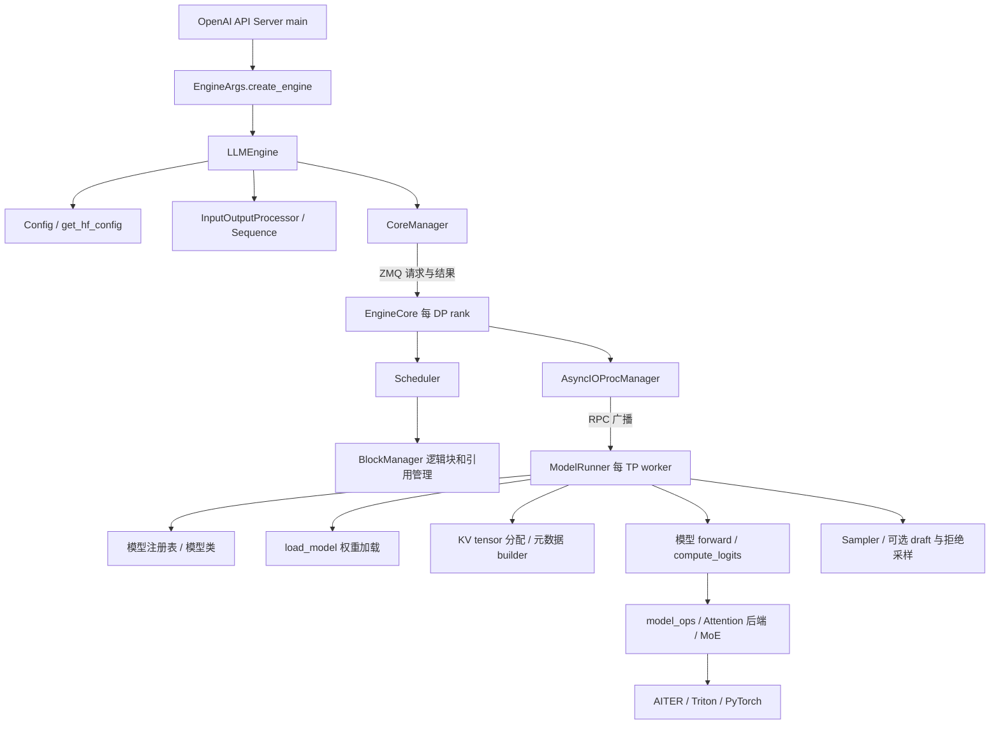

# ATOM 架构、模型接入与加载链

状态：2026-11-10 已有调查证据的主题整理；本次迁移没有重新运行技术检查。
源码基线：`26f23a0bdbf50b9010c07ee3a71171189723e767`。ATOM 相对路径基于 `/workspace/ATOM`。
区分源码事实、源码推断、待运行验证与未找到；静态风险不是已复现故障。

本页提取已有记录，原文中的“本轮”指原检查批次；残留数字节号指[归档原文](../archive/initial_research/02_atom_research_original.md)，不表示工作日或新的执行计划。当前方案统一见[Step 0](../../docs/plan/01_step0.md)。

## ATOM 工程结构与整体架构

### 实际目录与职责

仓库根目录实际存在 `atom/`、`docs/`、`recipes/`、`scripts/`、`tests/`、`tools/`、`docker/`，**没有根目录 `models/`**；模型实现位于 `atom/models/`。

| 路径 | 本轮确认的职责与代表性证据 |
|---|---|
| `atom/entrypoints/openai/` | HTTP 服务；`api_server.py:1070` 的 `main()` 组织启动，`:789` 的 `chat_completions()`、`:924` 的 `completions()` 是请求入口 |
| `atom/model_engine/` | 引擎 API、进程管理、批调度、请求状态、GPU 执行；见下文具体调用链 |
| `atom/config.py` | 运行配置与 HF 配置桥接；`Config`、`ParallelConfig`、`CompilationConfig`、`QuantizationConfig`、`SpeculativeConfig` |
| `atom/model_config/` | 自定义配置实现目录；实际有 `qwen3_5.py`、`qwen3_5_moe.py`、`qwen3_next.py`、`kimi_k25.py`；`__init__.py` 当前为空，不能将此目录直接视为唯一 Config 注册入口 |
| `atom/models/` | 模型结构；例如 `qwen3_moe.py:444` 的 `Qwen3MoeForCausalLM` |
| `atom/model_loader/` | `loader.py:279` 的 `load_model()`、`:140` 的 `safetensors_weights_iterator()`；`weight_utils.py` 提供下载、属性和分片过滤工具 |
| `atom/model_ops/` | Attention、并行 Linear、Embedding/Head、Norm、MoE、采样等算子；不是只有薄封装，也包含 Triton 实现与后端适配 |
| `atom/model_ops/attentions/` | 后端及元数据构建接口；`backends.py:49` 的 `AttentionBackend`、`:72` 的 `AttentionMetadataBuilder` |
| `atom/spec_decode/` | 可选 draft 路径；`eagle.py:161` 的 `EagleProposer`，`:240` 的 `load_model()`、`:330` 的 `propose()`；本轮仅定位 |
| `atom/utils/` | 前向上下文、编译/Graph、分布式工具等；`forward_context.py:360` 的 `ForwardContext` |
| `atom/quantization/` | 量化相关实现目录，本轮未分析具体量化方法 |
| `atom/plugin/` | vLLM / SGLang 集成目录；`pyproject.toml` 中也有 vLLM platform/general plugin 入口，与独立 Server 路径需区分 |
| `atom/kv_transfer/` | KV 传输相关模块；`EngineCore` 中有可选 connector 分支，本轮不深入 |
| `atom/examples/`、`atom/benchmarks/` | 离线示例与评测工具所在目录，本轮不执行 |
| `docs/` | 架构、模型支持、配置、调度/KV、算子、分布式等开发文档 |
| `recipes/` | 实际有 `atom_sglang/` 与 `atom_vllm/` 集成配方目录 |
| `scripts/`、`tests/`、`tools/` | 脚本、测试和分析工具；本轮仅检查目录，未认定任何脚本为 Mellum Baseline |

### 初步架构图

以下是源码调用关系的归纳，不表示已经完成所有分支验证。



图中两个所有权边界很重要：Scheduler 管理 Sequence 与逻辑 KV 块；ModelRunner 管理执行、实际 KV tensor 与前向元数据。它们通过 `ScheduledBatch` / `ScheduledBatchOutput` 交接，而不是由 Scheduler 直接执行模型算子。

证据：`scheduler.py:197,359` 定义这两个批结构；`EngineCore._process_engine_step()`（`engine_core.py:193–255`）依次调用 `schedule()`、RPC `forward`、`postprocess()`；`ModelRunner.allocate_kv_cache()`（`model_runner.py:1354`）调用 builder 的 `allocate_kv_cache_tensors()`（`:1406`），并在 `:1493` 注册 KV 数据。

### Server 启动与初始化

**源码事实：旧入口与新入口兼容。** `atom/entrypoints/openai_server.py:10–13` 仅导入 `atom.entrypoints.openai.api_server.main` 并执行它。因此 README / CLAUDE 的旧命令与指南脚本中的新模块路径并非两套服务。

后续如需启动开发副本，指南指定使用 `/workspace/scripts/atom`。本轮读取确认脚本设置 `PYTHONPATH=/workspace/ATOM...`，然后执行 `/opt/venv/bin/python -m atom.entrypoints.openai.api_server`，但没有执行脚本。

已确认的初始化链：

```text
api_server.main()                                  api_server.py:1070
  → EngineArgs.add_cli_args / parse_args            :1076,1100
  → _load_tokenizer(...)                           :1116
  → EngineArgs.from_cli_args(args)                 :1121
  → engine_args.create_engine(tokenizer=...)        :1122
      → LLMEngine(...)                             arg_utils.py:331–333
          → Config(model, **config_kwargs)         llm_engine.py:35–39
          → InputOutputProcessor(...)              :53–55
          → CoreManager(config)                    :56
  → uvicorn.run(app, ...)                          api_server.py:1146
```

`Config.__post_init__()`（`config.py:1001–1007`）先调用 `get_hf_config()`。CoreManager 创建并启动各本地 DP EngineCore（`engine_core_mgr.py:64–114`）；EngineCore 再创建 TP worker 管理器、询问 KV 块数量、分配 KV、按 `enforce_eager` 决定是否 capture Graph，之后创建 Scheduler 并发送 ready（`engine_core.py:81–135`）。这说明服务启动包含引擎初始化，并非先开 HTTP 再按请求懒加载模型；具体错误传播和 ready 等待细节留 Phase 2。

### 请求执行与主要输入输出

| 环节 | 输入 → 输出 | 调用依据 |
|---|---|---|
| 引擎接收请求 | prompt / token IDs + SamplingParams → Sequence | `LLMEngine.add_request()`，`llm_engine.py:79,129–136`；调用 `InputOutputProcessor.preprocess()` |
| 预处理 | 单请求 → Sequence | `preprocess():244–272` 实际委托 `preprocess_fanout()`；因此架构文档的描述是概括，不是当前完整实现 |
| IPC 分发 | Sequence 列表 → ADD 消息 | `CoreManager.add_request()`，`engine_core_mgr.py:373–410`，pickle + ROUTER；多本地 Core round-robin |
| 批调度 | waiting/running 请求状态 → ScheduledBatch 与 seq map | `Scheduler.schedule()`，`scheduler.py:633`；构造函数 `:412–421` 持有 BlockManager 和两个 deque |
| 执行派发 | ScheduledBatch → worker forward 结果 | `EngineCore._process_engine_step()`，`engine_core.py:234–236` |
| GPU 执行入口 | ScheduledBatch → ScheduledBatchOutput | `ModelRunner.forward()`，`model_runner.py:2017–2038`：prepare_model → run_model → postprocess → reset_forward_context |
| 模型执行 | input IDs、positions / 可选 PP intermediate → hidden states → logits | `run_model()` 中 `self.model(...)`、`compute_logits(...)`，`model_runner.py:1862–1872`；Qwen 包装器例见下文 |
| 状态回写 | seqs + forward 结果 → 已完成请求 / 流输出 | `Scheduler.postprocess()`，由 `engine_core.py:251–255` 调用 |
| 用户输出 | 已完成 Sequence → 解码后的输出结构 | `LLMEngine.generate()`，`llm_engine.py:145–164`，调用 `step()` 与 `InputOutputProcessor.postprocess()`；HTTP 流式分支本轮未逐条追踪 |

`Sequence` 是请求状态载体（`sequence.py:33–85`）：token IDs、prompt 长度、cached tokens、block_table、per-request cache slot 等；执行类型有 PREFILL/DECODE，状态还包含 `WAITING_FOR_REMOTE_KVS`，比架构文档的简图更丰富。

`Scheduler.schedule()` 的源码明确“先 prefill 后 decode”，但现有代码还包含 partial/chunked prefill 与 PrefillDelayer（`scheduler.py:633–681`）。不能把文档中“prefill 一次处理所有 prompt”的简述当作所有运行配置下的事实。

### 跨模块数据与进程通信

- `ForwardContext`（`utils/forward_context.py:360–374`）持有 attention metadata、KV tensor 引用、执行 Context、DP 与 spec metadata。`get_forward_context():426`、`set_forward_context():440`、`set_kv_cache_data():548` 是访问接口。`PagedAttentionImpl.forward_impl_server_mode()` 从全局上下文取信息（`attention_mha.py:89–99`）。这是模型显式参数之外的一条重要数据路径。
- `CoreManager` 与 EngineCore 的输入/输出分别使用 ROUTER/DEALER 与 PUSH/PULL；本轮在 manager 的 `:105–114` 核对 ROUTER/PULL，EngineCore 的 socket 方法位于 `engine_core.py:285,328`。
- **文档需要细化**：并非所有层级都单纯以 ZMQ 传 batch。`AsyncIOProcManager.__init__()`（`async_proc.py:210–258`）创建 `MessageQueue` 并把 handle 传给 worker；`call_func():353–362` 经 `rpc_broadcast_mq.enqueue()` 广播 RPC，主结果由 outputs_queue 返回。架构图因此将这一段标为 RPC 广播。
- `CoreManager` 在尚未设置启动方法时设为 spawn（`engine_core_mgr.py:55–58`）。CLAUDE 要求 multiprocessing 使用 spawn；本轮未展开 `get_mp_context()` 的完整实现和异常分支。

### ATOM 与 AITER

源码支持“ATOM 负责引擎编排与模型组织，并通过算子层使用 AITER”的理解，而不能简化成所有算子都直接调用同一个 AITER kernel。

具体依据：

1. `model_ops/moe.py:11–16` 导入 AITER routing、fused_moe、量化和 shuffle 相关能力；`rocm_aiter_fused_moe_impl()`（`:675–709`）接收 hidden states、专家权重、top-k 权重/IDs，转换 activation/quant 枚举后调用 `aiter.fused_moe.fused_moe()` 返回 tensor。本轮不判断 Mellum 最终将选择哪条 MoE 方法。
2. `model_ops/sampler.py:7–16` 导入 AITER sampling/softmax/topk，并包含能力探测；实际采样实现仍有分支。
3. Attention 构造入口 `base_attention.Attention.__new__()`（`base_attention.py:22–26`）转发到 `atom.model_ops.Attention`；后者在 `model_ops/__init__.py:1–8` 默认绑定 `PagedAttention`，并允许集成模式替换。不能仅看入口类名确定后端。
4. `PagedAttentionImpl`（`attention_mha.py:29–99`）保存 heads、head_dim、KV dtype、sliding_window、RoPE、Q/K norm 与 KV 引用，前向读取 ForwardContext。`attentions/aiter_attention.py:89,250` 进一步调用 AITER paged-attention metadata 接口。具体 kernel 选择留下一阶段之后分析。

## 对 Model Support Guide 的理解与适配边界

模型支持是一组需要相互一致的契约：

1. Config 能产生模型构造需要的字段。
2. HF architecture 字符串能在执行类注册表中定位类。
3. 模型分为 Attention/MLP/Decoder、backbone 和 CausalLM wrapper；forward 和 compute_logits 分工明确。
4. packed_modules_mapping、weights_mapping / WeightsMapper、get_expert_mapping 配合通用 loader 和参数 weight_loader。
5. PP intermediate、compile、KV/metadata 与可选 draft 也是工程接口，不能仅以 eager 单次 forward 推断全部路径正确。

这组理解分别得到本报告第 1–4 节引用的源码支持。Model Support Guide 可作为接口清单，但具体类名、注册表和签名必须重新核对。

CLAUDE 的关键约束也已记录：不得修改带 `@support_torch_compile` 的模型文件；multiprocessing 使用 spawn；GPU/Server 出错先走调试流程。当前只读任务没有触发修改或运行流程；没有执行文档中的安装、清缓存或格式化命令。将来如需实现，应结合用户届时授权和真实接口重新审视约束，本轮不作文件级修改方案。

本节暂不填写 Mellum 模块复用表、修改清单、实施顺序和正确性实验参数；这些属于 Phase 5，应建立在 Phase 2–4 的证据上。

### 从 CLI 到运行配置

入口仍是 `entrypoints/openai/api_server.py:1070` 的 main()，然后调用 `EngineArgs.from_cli_args()` / create_engine()，详见 Phase 1。

| 步骤 | 真实接口与源码位置 | 主要输入、转换与输出 |
|---|---|---|
| CLI 字段收集 | `EngineArgs.from_cli_args()`，`model_engine/arg_utils.py:269–275` | 按 dataclass 字段从 argparse Namespace 构造 EngineArgs |
| 运行参数转换 | `EngineArgs._get_engine_kwargs()`，`:277–329` | block_size → kv_cache_block_size；level/capture sizes → CompilationConfig；可选 method → SpeculativeConfig；TBO/all2all 参数转为运行标志 |
| 创建引擎 | `EngineArgs.create_engine()`，`:331–333` | `LLMEngine(self.model, tokenizer=..., **kwargs)` |
| 创建主配置 | `LLMEngine.__init__()`，`llm_engine.py:35–56` | 只把 Config dataclass 字段送入 Config；data_parallel_size 单独写入 parallel_config；设置 tokenizer/BOS/EOS，随后创建 CoreManager |
| 配置解析 | `Config.__post_init__()`，`config.py:1001–1140` | 读取 HF config，归一化部分 RoPE 字段，读取 generation config、量化规格、上下文上限、dtype 与编译设置 |

关键默认值：`EngineArgs` 的 level=3、enforce_eager=False、BF16 KV、prefix cache 与 chunked prefill 默认开启（`arg_utils.py:30–59`）；但直接使用 `CompilationConfig()` 的 level 默认是 0（`config.py:97–98`）。不能混淆 CLI 默认和配置类默认。

`Config.__post_init__()` 的具体派生行为：

- `:1005–1007` 调 get_hf_config；返回前异常会阻止后续 CoreManager/worker 创建。
- `:1012–1026` 仅在 rope_parameters 缺失或为 None 时从 rope_scaling / root rope_theta 等合成；不会在这里把现存按层类型嵌套的 RoPE 配置转换成平面配置。
- `:1028–1033` 从 GenerationConfig.eos_token_id 填 stop_token_ids；`get_generation_config():688–694` 在 OSError 时返回 None。
- `:1034–1037` 构造 QuantizationConfig；无 quantization_config 时默认 QuantType.No（`:286–296`），但仍存在用户显式 online_quant_config 路径（`:300–318`），故 BF16 checkpoint 不自动保证用户未打开在线量化。
- `:1049–1057` max_model_len 默认取 HF max_position_embeddings，显式设置时取两者较小值。
- `:1072–1076` level=3 设置 piecewise splitting/graph 配置；`:1078–1082` 运行 dtype 取 hf_config.dtype，否则 BF16。量化配置则读取 hf_config.torch_dtype（`:286–293`），两者依赖 HF Config 的 dtype 兼容接口。
- `:1096–1101` 对已启用 speculative_config 限制 draft token 数为 1–4。默认 method=None 时 `_get_engine_kwargs():313–317` 设置 speculative_config=None，即不因 num_speculative_tokens 的默认数值自动启用 MTP。

**编译与 Graph 是两层开关。** EngineCore 在 `not config.enforce_eager` 时请求 capture（`engine_core.py:104–112`），Config 的 level 管编译；Runner 的 run_model() 也单独检查 enforce_eager。仅设 level=0 不能据此推断“完全没有 Graph”。本轮没有提出或执行 Baseline 启动参数，后续需同时核对两类开关。

### 配置支持：Mellum 阻塞点与自定义 Config 的真实作用

#### A. ATOM 实际配置分支

`config.py:get_hf_config():592–685` 的控制流：

```text
PretrainedConfig.get_config_dict(model) → model_type
  ├─ model_type 在多模态表 → 提取 text_config → AutoConfig.for_model(mapped_type)
  │                            → 恢复原 architectures，尝试取得完整多模态 config
  ├─ model_type 在 _CONFIG_REGISTRY → AutoConfig.for_model(alias)
  │                                → config 实例.from_pretrained(model)
  │                                → 回填目标 Config 未包含的原字段
  └─ 普通分支 → AutoConfig.from_pretrained(model, trust_remote_code=...)
                 └─ ValueError：仅 is_vllm() 才尝试 vLLM helper，否则原样抛出
```

注意：`AutoConfig.for_model()` 返回配置**实例**，虽然 ATOM 局部变量叫 config_class（本机 `configuration_auto.py:1307–1313`）；之后通过实例访问 from_pretrained/from_dict 类方法。不能从变量名误认是独立的 ATOM Config 工厂。

`_CONFIG_REGISTRY`（`config.py:567–574`）是 model_type 别名，不是任意 JSON 到 PretrainedConfig 的通用 fallback。普通分支并没有在 AutoConfig 失败时直接执行 `PretrainedConfig(**config_dict)`。

#### B. 本机 Mellum 配置与 Transformers 源码证据

本轮只读 `/data/models/Mellum2.1-12B-A2.5B-Thinking/config.json`，核实 model_type=mellum（`:77`）、architectures=[MellumForCausalLM]（`:2–4`）、dtype=bfloat16（`:8`），且整个文件没有 auto_map 和 quantization_config。标准库静态统计确认 28 层中 SWA 21 / Full 7；`:87–101` 的 rope_parameters 按 full_attention/sliding_attention 嵌套。这里只记录配置事实，不推断数学实现。

读取的本机依赖文件为：

`/opt/venv/lib/python3.12/site-packages/transformers/models/auto/configuration_auto.py`

- 静态解析 CONFIG_MAPPING_NAMES 得到 463 个键，没有 mellum。
- `AutoConfig.from_pretrained():1403–1405` 读 config_dict，并检查 auto_map 与 CONFIG_MAPPING。
- `:1416–1421` 的 remote-code 分支需要 config 中提供 AutoConfig 映射且 trust_remote_code 为真；当前 Mellum config 没有该映射，因此仅增加 trust_remote_code 不能凭空获得 Mellum Config。
- `:1430–1443` 按 model_type 查表；KeyError 转为“Transformers does not recognize this architecture”的 ValueError。
- ATOM 的两张配置分支表均无 mellum；独立服务框架默认是 atom（`plugin/prepare.py:12–28`），因此走普通 AutoConfig 分支，ValueError 被 `config.py:683–684` 重新抛出。

**推导结论与边界：** 在当前未额外注入注册的独立 Server 启动路径、当前安装依赖和当前 checkpoint config 下，不能独立解析 Mellum 并构建模型。失败发生在 LLMEngine 的 Config 构造阶段，早于 GPU worker 和模型权重加载。此为跨源码静态推导，与指南中先前 AutoConfig 失败结果一致；本轮没有再次执行 AutoConfig。不能据此断言所有 plugin/外部补丁环境都失败，也不能把别名指到 Qwen 就当作正确适配。

#### C. `atom/model_config/` 不会自动注册

对当前工作副本 Python 源码做定向检索：

```bash
rg -n 'atom.model_config|AutoConfig.register|CONFIG_MAPPING.register' . --glob '*.py'
```

没有发现 AutoConfig.register 或 CONFIG_MAPPING.register 调用；本地 Config 的导入点集中于 Qwen 模型/MTP 文件及 Kimi plugin 模型。具体例子：

- `models/qwen3_next.py:14` 导入 Qwen3NextConfig；使用处包括类型注解 `:939`。
- `models/qwen3_5.py:15–19` 导入本地 Config 类；`get_qwen3_5_text_config():54–56` 实际从 atom_config.hf_config/text_config 返回已有配置，并不在这里调用本地 Config.from_pretrained。
- 本地 `model_config/qwen3_5.py:22–118` 定义字段、layer_types 默认值及验证；`qwen3_5_moe.py`、`qwen3_next.py` 类似，但定义类本身不会修改 Transformers 的映射表。
- `atom/__init__.py:4–8` 导出 LLMEngine、SamplingParams、prepare_model，没有扫描本地 Config 目录的逻辑；`get_hf_config()` 也没有按文件名动态导入本地 Config。

结论限于所检查源码：不能靠往该目录放一个类就让独立 Server 的 AutoConfig 自动识别它。未来需明确设计配置接入接口，届时再选择显式配置类、受控注册或别名等方案；本轮不选择实现路线。

### 模型类查找、构造环境和 ready 边界

`ModelRunner.__init__()`（`model_runner.py:507–727`）按以下顺序初始化：

1. `:513` 设置进程全局 current Config；`:520` 经 `utils.get_hf_text_config():107–118` 取文本配置；`:526–530` 判 MLA/GDN/V4/MRoPE。
2. `:537–551` 根据 local DP rank × TP size + worker rank 定位 GPU，并检查设备数量；`:567–581` 设置 CUDA device 和 AITER init_dist_env(backend="nccl", ...)；ROCm 环境仍使用 torch.cuda API 名称。
3. `:583–591` 设置默认 dtype 和默认 GPU device，再选择 Attention backend。
4. `:619` 直接查 `support_model_arch_dict[hf_config.architectures[0]]`，交给 `resolve_obj_by_qualname()`（`utils/__init__.py:561–567`）做 importlib 导入与 getattr；`:622–628` 先做量化配置的 packed/exclude 名称映射，再 `:629` 构造 model_class(config)。
5. `:633` 把默认 device 重置为 None，然后 `:634–640` 调通用 load_model；模型参数已在构造时创建，loader 读取 CPU tensor 再复制到目标参数。
6. 仅启用 speculative_config 时构造/加载 drafter（`:655–664`）。随后重新设 GPU default device、分配 forward buffers、创建 backend metadata builder（`:677–683`）。有 per-request cache 的 builder 还要求 model_type 出现在 IOProcessor 对应集合（`:691–704`）。
7. 可选 TBO 包装后 `:716` 调 warmup_model；最后恢复默认 CPU device（`:719`）；level=1 时还有显式 `torch.compile(..., backend="eager")`（`:722–727`）。

Attention backend 选择依据 `utils/selector.py:get_attn_backend_cls():49–68`：V4 → MLA（AITER 或 Triton）→ GDN（区分 plugin）→ 普通 MHA（ATOM_USE_UNIFIED_ATTN 时 TritonMHABackend，否则 AiterBackend）。这只是 Runner 层选路，本轮未验证 Mellum 的实际 Attention kernel 能力。

`is_deepseek_mla()` / is_qwen_next()（`model_runner.py:729–760`）基于 model_type 等字段；不是“只要 MoE 就是 MLA”。Phase 1 所读 Architecture Guide 第 7 节把 Qwen3 MoE 放在 MLA 描述中，不应直接沿用为实际架构事实。

模型支持表静态核对有 16 项，未含 MellumForCausalLM。即使让配置解析成功，当前 `:619` 仍无目标类可查；这是第二道独立缺口。架构列表为空/首项未支持时此处也没有遍历候选的 fallback。

**初始化不会止于权重加载：** `warmup_model():1051–1097` 构造 zero-token dummy ScheduledBatch，调用 `self.forward(dummy_batch)`；is_dummy_run 会改变 Attention 行为，但这仍是 GPU 前向，不是纯 CPU 配置检查。本轮没有调用 Runner 构造。

EngineCore 在 worker 初始化后调用 get_num_blocks、allocate_kv_cache、按开关 capture，创建 Scheduler 后才发 READY（`engine_core.py:84–135`）。CoreManager 在创建输出线程前同步等待所有 READY（`engine_core_mgr.py:120–131,157–193`）；等待函数无超时。异常清理路径在 `:142–147`，但不能由此推断所有 worker 故障都能立即返回到 HTTP 调用者，本轮没有验证所有 IPC 失败分支。

补齐的进程证据：`utils.get_mp_context():121–123` 显式返回 spawn；AsyncIOProc 在 `async_proc.py:110–113` 动态解析 ModelRunner 并实例化，busy_loop `:165–189` 根据 RPC 名字调用方法。

### 通用权重加载完整顺序

#### A. 分片发现与 CPU tensor 迭代

`model_loader/loader.py:safetensors_weights_iterator():140–189`：

```text
本地模型目录？
  是 → glob *.safetensors
  否 → download_weights_from_hf(... allow_patterns=["*.safetensors"])
→ filter_duplicate_safetensors_files(..., SAFE_WEIGHTS_INDEX_NAME)
→ 遍历分片
→ 默认 safe_open(framework="pt", device="cpu") → (name, tensor)
  或 disable_mmap 时读整个分片 bytes → safetensors.torch.load()
```

`weight_utils.py:156–174` 的索引过滤只按 weight_map 中**文件名集合**筛选候选分片；没有在这里按每个权重 key 检查是否加载，也不会在这个函数中检查索引所列的全部文件都存在。无 index 时原样返回文件列表。不要把这个函数理解成 checkpoint 完整性校验。

远程下载由 `weight_utils.py:65–123` 处理，使用 HF offline 状态、文件锁和 snapshot_download；本轮使用本地文件阅读，没有网络下载。

#### B. 名称变换与参数分发顺序

`load_model()`（`loader.py:279–727`）真实处理顺序如下：

| 顺序 | 源码位置 | 行为 |
|---|---|---|
| 初始化 mapper | `:319–336` | 优先显式参数；否则 hf_to_atom_mapper（dict 当作前缀映射 / WeightsMapper）；若仍无 mapper，再取 model.weights_mapper |
| 初始化参数/专家索引 | `:327–359` | 读取 packed_modules_mapping、weights_mapping、skip_weight_prefixes、remap_mtp_weight_name；named_parameters() 建表；get_expert_mapping() 按 key 建索引，长匹配串优先 |
| 读取 tensor 后第一次改名 | `:383–391` | weights_mapper._map_name()；返回 None 即跳过 |
| dummy 与默认跳过 | `:392–409` | load_dummy 则 continue；target 模式跳过名称含 mtp 的项，跳过 kv_scale / inv_freq 与模型声明 skip prefixes |
| draft 与旧映射 | `:410–419` | spec_decode 下可做模型 MTP remap；weights_mapping 子串替换；weight_scale_inv → weight_scale |
| 层过滤与共享专家 | `:421–437` | 正则提取 model.layers.N，target 模式跳过超出 num_hidden_layers 的层；开关启用时 shared expert 改名 |
| packed 参数 | `:438–474` | tuple 表示多个磁盘权重写入一个内部参数，并传 shard_id；list 表示由目标 loader 按 shard_idx 处理磁盘 fused tensor。expert 不在 params_dict 时留给专家分支 |
| fused expert 回调 | `:475–518` | 可选 detect_fused_expert_format/get_fused_expert_mapping/load_fused_expert_weights；属于模型特定格式协议 |
| 常规 expert mapping | `:520–552` | 改为内部参数名，调用 param.weight_loader(param,tensor,name,shard_id,expert_id) |
| fallback | `:553–596` | 部分 expert merged 形式特殊处理；其他按名字 get_parameter，使用自带 loader 或 default_weight_loader |
| 等待、覆盖记录与后处理 | `:597–727` | 等待线程池，参数/丢弃 key 告警，模块与 quant_method 后处理，返回 loaded_weights_record |

`WeightsMapper._map_name()`（`:72–94`）按 substr → prefix → suffix 顺序处理，每条匹配可改名或映射为 None；这是具体的顺序规则，不等同于 weights_mapping 的无锚点 replace。

**文档校正：** Model Support Guide 曾描述通用 loader 调 rewrite_spec_layer_name()，当前 `load_model()` 实际通过模型可选 `remap_mtp_weight_name` 回调工作；不能把文档函数名照抄为当前通用调用。完整 draft 格式留 Phase 3。

`load_dummy=True` 的 continue 在 tensor 已 yield 之后（`:383–393`），因此不能把它当作“完全不读取 checkpoint”的纯结构模式。

### 参数 weight_loader：TP、Embedding/LM Head 与专家布局

通用 loader 负责选目标；具体切片方式由参数自带的 weight_loader 决定。`LinearBase` 在 `linear.py:304–313` 把实例方法挂到 weight/bias/scale 参数上；Embedding 在 `embed_head.py:120–123` 同样挂载。参数本身通过 `model_ops/utils.py:21–32` 的 atom_parameter() 创建。

| 参数类型 | loader 证据 | 加载与布局 |
|---|---|---|
| ReplicatedLinear | `linear.py:639–641` | 不做 TP 维度切分，交给 weight_loader_process 复制 |
| ColumnParallelLinear | `:644–671` | tp_dim=0，按 TP rank narrow 输出行 |
| RowParallelLinear | `:1358–1400` | tp_dim=1，按输入列切；bias 特殊处理，非零 rank 置零；scale 另有维度分支 |
| MergedColumnParallelLinear | `:696–777` | 多逻辑输出存储在一个参数；整数 shard_id 定位片段，再对该磁盘权重切 TP；支持 tuple、多输出以及盘上 fused 输入分支 |
| QKVParallelLinear | `:1275–1355` | Q/K/V 内部拼接；q 按 TP rank 分片；当 KV heads < TP size 时复制 KV heads，k/v shard_rank 按 replicas 调整 |
| VocabParallelEmbedding | `embed_head.py:105–142` | vocab 必须整除 TP；weight 为 [vocab/TP, hidden]，按词表行切片并断言 shape；前向 TP>1 时 masked embedding + all_reduce |
| ParallelLMHead | `embed_head.py:154–192` | 继承词表 weight_loader；前向 AITER tgemm.mm，并按需 gather 词表 logits；target prefill 时只选各序列最后 query token |
| 普通 fallback | `loader.py:120–137` | numel 相等时 copy；或按 TP 做扁平区间切片；不满足时 RuntimeError。并不提供复杂 packed/expert 格式推断 |

`LinearBase.weight_loader_process()`（`linear.py:318–345`）还处理 dtype 转换/同宽格式、等 numel reshape 与 raw FP4 拷贝；因此不能只核对磁盘与参数名称，而不核对 shape、dtype 和 loader 分支。

#### 专家参数具体组织

- `FusedMoE.make_expert_params_mapping()`（`moe.py:3106–3133`）对每个 expert 生成三项：gate_proj → experts.w13_ / w1；down_proj → experts.w2_ / w2；up_proj → experts.w13_ / w3，保留 expert_id。
- 无量化方法 `UnquantizedFusedMoEMethod.create_weights()`（`:507–541`）创建 w13_weight=[local_experts, 2×I_partition, H]、w2_weight=[local_experts, H, I_partition]。`FusedMoE.__init__():2077–2079` 要求 intermediate_size 可整除其 TP size，`:2133–2140` 传入 local_experts、维度、dtype 和 weight_loader。
- `FusedMoE.weight_loader()`（`:2726–2773`）先把 global expert ID 映射到本地；未归属本 rank 的 expert 返回；正常权重按 w1/w3 的输出维、w2 的输入维切片（`:2759`）。2D 单专家与 3D full_load 分支不同。
- `_load_model_weight_or_group_weight_scale():2368–2404` 分发到 `_load_w13()` / `_load_w2()`；`:2502–2524` 将 gate/up 放到 w13 两半并切 TP，`:2550–2572` 处理 down 的输入维切片。量化 scale 有额外逻辑，本轮不展开全部量化类型。
- 所谓 BF16 原始权重也不等于运行时完全保留磁盘布局：`UnquantizedFusedMoEMethod.process_weights_after_loading():546–552` 调 shuffle_weights；通用 loader `:691–701` 会调用模块及 quant_method 后处理，并初始化 MoE prepare/finalize。

这是 ATOM 参数布局事实；本轮没有读取 Mellum 权重索引或 tensor，不能据此声称 Mellum 磁盘权重已匹配这些路径。

### 权重完整性检查的静态局限

以下是需要后续验证的代码风险，不是已复现的 Mellum 故障，也未在本轮修复：

1. **线程池异常未被消费。** `_submit()` 把 executor.submit 的 Future 存入列表（`loader.py:375–379`），结束时只 wait/shutdown（`:597–600`），函数内没有 Future.result()/exception()。`envs.py:88–90` 的 ATOM_LOADER_USE_THREADPOOL 默认值为 1。在该路径中，loader 任务抛出的异常没有由这段代码显式重新抛给主线程；同步路径的异常则会直接传播。标准库 AST 检查也确认 load_model 内没有 result/exception 调用，但本轮未做故障注入。
2. **记录写入早于任务成功确认。** 例如 packed 分支先 submit，然后立刻往 loaded_weights_record 加参数名（`:471–473`）。因此“被记录加载”并非“复制成功”的充分证明。
3. **覆盖粒度是参数名。** `:609–621` 做 expected_param_names - loaded_param_names；qkv_proj 或 w13_weight 的某个 shard/expert 到达就会记录整个参数名，不能证明其余 Q/K/V、gate/up 或所有专家已到齐。
4. **缺失通常仅 warning。** 未加载参数（`:622–641`）和部分 checkpoint 改名后无匹配参数（`:648–675`）只告警，且过滤了一些后缀/名称；不是 strict fail。专家映射分支的 get_parameter AttributeError（`:534–540`）还直接跳过，不进入同样的 dropped key 记录。
5. **记录名不总是内部目标名。** 常规专家映射记录改名后的 name（`:550`），但 fused-expert 回调成功分支记录 prefix+name（`:514`），未必等于 name_mapped；不能无条件拿所有记录项当成统一规范的模型参数覆盖表。
6. **文件筛选不等于完整 checkpoint 校验。** 11.5 已说明，index 仅用于筛选实际 glob 得到的文件，缺分片/缺 shard 的保证需另查。

因此未来正确性阶段应分别核对磁盘权重覆盖、packed shard/expert 覆盖、加载异常和数值输出；本轮只确立验证维度，不提前修改 loader 或设计 Mellum 专用映射。

### ModelRunner 的 forward 输入输出与 KV 接口

完整主链（非多模态、无 MTP 的基本路径）为：

```text
EngineCore._process_engine_step()                   engine_core.py:193
 → Scheduler.schedule() → ScheduledBatch
 → runner_mgr.call_func("forward", batch)           :234–236
 → AsyncIOProc.busy_loop() → getattr(runner, name)   async_proc.py:165–189
 → ModelRunner.forward()                            model_runner.py:2017–2038
    → prepare_model()                              :1784–1800
       → prepare_sample()                          :1736
       → tokenIDProcessor.prepare_input_ids()
       → prepare_inputs()                          :1653–1734
          → attn_metadata_builder.build(batch,bs)   :1691
          → Context + set_forward_context()        :1695–1733
    → run_model(input_ids,batch)                    :1802–1902
       → self.model(input_ids,positions)            :1862
       → self.model.compute_logits(hidden_states) :1872
    → postprocess() → Sampler + tokenIDProcessor    :1904–2014
    → reset_forward_context()
 → Scheduler.postprocess(seqs,fwd_out,batch=...)     engine_core.py:251–255
```

主要接口细节：

- prepare_inputs 接收 ScheduledBatch，按 num_scheduled_tokens 计算 query 累积长度，处理 DP padding/Graph batch size，再由 backend builder 返回 positions 和 attention metadata；模型不直接接收完整 ScheduledBatch，而是显式输入 token IDs/positions，加上全局 ForwardContext 中的隐式数据。
- tokenIDProcessor 缓存 GPU 上的前次 sampled tokens。`prepare_input_ids()` 的 prefill/decode 分支见 `model_runner.py:298–358,413–443`；普通 decode 会按请求位置 gather 前次 token，不是每步都仅从 CPU Sequence 重建输入。
- `tokenIDProcessor.__init__():91–94` 虽有“PD 关闭 deferred”的注释，实际代码直接令 is_deferred_out=True；不能把注释当成当前条件判断。`prepare_sampled_ids():242–254` 先接收前次异步输出，再发送当前 tokens，返回 prev_batch.req_ids；因此 ScheduledBatchOutput 不一定对应当前 forward 的同一批请求。Scheduler 接口需处理该标志，不应由模型适配绕过。
- run_model 的 eager 条件是 prefill / enforce_eager / DP 非统一 decode / batch 超出最大 graph（`:1813–1818`）；否则 replay graph（`:1885–1900`）。logits 可以被 capture，也可在 replay 后单算。当前基本模型 forward 返回 hidden states，而不是 HF ModelOutput 或已采样 token。
- postprocess 无 spec metadata 时采样（`:1918–1928`），有 spec 时调用 rejection_sampler（`:1930–1959`）；最终返回 ScheduledBatchOutput 中的 req_ids、token_ids、deferred 标志及 spec 统计（`:2007–2014`）。本轮没有深入接受率算法。

#### Qwen3-MoE 作为接口实例

`Qwen3MoeForCausalLM` 构造 backbone + lm_head，tie_word_embeddings 时共享参数；forward 返回 hidden states，再由 compute_logits 调 head（`qwen3_moe.py:453–512`）。

backbone `Qwen3MoeModel.__init__():355–396` 使用 Embedding → make_layers → Final RMSNorm；`forward():401–431` 在首 PP rank 做 embedding，其他 rank 读 IntermediateTensors；依次执行本 stage 的 decoder，非末 rank 返回 hidden_states/residual 字典包装，末 rank 做 Final Norm 后返回 hidden states。

`models/utils.py:118–140` 的 make_layers() 按 PP 分配层范围，用 PPMissingLayer 保持层编号；`:178–200` 的 IntermediateTensors 承载 hidden_states/residual。这里只确认模型层具备 PP 接口；本轮看到的独立 Runner 基本 eager 调用未传 intermediate_tensors，不据此宣称独立 CLI 的 PP 端到端能力已经验证。Mellum Step 0 单卡不需要先解决 PP。

#### KV 的初始化与执行衔接

`get_num_blocks():1204–1279` 使用 warmup 的内存 peak/current、GPU budget、Graph 估计和安全余量计算可用 pool，并由 backend builder 提供每块及 per-request cache 的费用；它不是单纯“总显存减模型大小”。

`allocate_kv_cache():1354–1493` 根据 KV heads 与 TP 确定本 rank heads，委托 builder.allocate_kv_cache_tensors()，遍历模型模块用 builder.build_kv_cache_tensor() 绑定，最后 set_kv_cache_data() 注册。实际 SWA/Full 的分配形状、窗口是否节省缓存和后端限制仍需 Phase 3，不从“传入 sliding_window”推断。

## 尚待运行验证

加载线程池异常传播、参数覆盖局限属于静态发现；第一次真实加载需显式审计，不能以构造成功代替正确加载。配置检查不应实例化会触发 GPU 初始化与 warmup 的 ModelRunner。
